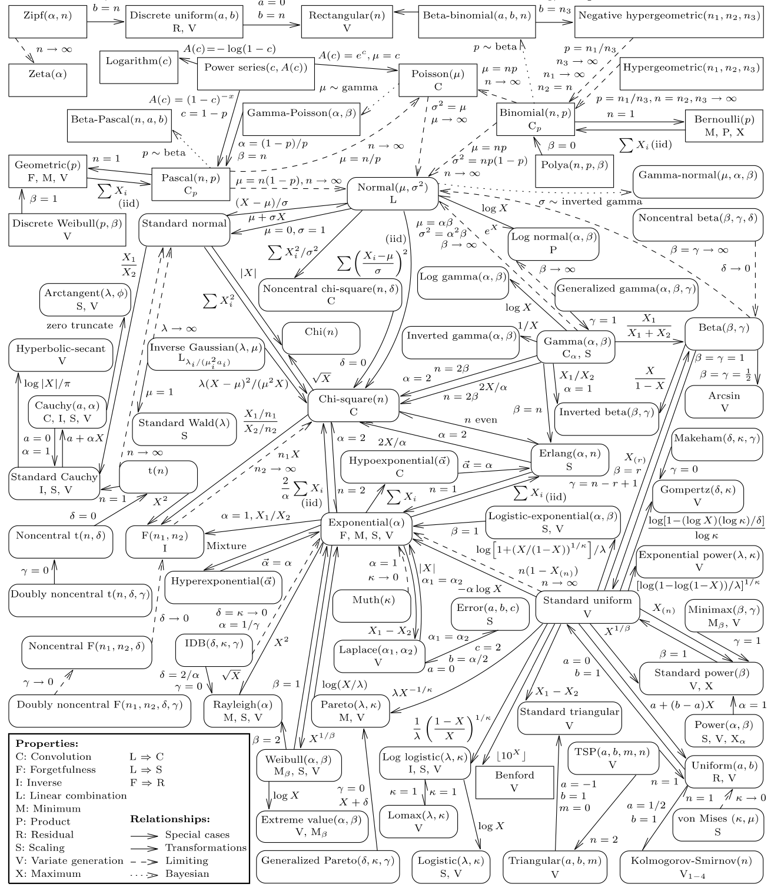
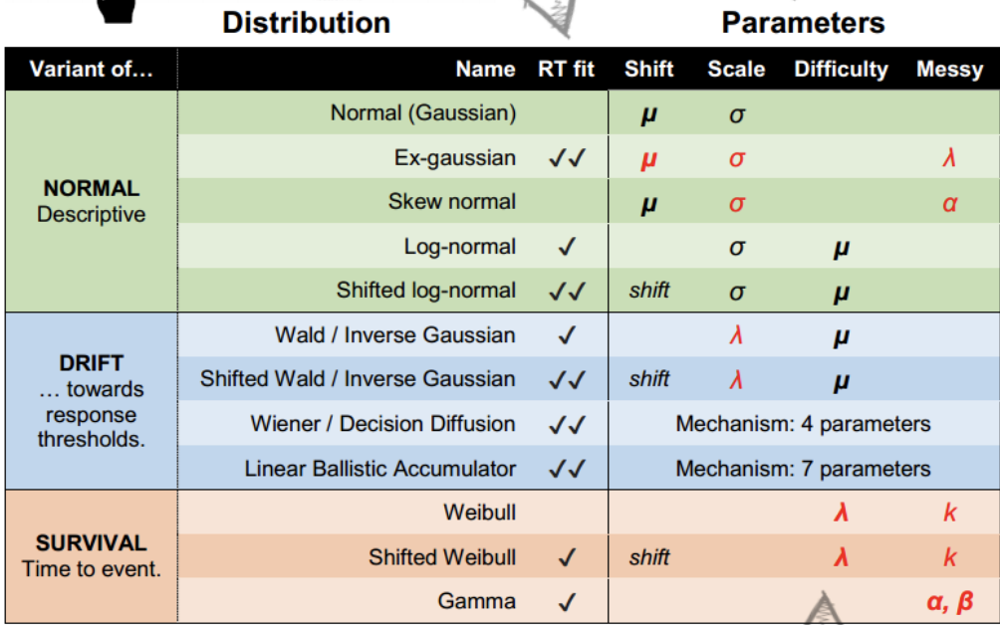
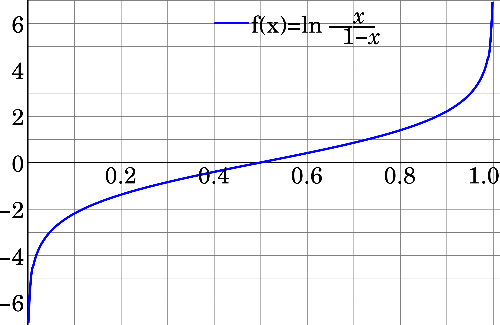

## This time

-   work with distributions other than Gaussian/t

-   introduce GLM families with link functions

-   logistic (binary) and multinomial (unordered categories) regression

-   next time: counts and ordered categories

## Generalized linear model

-   Used to describe different Data Generating Processes (DGPs) "likelihoods" other than the Gaussian (normal)

-   Need to use if we cannot use the Gaussian normal e.g. the range of Y is restricted (e.g. binary, count) and/or the variance of Y depends on the mean

-   Often there is a maximum entropy distribution that serves as the default likelihood, helping us guide our choice

## Two ingredients

Need to:

1.  Specify your DGP distribution (likelihood)

2.  Specify a link function. We do this so we can continue to use a typical linear regression model. Our parameters are now often non-linear, so we need to map a non-linear relationship to a linear one.

## Which likelihood? {.smaller}

::: {style="font-size: 80%"}
| Outcome | brms family | Link | exp(coefficient) |
|---------|-------------|------|------------------|
| Continuous | `gaussian`, `student` | identity | — |
| Binary, or *k* of *n* | `bernoulli`, `binomial` | logit | odds ratio |
| Unordered categories | `categorical` | logit | odds ratio vs. reference |
| Count, var ≈ mean | `poisson` | log | rate ratio |
| Count, var > mean | `negbinomial` | log | rate ratio |
| Count, extra zeros | `zero_inflated_*`, `hurdle_*` | log + logit | rate ratio + odds ratio |
| Ordered categories | `cumulative` | logit | cumulative odds ratio |
| Positive, skewed | `lognormal`, `Gamma` | log | multiplicative change |
:::

This week: binary and unordered categories. Next week (the next deck): counts and ordered categories.

## Binomial {.smaller}

$$y_i \sim \operatorname{Binomial} (n, p_i)$$

$$f(p_i) = \alpha + \beta (x_i - \bar x)$$

-   The f of the $f(p_i)$ is a link function, typically logistic

-   Link function is needed because the shape of the Binomial distribution is determined by two parameters, neither equivalent to the Gaussian mean (which the right side of the equation is based on).

-   The link function also ensures the model doesn’t make improper probability predictions (ie outside of 0-1)

## Link function for binomial

-   Our number of trials is a fixed N, (here it is 1, a Bernoulli) so we are predicting the probability of y. Probabilities are bounded between 0 and 1

-   Because our variables are not in probability units we need to "link" them via a function. The linear right side of the equation is not in the same units as the non-linear left side.

-   Instead of predicting probabilities directly, we are instead predicting the log of the odds. Other link functions: probit, negative inverse, cloglog.

## The logit link

-   We need to map the s shaped ogive that goes between (0,1) to linear looking line that falls between $(-\infty, \infty)$

-   Probabilities live in (0, 1); odds, $p/(1-p)$, live in (0, ∞); log odds live in (−∞, ∞).

-   Think of it as a transformation of Y-hats $$f(p) = logit(p) = log (\frac {p_{i}}{1-p_{i}})$$

-   Logits are now in a shape similar to a normal regression (ie a line/plane that goes to infinity)

## Inverse link {.smaller}

-   It is easier to think of transforming the probabilities but computationally the right side of the equation usually gets transformed. Note these two are equivalent.

$$f(p_i) = \alpha + \beta (x_i - \bar x)$$

$$p_i = f^{-1}(\alpha + \beta (x_i - \bar x))$$

-   For the logit link, the inverse link is the logistic function: $p = \frac{1}{1 + e^{-x}}$ (`plogis()` or brms's `inv_logit_scaled()`). For the log link (counts), the inverse is `exp()`.

## Exponential Family

```{r}
#| code-fold: true
library(patchwork)
library(tidyverse)
library(brms)

E1 <- ggplot(data.frame(x = c(0, 15)), aes(x = x))  +
    stat_function(fun = dexp, args = list(rate = 0.2), geom = "area", fill = "blue", alpha = 0.25) + ggtitle("Exponential with lambda = 0.2")

G1 <- ggplot(data.frame(x = c(0, 5)), aes(x = x))  +
    stat_function(fun = dgamma, args=list(shape=2, rate=2), geom = "area", fill = "blue", alpha = 0.25) + ggtitle("Gamma with lambda = 2, kappa = 2")

p1 <- tibble(x = 0:12) %>%
  mutate(density = dpois(x, lambda = 3),
         strip   = "y %~% Poisson(lambda)") %>%
  ggplot(aes(x = x, y = density)) +
  geom_col(fill = "blue", alpha = 0.25,width = 1/2) +
  ggtitle("Poisson with lambda = 3")

b1 <-tibble(x = 0:10) %>%
  mutate(density = dbinom(x, size = 10, prob = .3),
         strip   = "y %~% Binomial(n, p)") %>%
  ggplot(aes(x = x, y = density)) +
  geom_col(fill = "blue", alpha = 0.25, width = 1/2) +
  ggtitle("binomial with N = 10, p = .3")

(E1 + G1) /
  (p1 + b1)
```

## Exponential family members {.smaller}

-   Exponential is constrained to be above zero. If probability of some event is constant, it tends to follow an exponential. Used a lot in survival models.

-   Gamma is positive but its peak needn't be at zero. It arises as the sum of several exponential waiting times (e.g., time until the *k*th event). Common for skewed positive outcomes like reaction times or costs.

-   Poisson for counts, when p is low and the number of trials is large or unknown. It is the limit of the binomial as n → ∞ with np fixed. Used a lot in health, epidemiology and sport applications where counts are used.

## Distributions and their relationships



## brms families

gaussian, student, binomial, bernoulli, poisson, negbinomial, geometric, gamma, skew_normal, lognormal, shifted_lognormal, exgaussian, wiener, inverse.gaussian, exponential, weibull, frechet, Beta, dirichlet, von_mises, asym_laplace, gen_extreme_value, categorical, multinomial, cumulative, cratio, sratio, acat, hurdle_poisson, hurdle_negbinomial, hurdle_gamma, hurdle_lognormal, zero_inflated_binomial, zero_inflated_beta, zero_inflated_negbinomial, zero_inflated_poisson, and zero_one_inflated_beta

## common RT distributions



## Example

```{r}
#| code-fold: true
library(readr)
mortality <- read_csv("mortality.csv")  # also at https://bayes27.netlify.app/mortality.csv

mortality <- mortality %>%
  mutate(IQ_c = IQ - mean(IQ)) %>%
  select(-'...1')
mortality

```

## Describing the data

```{r}
library(psych)
describe(mortality)
```

## The model

$$P.Death_i  \sim \operatorname{Binomial} (1, p_i)$$\
or $$P.Death_i  \sim \operatorname{Bernoulli} (p_i)$$

$$\operatorname{logit} (p_i)= \beta_0 + \beta_1*IQ_c $$ $$\beta_0\sim \operatorname{Normal} (0, ?)$$ $$\beta_1\sim \operatorname{Normal} (0, ?)$$

## Intercept-only logistic model

```{r}
glm.1 <-
  brm(family = binomial,
      NOT.premature | trials(1) ~ 1,
      prior(normal(0, 10), class = Intercept),
      sample_prior = "yes",
      data = mortality,
      backend = "cmdstanr",
      file = "glm.1")
```

```{r, eval = FALSE}
glm.1 <-
  brm(family = bernoulli(),
      NOT.premature ~ 1,
      prior(normal(0, 10), class = Intercept),
      sample_prior = "yes",
      data = mortality,
      backend = "cmdstanr",
      file = "glm.1b")
```

## Prior draws

```{r}
prior_draws(glm.1)
```

## A Normal(0, 10) prior on the probability scale

```{r}
#| code-fold: true
prior_draws(glm.1) %>%
  mutate(p = inv_logit_scaled(Intercept)) %>%
  ggplot(aes(x = p)) +
  geom_density( )
```

## Why so extreme?

-   Before we see the data, do we think the event happens all the time or never?

-   Why is it distributed like that? Think of what logits are

## Logits vs probabilities



## Picking an intercept prior with `qlogis()` {.smaller}

Think on the probability scale, then convert. `qlogis()` is the logit; `plogis()` is the inverse logit.

-   Say I expect about 80% of people *not* to die prematurely, and I'd be surprised if it were below 50% or above 95%:

```{r}
qlogis(.80)            # center of the prior, on the logit scale
qlogis(c(.50, .95))    # the range I find plausible
```

-   So something like `normal(1.4, 0.75)` puts most of its mass between 0 and 2.9 logits, i.e., 50% to 95%. Check it with `plogis(rnorm(1e4, 1.4, .75))`.
-   Below we use the looser `normal(0, 2)`, centered on 50%, which still keeps the probabilities off the walls.

## A tighter intercept prior

```{r}
glm.2 <-
  brm(family = binomial,
      NOT.premature | trials(1) ~ 1,
      prior(normal(0, 2), class = Intercept),
      sample_prior = "yes",
      data = mortality,
      backend = "cmdstanr",
      file = "glm.2")
```

## The Normal(0, 2) prior on the probability scale

```{r}
#| code-fold: true
prior_draws(glm.2) %>%
  mutate(p = inv_logit_scaled(Intercept)) %>%
  ggplot(aes(x = p)) +
  geom_density( )
```

## Adding IQ

```{r}
glm.3 <-
  brm(family = bernoulli(link = "logit"),
      NOT.premature ~ 1 + IQ_c,
      prior = c(prior(normal(0, 2), class = Intercept),
      prior(normal(0, 3), class = b)),
      sample_prior = "yes",
      data = mortality,
      backend = "cmdstanr",
      file = "glm.3")
```

## Prior draws for `glm.3`

```{r}
prior_draws(glm.3)

```

## Prior predictive lines (logit scale)

```{r}
#| code-fold: true
prior_draws(glm.3)%>%
  slice_sample(n = 100) %>%
  rownames_to_column("draw") %>%
  expand(nesting(draw, Intercept, b),
         a = c(-9, 9)) %>%
  mutate(d = Intercept + b * a) %>%
  ggplot(aes(x = a, y = d)) +
  geom_line(aes(group = draw), alpha = .4) +
  labs(x = "IQ",
       y = "logit(Not-premature death)") +
  coord_cartesian(ylim = c(-10, 10)) +
  theme_bw() +
  theme(panel.grid = element_blank())
```

## Prior predictive lines (probability scale)

scaled to probability

```{r}
#| code-fold: true
a <- seq(-9,9, .2)

prior_draws(glm.3)%>%
  slice_sample(n = 100) %>%
  rownames_to_column("draw") %>%
  expand(nesting(draw, Intercept, b), a) %>%
  mutate(d = inv_logit_scaled(Intercept + b * a)) %>%
  ggplot(aes(x = a, y = d)) +
  geom_line(aes(group = draw), alpha = .4) +
  labs(x = "IQ",
       y = "prob(Not-premature death)") +
  coord_cartesian(ylim = c(0, 1))
```

## `glm.3` summary

```{r}
summary(glm.3)
```

## A tighter slope prior

Instead of normal(0, 3), let's try normal(0, .5) for our prior

```{r}
#| code-fold: true

glm.4 <-
  brm(family = bernoulli(link = "logit"),
      NOT.premature ~ 1 + IQ_c,
      prior = c(prior(normal(0, 2), class = Intercept),
      prior(normal(0, .5), class = b)),
      sample_prior = "yes",
      data = mortality,
      backend = "cmdstanr",
      file = "glm.4")
```

## Prior predictive lines with Normal(0, .5)

```{r}
#| code-fold: true

a <- seq(-9,9, .2)

prior_draws(glm.4)%>%
  slice_sample(n = 100) %>%
  rownames_to_column("draw") %>%
  expand(nesting(draw, Intercept, b), a) %>%
  mutate(d = inv_logit_scaled(Intercept + b * a)) %>%
  ggplot(aes(x = a, y = d)) +
  geom_line(aes(group = draw), alpha = .4) +
  labs(x = "IQ",
       y = "prob(Not-premature death)") +
  coord_cartesian(ylim = c(0, 1))
```

## `glm.4` summary

```{r}
summary(glm.4)
```

## Interpreting logistic coefficients

Interpretation of coefficients is not straight forward. Easier to plot predictions.

Why are they hard?

1. Logits are not on a natural scale
2. The association is nonlinear on the probability scale
3. So the change in probability depends on where you start (and on the other predictors)

## From logits to probabilities by hand

```{r}
# posterior means from summary(glm.4); ±3.73 = ±1 SD of IQ
tibble(b0     = 1.62,
       b1     = .08,
       IQ_c = c(-6,-2,0,2,6)) %>%
  mutate(logit_mu = b0 + b1 * IQ_c ) %>%
  mutate(Not_premature   = 1 / (1 + exp(-logit_mu))) %>%
  mutate(Not_premature2   = inv_logit_scaled(logit_mu))
```

## Predictions with marginaleffects

```{r}
library(marginaleffects)
predictions(glm.4, newdata = datagrid(IQ_c = c(-3.73, -2, 0, 2, 3.73)))
```

## One slope, three scales {.smaller}

The IQ slope from `glm.4`, three ways:

```{r}
#| code-fold: true
draws_4 <- as_draws_df(glm.4)
tibble(scale = c("logit (log odds per IQ point)", "odds ratio, exp(b)"),
       median = c(median(draws_4$b_IQ_c), median(exp(draws_4$b_IQ_c))),
       lower  = c(quantile(draws_4$b_IQ_c, .025), quantile(exp(draws_4$b_IQ_c), .025)),
       upper  = c(quantile(draws_4$b_IQ_c, .975), quantile(exp(draws_4$b_IQ_c), .975))) %>%
  knitr::kable(digits = 3)
```

-   Exponentiate the **draws**, then summarize. Don't exponentiate the summary (the median survives, the mean and intervals don't always).
-   Each IQ point multiplies the odds of *not* dying prematurely by about 1.08.

## On the probability scale

```{r}
avg_slopes(glm.4)
```

-   On the probability scale: averaged over the sample, one more IQ point raises Pr(not premature) by about 1 percentage point.

## The probability slope isn't constant {.smaller}

The logit slope is one number, but the probability slope depends on where you are on the curve:

```{r}
slopes(glm.4, newdata = datagrid(IQ_c = c(-7.46, 0, 7.46)))  # −2 SD, mean, +2 SD
```

-   At low IQ, predicted survival is lower (around .7), where the logistic curve is steeper: about 1.5 points per IQ point.
-   At high IQ it's already near the ceiling, so each extra IQ point buys less (about 0.7 points).
-   This is why "the effect" in a logistic regression needs a scale *and* a location.

## Trace plots

```{r}
plot(glm.4)
```

## Posterior predictive check

```{r}
pp_check(glm.4)
```

## Fitted probability curves

```{r}
#| code-fold: true

library(tidybayes)
library(modelr)

mortality %>%
   data_grid(IQ_c = seq_range(IQ_c, n = 100)) %>%
  add_epred_draws(glm.4) %>%
  sample_draws(100) %>%
    ggplot(aes(x = IQ_c)) +
  geom_line(aes(y = .epred, group = .draw),
            color = "grey50", linewidth = 1/3, alpha = 2/3) +
  ylim(0,1) + geom_point(data = mortality,
               aes(y = NOT.premature),
               alpha = .3)
```

## Distribution of predicted probabilities

```{r}
#| code-fold: true
predictions(glm.4) %>%
  ggplot() +
  geom_histogram(aes(estimate)) +
  labs(x = "Pr(outcome = 1)", y = "Count")

```

## Predicted probability with uncertainty

```{r}
#| code-fold: true

predictions(glm.4, newdata = datagrid(IQ_c = seq(from = min(mortality$IQ_c), to = max(mortality$IQ_c)))) %>%
  get_draws() %>%
    ggplot(aes(y = draw, x = IQ_c)) +
  stat_lineribbon(.width = c(.95), alpha = .4) + geom_point(data = mortality,
               aes(y = NOT.premature),
               alpha = .3)
```

## epred vs prediction vs linear prediction {.smaller}

-   When we want to create fitted values we run into an extra complication. Do we want to plot probabilities (original metric) or logits (our transformed metric)? We haven't had to deal with this prior because we didn't do any transformations with a Gaussian normal.

-   epred: the expected value on the response scale (here, a probability)

-   linpred: the linear predictor on the link scale (here, log odds)

-   predict: a simulated new observation on the response scale (here, a 0 or 1)

## The model, again

$$y_i \sim \operatorname{Binomial} (n, p_i)$$

$$logit(p_i) = \alpha + \beta (x_i - \bar x)$$

## epred vs linpred

```{r}
#| code-fold: true
epred <- mortality %>%
  data_grid(IQ_c, .model = mortality) %>%
  add_epred_draws(glm.4) %>%
  ungroup() %>%
  select(.epred)

linpred <-mortality %>%
  data_grid(IQ_c, .model = mortality) %>%
  add_linpred_draws(glm.4) %>%
  ungroup() %>%
  select(.linpred)

cbind(epred,linpred )
```

## Linear predictor (logit scale)

```{r}
#| code-fold: true

mortality %>%
  data_grid(IQ_c = seq_range(IQ_c, n = 100)) %>%
  add_linpred_draws(glm.4) %>%
  sample_draws(100) %>%
    ggplot(aes(x = IQ_c)) +
  geom_line(aes(y = .linpred, group = .draw),
            color = "grey50", linewidth = 1/3, alpha = 2/3) +
  ylab("logit")
```

## Link vs response scale with marginaleffects

```{r}
predictions(glm.4, newdata = datagrid(IQ_c = c(-3.73, 0, 3.73)), type = "link")
```

```{r}
predictions(glm.4, newdata = datagrid(IQ_c = c(-3.73, 0, 3.73)))
```

## Multinomial logistic regression

-   When you are predicting more than two groups (aka categorical regression aka maximum entropy classifier)

-   Uses a categorical (multinomial) distribution, the generalization of the binomial. Like the binomial but with more events.

-   Need to construct K - 1 linear models for K events, similar to constructing number of dummy variables

## When would you use this?

-   Anytime people have more than two choices in some task. Trying to understand different demographic categories (race/ethnicity/gender identities/etc).

-   Eg, does 401k amount predict whether someone at 62 is retired/part time/ still working? You could use 401k amount as the DV, with two dummy variables as predictors, but what if you wanted to control for years worked? Very different interpretations depending on what is your DV.

## Multinomial example from SR

Career choice predicted by salary

```{r}
#| code-fold: true
#|
softmax <- function(...) { x <- c(...); exp(x) / sum(exp(x)) }  # same as rethinking::softmax

# simulate career choices among 500 individuals
n      <- 500           # number of individuals
income <- c(1, 2, 5)    # expected income of each career
score  <- 0.5 * income  # scores for each career, based on income

# next line converts scores to probabilities
p <- softmax(score[1], score[2], score[3])

# now simulate choice
# outcome career holds event type values, not counts
career <- rep(NA, n)  # empty vector of choices for each individual

# sample chosen career for each individual
set.seed(123)
# sample chosen career for each individual
for(i in 1:n) career[i] <- sample(1:3, size = 1, prob = p)

d <-
  tibble(career = career) %>%
  mutate(career_income = ifelse(career == 3, 5, career))

d %>%
  ggplot(aes(x = career)) +
  geom_bar()

```

## K − 1 linear models

For K categories, we estimate K -1 linear models. Think of a logistic regression where K = 2, we fit just a single regression model. Here we are doing multiple regression models simultaneously within the same model.

## Intercept-only categorical model

Intercept only model, where we will get two intercepts, because it is like we have two models

```{r}

glm.5 <-
  brm(family = categorical(link = logit, refcat = 3), # to match up with book
      career ~ 1,
      prior = c(prior(normal(0, 1), class = Intercept, dpar = mu1),
                prior(normal(0, 1), class = Intercept, dpar = mu2)),
      iter = 2000, warmup = 1000, cores = 4, chains = 4,
      data = d,
      backend = "cmdstanr",
      file = "glm.5")
```

## `glm.5` summary

```{r}
summary(glm.5)
```

## Back to probabilities

```{r}
#| code-fold: true
glm.5 %>%
  spread_draws(b_mu1_Intercept, b_mu2_Intercept) %>%
  mutate(b_mu3_Intercept = 0) %>%
  mutate(p1 = exp(b_mu1_Intercept) / (exp(b_mu1_Intercept) + exp(b_mu2_Intercept) + exp(b_mu3_Intercept)),
         p2 = exp(b_mu2_Intercept) / (exp(b_mu1_Intercept) + exp(b_mu2_Intercept) + exp(b_mu3_Intercept)),
         p3 = exp(b_mu3_Intercept) / (exp(b_mu1_Intercept) + exp(b_mu2_Intercept) + exp(b_mu3_Intercept))) %>%
  pivot_longer(p1:p3) %>%
  group_by(name) %>%
  mean_qi(value) %>%
  mutate_if(is.double, round, digits = 2)
```

The same probabilities that we simulated with!

## Interpreting the intercepts

mu1_Intercept coefficient is -2.01. What does that mean? Remember refcat = 3

```{r}

exp(-2.01)
```

```{r}
1/exp(-2.01)
```

mu2_Intercept coefficient is -1.57. What does that mean?

```{r}
1/exp(-1.57)
```

## Adding a predictor

```{r}
#| code-fold: true
set.seed(123)
b      <- c(-2, 0, 2)
family_income <- runif(n)


career <- rep(NA, n)  # empty vector of choices for each individual
for (i in 1:n) {
    score     <- 0.5 * (1:3) + b * family_income[i]
    p         <- softmax(score[1], score[2], score[3])
    career[i] <- sample(1:3, size = 1, prob = p)
}

d <-
  tibble(career = career) %>%
  mutate(family_income = family_income)
d

```

## Categorical model with a predictor

```{r}

glm.6 <-
  brm(family = categorical(link = logit, refcat = 3),
      career ~ 1 + family_income,
      prior = c(prior(normal(0, 1), class = Intercept, dpar = mu1),
                prior(normal(0, 1), class = Intercept, dpar = mu2),
                prior(normal(0, .5), class = b, dpar = mu1),
                prior(normal(0, .5), class = b, dpar = mu2)),
      iter = 2000, warmup = 1000, cores = 4, chains = 4,
      data = d,
      backend = "cmdstanr",
      file = "glm.6")

```

## `glm.6` summary

```{r}
summary(glm.6)
```

## Predictions by family income

```{r}
#| code-fold: true
library(marginaleffects)
predictions(glm.6,by = "family_income")

```

## Predicted probabilities by career

```{r}
#| code-fold: true
plot_predictions(glm.6, condition = "family_income", type = "response") + facet_wrap(~group)
```

## All careers on one plot

```{r}
#| code-fold: true
plot_predictions(glm.6, condition = c("family_income", "group"), type = "response")
```

## On the link scale

```{r}
plot_predictions(glm.6, condition = c("family_income", "group"), type = "link")
```

## Predictions with uncertainty

```{r}
#| code-fold: true
predictions(glm.6,by = "family_income") %>%
  get_draws() %>%
  ggplot(aes(x = family_income, y = draw, group = group)) +
  stat_lineribbon(.width = .95, alpha = .4)
```

## Average predicted probabilities

```{r}
avg_predictions(glm.6,type = "response")
```

## Predictions for every row

```{r}
glm6_pred <- predictions(glm.6)
glm6_pred
```
