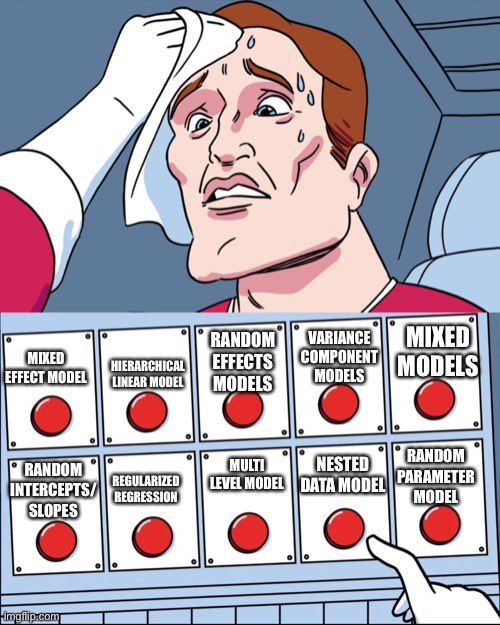
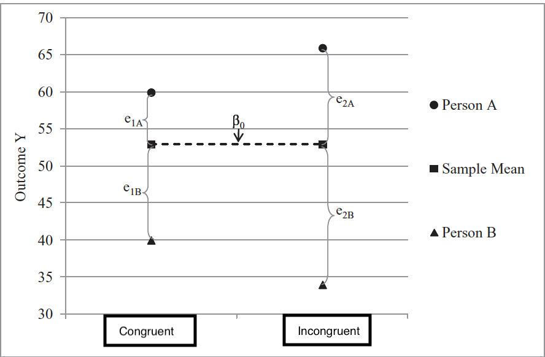
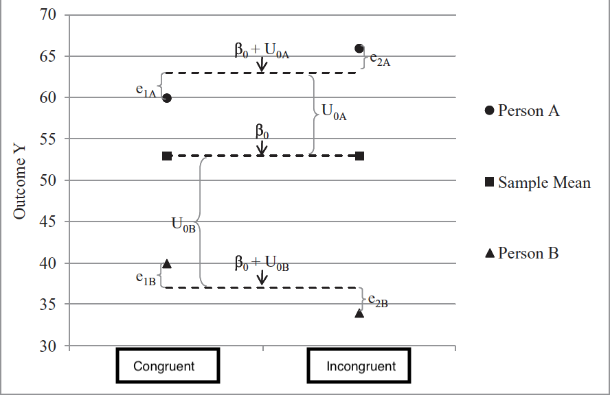

## So many names, one model



## MLM review

$${Y}_{i} = b_{0} + b_{1}X_{i} +  ... +\epsilon_{i}$$

$${Y}_{ij} = b_{0} + b_{1}X_{ij} + ... +\epsilon_{ij}$$ where *i* refers to the cluster or group (e.g., a person) and *j* to the observations within it

## Our running example {.smaller}

```{r}
mlm <- read.csv("mlm.csv")  # also at https://bayes27.netlify.app/mlm.csv
names(mlm)[names(mlm) == "group"] <- "diagnosis"  # marginaleffects reserves the name "group"
```

-   91 people (people with Parkinson's disease, `diagnosis = "PD"`, and controls, `"CTRL"`), each scanned 2–4 times: 225 rows in all.
-   `CON` and `SMN7` are resting-state connectivity scores for two brain networks; `time` is time since the first scan (0–6); `week` is a finer-grained version of it.
-   Observations (*j*) are nested in people (*i*). Some examples below are conceptual (a Stroop task, students in schools); whenever there's a plot, it's these data.

```{r, echo = FALSE}
library(tidyverse)
library(tidybayes)
library(ggdist)
library(brms)
library(modelr)
library(marginaleffects)
# keep every row for a random sample of `size` groups
sample_n_of <- function(data, size, ...) {
  keys <- data %>% distinct(...) %>% slice_sample(n = size)
  semi_join(data, keys, by = names(keys))
}
```

## Twenty people, twenty lines

```{r}
#| code-fold: true

set.seed(114)
mlm %>%
  sample_n_of(20, ID) %>%
ggplot(aes(x = week, y = CON, group = ID, fill = ID)) + geom_point(aes(color = factor(ID))) + stat_smooth(aes(color = factor(ID)),method = "lm", se = FALSE) +
  xlab("week") + ylab("CON connectivity") + theme(legend.position = "none")

```

## Empty model

Level 1 $${Y}_{ij} = \beta_{0i}  + \varepsilon_{ij}$$

Level 2 $${\beta}_{0i} = \gamma_{00} + U_{0i}$$

$${U}_{0i} \sim N(0, \tau_{00}^{2})$$
$${\varepsilon}_{ij} \sim N(0, \sigma^{2})$$

## The empty model, pictured

```{r}
#| code-fold: true

mlm %>%
  sample_n_of(8, ID) %>%
ggplot(aes(x = week, y = CON, group = ID)) + geom_point(aes(color = factor(ID))) + stat_smooth(aes(color = factor(ID)), method = "lm", formula=y~1, se = FALSE) + xlab("week") + ylab("CON connectivity") + theme(legend.position = "none")
```

$${Y}_{ij} = \gamma_{00} + U_{0i}  + \varepsilon_{ij}$$

Akin to ANOVA if we treat $U_{0i}$ as between subjects variance & $\varepsilon_{ij}$ as within subjects variance.

## Random and fixed effects

::::: columns
::: {.column width="40%"}
Level 1: $${Y}_{ij} = \beta_{0i}  + \varepsilon_{ij}$$

Level 2: $${\beta}_{0i} = \gamma_{00} + U_{0i}$$ Combined: $${Y}_{ij} = \gamma_{00} + U_{0i}  + \varepsilon_{ij}$$
:::

::: {.column width="60%"}
$U_{0i}$ is considered a random effect, as it varies across our grouping

$\gamma_{00}$ is considered a fixed effect, as it is what is fixed (average) across our grouping
:::
:::::

## Level 1 predictors

Level 1 is where you have data that repeats within your grouping or clustering data. Is your cluster classrooms? Then students are level 1. Is your cluster people? Then observations are level 1.

$${Y}_{ij} = \beta_{0i}  + \beta_{1i}X_{ij} + \varepsilon_{ij}$$ Notice the subscripts on X: these predictors vary across groups (*i*) and within a group (*j*). So if your grouping (*i*) is people, then *j* refers to different observations.

## Level 2 {.smaller}

Level 2 takes the parameters at level 1 and decomposes them into a fixed component ( $\gamma$ ) that reflects the average and, if desired, the individual deviations around that fixed effect (U).

$$
\begin{aligned}
\text{Level 1:}\quad Y_{ij} &= \beta_{0i} + \beta_{1i}X_{ij} + \varepsilon_{ij} \\
\text{Level 2:}\quad \beta_{0i} &= \gamma_{00} + U_{0i} \\
\beta_{1i} &= \gamma_{10}
\end{aligned}
$$

## Adding a random slope {.smaller}

$$
\begin{aligned}
\text{Level 1:}\quad Y_{ij} &= \beta_{0i} + \beta_{1i}X_{ij} + \varepsilon_{ij} \\
\text{Level 2:}\quad \beta_{0i} &= \gamma_{00} + U_{0i} \\
\beta_{1i} &= \gamma_{10} + U_{1i} \\
\text{Combined:}\quad Y_{ij} &= \gamma_{00} + \gamma_{10}X_{ij} + U_{0i} + U_{1i}X_{ij} + \varepsilon_{ij}
\end{aligned}
$$

Each person's slope is a fixed part plus their own deviation: for person 16, $\beta_{1,16} = \gamma_{10} + U_{1,16}$.

## Error structure

The residual structure, where the random effects are again normally distributed with a mean of zero, but this time one must also consider covariance in addition to variance.

$$\begin{pmatrix} {U}_{0i} \\ {U}_{1i} \end{pmatrix}
\sim N \left( \begin{pmatrix} 0 \\ 0 \end{pmatrix}, \begin{pmatrix} \tau_{00}^{2} & \tau_{01}\\ \tau_{01} & \tau_{11}^{2} \end{pmatrix} \right)$$

Note that it is possible to have a different error structure for the random effects

$${\varepsilon}_{ij} \sim N(0, \sigma^{2})$$

## Multiple level 1 predictors

Level 1:

$${Y}_{ij} = \beta_{0i}  + \beta_{1i}X_{ij} + \beta_{2i}Z_{ij} + \varepsilon_{ij}$$ Level 2:\
$${\beta}_{0i} = \gamma_{00} + U_{0i}$$

$${\beta}_{1i} = \gamma_{10} + U_{1i}$$
$${\beta}_{2i} = \gamma_{20} + U_{2i}$$

## Level 2 predictors

$$
\begin{aligned}
\text{Level 1:}\quad Y_{ij} &= \beta_{0i} + \beta_{1i}X_{ij} + \varepsilon_{ij} \\
\text{Level 2:}\quad \beta_{0i} &= \gamma_{00} + \gamma_{01}G_{i} + U_{0i} \\
\beta_{1i} &= \gamma_{10} + U_{1i}
\end{aligned}
$$

$G_i$ is a person-level variable (it has no *j*): it can only predict person-level things, like each person's intercept.

## Level 2 predictors: combined

Combined $${Y}_{ij} = \gamma_{00} + \gamma_{01}G_{i}+  \gamma_{10} (X_{ij}) + U_{0i} + U_{1i}(X_{ij}) + \varepsilon_{ij}$$ $${Y}_{ij} = [\gamma_{00} + \gamma_{01}G_{i}+ U_{0i}]  + [(\gamma_{10}  + U_{1i})(X_{ij})] + \varepsilon_{ij}$$

## Cross-level interactions {.smaller}

$$
\begin{aligned}
\text{Level 1:}\quad Y_{ij} &= \beta_{0i} + \beta_{1i}X_{ij} + \varepsilon_{ij} \\
\text{Level 2:}\quad \beta_{0i} &= \gamma_{00} + \gamma_{01}G_{i} + U_{0i} \\
\beta_{1i} &= \gamma_{10} + \gamma_{11}G_{i} + U_{1i} \\
\text{Combined:}\quad Y_{ij} &= \gamma_{00} + \gamma_{01}G_{i} + \gamma_{10}X_{ij} + \gamma_{11}G_{i}X_{ij} + U_{0i} + U_{1i}X_{ij} + \varepsilon_{ij}
\end{aligned}
$$

$\gamma_{11}$, the cross-level interaction: does the person-level variable G predict how strong each person's X effect is?

## Cross-level interactions: grouped

$${Y}_{ij} = [\gamma_{00} + U_{0i} +\gamma_{01}G_{i}] + [(\gamma_{10}  + \gamma_{11}G_{i}+  U_{1i})(X_{ij})] + \varepsilon_{ij}$$

## Centering

As a rule, each level-1 predictor is usually really 2 predictor variables. It is important to separate within-group from between group variance. Failing to do so will "smush" between and within variance to level 1.

Example: student SES at level 1, with schools at level 2. Some kids have more money than other kids in their school; some schools have more money than other schools.

Fortunately it is easy to separate this

## Centering: within and between {.smaller}

Level 1: $${Y}_{ij} = \beta_{0i}  + \beta_{1i}(X_{ij}- \bar{X_i}) + \varepsilon_{ij}$$

Level 2: $${\beta}_{0i} = \gamma_{00} + \gamma_{01}\bar{X_i} +   U_{0i}$$

$${\beta}_{1i} = \gamma_{10} + \gamma_{11}\bar{X_i} + U_{1i}$$

$\gamma_{10}$ is the *within*-person effect; $\gamma_{01}$ is the *between*-person effect.

Could also grand mean center the level 2 means so that the interaction has a meaningful zero point.

## MLM as default and make it maximum

If you have data like this you should analyze like this! If you don't, then you are losing information (GEE being a potential exception).

The question often is about which random effects to fit. There are multiple opinions, but mine is to start maximum, and then work downward (ie simplify) if necessary/consistent with theory. It doesn't really hurt to include them, especially within Bayesian estimation!

## MLM intuitions {.smaller}

Anytime you have repeated DVs you should use MLM as opposed to doing aggregation outside the model. While that should be your default, it is helpful to conceptualize why it is helpful.

1.  Aggregation is bad
2.  Regressions within regressions (ie coefficients as outcomes)
3.  Questions at different levels
4.  Variance decomposition\
5.  Learning from other data through pooling/shrinkage
6.  Parameters that depend on parameters


## 1. Aggregation obscures hypotheses

What if people had more than 1 DV, like we do with time? What do you do with multiple items, multiple trials, multiple \_\_\_\_ ?

Two options: 1. Collapse and average across.

## Example

```{r}
#| code-fold: true
library(tidyverse)
library(broom)

simp<- tribble(
  ~ID, ~group,  ~test.score, ~study,
1,1,5,1,
2,1,7,3,
3,2,4,2,
4,2,6,4,
5,3,3,3,
6,3,5,5,
7,4,2,4,
8,4,4,6,
9,5,1,5,
10,5,3,7)
```

```{r, echo=FALSE}
simp %>%
ggplot(aes(x=study, y=test.score)) +
    geom_point(aes(colour = factor(group)))
```

## Aggregating

Could aggregate across group

```{r, echo = FALSE}
simp.1<- tribble(
  ~ID, ~group,  ~test.score, ~study,
  1,1,6,2,
  2,2,5,3,
  3,3,4,4,
  4,4,3,5,
  5,5,2,6)
```

```{r, echo=FALSE}
simp.1 %>%
ggplot(aes(x=study, y=test.score)) +
    geom_point() +
    geom_smooth(method=lm, se=FALSE) +
  geom_point(data = simp, aes(colour = factor(group)))
```

## Separate lines for each group

```{r, echo = FALSE}
simp %>%
ggplot(aes(x=study, y=test.score, group = group)) +
    geom_point(aes(colour = factor(group))) +
    geom_smooth(aes(colour = factor(group)),method=lm,se=FALSE)
```

## 1. Aggregation obscures hypotheses

-   Between person H1: Do students who study more get better grades?

-   Within person H2: When a student studies, do they get better grades?

-   H1 and H2 are independent from one another! Aggregation collapses the two. When you have nested data with many DVs it is important to not aggregate.

-   #compositeskill

## 2. Regressions within regressions

Helps to take multilevel and split it into the different levels.

Level 1 is the smallest unit of analysis (students, waves, trials, family members)

Level 2 variables are what level 1 variables are "nested" in (people, schools, counties, families, dyads)

We use the level 1 coefficients as outcomes in a level 2 regression, while level 1 is also estimating its own regression (coefficients as outcomes).


## Stroop example

We calculate stroop scores by looking at repeated trials of congruent vs not congruent. This is dummy coded such that the $\beta_{1}$ reflects the average stroop effect. How much slower are people in incongruent trials?

$$Y_{i} = \beta_{0} + \beta_{1}X_{1} + \varepsilon_i$$

## Stroop as an MLM {.smaller}

$$Y_{trials, i} = \beta_{0i} + \beta_{1i}X_{trial,i} + \varepsilon_{trial,i}$$

$$\beta_{0} = \gamma_{00} + U_{0i}$$ $$\beta_{1} = \gamma_{10} +\gamma_{11}Age_i+ U_{1i}$$

Our B1 coefficient indexes the stroop effect. However, people differ on this stroop effect. There is some average effect (fixed effect) that people vary around. Each person has some personal $\beta_1$, which we find using Level 1 data. From there we can also ask questions (with regressions) about that random variable.

## People differ

Same idea with our data: each person has their own average SMN7 connectivity, and people vary around the grand mean.

```{r}
#| code-fold: true
example <- read_csv("mlm.csv")  # same data as above
example$year <- example$week

set.seed(11)
ex.random <- example %>%
  dplyr::select(ID) %>%
  distinct() %>%
  slice_sample(n = 3)

example2 <-
  left_join(ex.random, example)

g2<- ggplot(example2,
   aes(x = week, y = SMN7, group = ID)) +  geom_point() + stat_smooth(method="lm", formula=y~1, se = FALSE) + facet_wrap( ~ID) +
  geom_hline(yintercept = mean(example$SMN7)) +  ylab("SMN7 connectivity") + xlab("week") +
  geom_label(label="Grand mean ",  x=1,y=mean(example$SMN7),
    label.size = 0.15)
g2
```

## Distribution of person means

```{r}
#| code-fold: true
library(tidybayes)
example %>% group_by(ID) %>%
  do(avg = tidy(lm(SMN7 ~ 1, data = .))) %>%
  unnest(avg) %>%
  ggplot(aes(x = estimate)) +
  stat_dotsinterval() + xlab("person mean SMN7 connectivity") + ylab(NULL)
```

## 3. Different levels

To sum up the first two ways to think about regression, we take a relationship that could be simplified by aggregation, and conduct regressions from regressions. (Regression inception)

The third way is to think of questions at different levels. At level 1 we can ask lower-unit questions e.g., if trials are nested within person, what predicts lengthier trials?

If level 1 is made up of repeated observations, then we can ask level 1/observation level questions like does failure at the trial level impact future trial performance.

## Level 2 questions

At level 2 we can ask broader-unit questions. E.g., is age associated with stroop differences

Often level 2 is between person variables.

Both levels are simple regressions. Level 2 uses coefficients from level 1 as DVs. Level 1 variables are time varying, level 2 variables are time invariant

## 4. Variance decomposition {.smaller}

For standard regression, we think of error as existing in one big bucket called $\varepsilon$ . Everything that we do not know goes into that bucket, from measurement error to unmeasured important factors.

For MLMs we will be breaking up ( $\varepsilon$ ) into multiple buckets. These useful "buckets" (Us) are what we refer to as random/varying effects.

$$Y_{trials, i} = \beta_{0i} + \beta_{1i}X_{trial,i} + \varepsilon_{trial}$$ $$\beta_{0} = \gamma_{00} + U_{0i}$$ $$\beta_{1} = \gamma_{10} +\gamma_{11}Z_i+ U_{1i}$$

## One bucket of error



Assume a simple intercept only model where we aggregate across types of trials.

## Person-specific buckets



A MLM intercept only model takes what was previously chalked up to error and reassigns it into person specific "buckets"

## A model for the variance

Model for the means (like normal) and now we have a model for the variance (random effects!)

We will treat random effects as variables themselves e.g. individual differences in reaction time or stroop effect. They index how much people DIFFER on some effect. e.g. does everyone show the same stroop effect?

We can relate the random effects to other random effects e.g., do people who show an effect have a slower reaction time?

## 5. Shrinkage/partial pooling

-   We treat our group variable as coming from a population. All groups are alike (because they are from the same population), but different in their own way. Because of this it is helpful to use information from other groups to help make predictions.

-   We do this in standard regression where we make predictions based on values from the whole dataset (not just binned Xs). We want to pool as this leads to better predictions as we are not overfitting our data!

## Where do the U's come from?

If we take our simplified stroop effect model (an empty model)

$$Y_{trials, i} = \beta_{0i} +  \varepsilon_{trial}$$

$$\beta_{0} = \gamma_{00} + U_{0i}$$

Where does $U_{0i}$ come from? If we calculated each by hand, through taking the average reaction time for a person i and subtracting that from the grand mean reaction time, would that equal $U_{0i}$ ?

## Complete, partial and no pooling {.smaller}

-   Complete assumes everyone is the same, with $U_{0i}$ being zero for everyone.

-   No pooling is if we calculate every person's effect with a separate regression, subtracting out the grand mean.

-   Partial pooling is in the middle, a weighted average between the two. For those with fewer trials there is less information for a particular individual, thus the complete pooling estimate will be given more weight. If someone has a lot of data, their weighted average is closer to no pooling.

-   Partial pooling prevents both over and under fitting of your data, leading to increased out of sample predictions.

## Complete pooling

Ignores any dependency. Doesn't learn from others, assumes everyone is the same. Underfits the model.

```{r}
#| code-fold: true

ggplot(mlm, aes(x = week, y = SMN7)) + geom_point() + stat_smooth(method="lm") +ylab("SMN7") + xlab("week") +  theme(axis.ticks.y = element_blank(),
        axis.text.y = element_blank())

```

## No Pooling

Everyone is unique and we cannot learn from others. Leads to overfitting

```{r}
#| code-fold: true

ggplot(mlm, aes(x = week, y = SMN7, group = ID)) + geom_line() +  geom_point() + facet_wrap( ~ ID) +ylab("SMN7") + xlab("week")

```

## Partial pooling aka shrinkage aka regularization

```{r}
#| code-fold: true

library(viridis)
ggplot(mlm, aes(x = week, y = SMN7, group = ID, colour = ID)) + stat_smooth(method = "lm", se = FALSE, alpha = .5) +scale_color_viridis()+  ylab("SMN7") + xlab("week") + geom_point()
```

## Partial pooling as learning

Partial pooling aka shrinkage provides the optimal amount of learning from others. Assumes people come from the same distribution but are distinct from one another.

If you have a little data, then the safe bet is to look at the average. If you have a lot of data, you can ignore others.

In a way, this is similar to Bayesian reasoning where learning is based on how much information you have about a person with other people serving as a prior.

## 6. Parameters that depend on other parameters {.smaller}

$$\text{y}_{ij}  \sim \operatorname{Normal}(\mu_{ij}, \sigma)$$ $$\mu_{ij}  = \beta_{0[i]}$$

$$\beta_{0[i]} \sim \operatorname{Normal}({\bar \mu},  \sigma_0)$$ $${\bar \mu}  \sim {\operatorname{Normal}(0, 1.5)}$$ $$\sigma_0 \sim {\operatorname{Half-Normal}(0, 1.5)}$$ $$\sigma \sim {\operatorname{Exponential}(1)}$$

## Hyperprior

We now have a prior for the population of effects. We typically put a prior directly on parameters. Here, because we are using a multilevel model, we are interested in the population of intercepts, not just a single intercept.

Intercept in simple regression --\> a (prior/posterior) distribution of possible scores

Intercept in mlm --\> a distribution of group/clusters of intercepts. The population we are sampling from can have a distribution (mu, sigma), and that distribution is different from the observed distribution of mu (or sigma)

## Priors with their own priors {.nostretch .smaller}

The person intercepts $\beta_{0[i]}$ get a prior whose parameters ($\bar\mu$, $\sigma_0$) are themselves estimated: a prior with its own priors.

```{r}
#| code-fold: true
#| out-width: "80%"
#| fig-width: 10
#| fig-height: 4.2
lab <- tribble(~x, ~y, ~label,
  1.2, 3, "bar(mu) %~% Normal(0, 1.5)",
  3.2, 3, "sigma[0] %~% HalfNormal(0, 1.5)",
  2.2, 2, "beta[0*'['*i*']'] %~% Normal(bar(mu), sigma[0])",
  4.2, 2, "sigma %~% Exponential(1)",
  3.2, 1, "CON[ij] %~% Normal(beta[0*'['*i*']'], sigma)")
arrows <- tribble(~x, ~y, ~xend, ~yend,
  1.3, 2.8, 2.0, 2.2,   3.1, 2.8, 2.4, 2.2,
  2.4, 1.8, 3.0, 1.2,   4.0, 1.8, 3.4, 1.2)
ggplot() +
  geom_segment(data = arrows, aes(x = x, y = y, xend = xend, yend = yend),
               arrow = arrow(length = unit(0.25, "cm"), type = "closed"), colour = "grey50") +
  geom_label(data = lab, aes(x = x, y = y, label = label), parse = TRUE, size = 5.5,
             label.padding = unit(0.4, "lines"), fill = "grey95") +
  annotate("text", x = -0.2, y = c(3, 2, 1), label = c("hyperpriors", "one per person", "one per observation"),
           hjust = 0, colour = "grey40", size = 4.5) +
  xlim(-0.2, 5) + ylim(0.6, 3.4) + theme_void()
```


## Two kinds of priors

If we are estimating a mean, we can divide that up into two priors:

1.  A distribution of our best guess at the mean e.g., N(3,.5) means I am very confident in my guess vs N(3,50). This is all about the mean.

2.  A distribution that represents the spread around that mean e.g., N(0,1) suggests small spread vs (0,100) suggest people may differ a lot (Even though the distribution has the same mean).

Fixed effect describes #1 whereas random effects describe #2

## The empty model in brms {.smaller}

```{r}
library(brms)
mlm.1 <-
  brm(family = gaussian,
      CON ~ 1 + (1 | ID),
      prior = c(prior(normal(0, 1.5), class = Intercept),
                prior(normal(0, 1.5), class = sd),
                prior(exponential(1), class = sigma)),
      iter = 5000, warmup = 1000, chains = 4, cores = 4,
      sample_prior = "yes",
      data = mlm,
      backend = "cmdstanr",
      file = "mlm.1")
```

If you think about parameters you are estimating the number of priors are simple. But in terms of what those priors represent, they are providing a prior on a prior. The intercept and the SD are both providing estimates of means. We could model this 1 parameter (anova or index coded) or 2 (mlm)

## `mlm.1` summary

```{r}
summary(mlm.1)
```

## How much is between people? The ICC {.smaller}

The intraclass correlation: the share of the total variance that is between people,

$$\text{ICC} = \frac{\sigma_0^2}{\sigma_0^2 + \sigma^2}$$

Compute it **draw by draw**, so it gets its own posterior:

```{r}
as_draws_df(mlm.1) %>%
  mutate(icc = sd_ID__Intercept^2 / (sd_ID__Intercept^2 + sigma^2)) %>%
  median_qi(icc)
```

## Reading the ICC

About 60% of the variation in CON is stable differences between people; about 40% is scan-to-scan change within a person. Equivalently, two scans from the same person correlate about .6.

## A single-level model

Notice we have one less parameter we are estimating.

```{r}
mlm.2 <-
  brm(family = gaussian,
      CON ~ 1 ,
      prior = c(prior(normal(0, 1.5), class = Intercept),
                prior(exponential(1), class = sigma)),
      iter = 5000, warmup = 1000, chains = 4, cores = 4,
      sample_prior = "yes",
      data = mlm,
      backend = "cmdstanr",
      file = "mlm.2")
```

## `mlm.2` summary

```{r}
summary(mlm.2)
```

## Comparing the two

```{r}
mlm.1 <- add_criterion(mlm.1, "loo")
mlm.2 <- add_criterion(mlm.2, "loo")
loo_compare(mlm.1, mlm.2, criterion = "loo")
```

## Same intercept, different meaning

-   Notice how the intercept estimate is about the same in each of these models, but the MLM's interval is wider: it knows the 91 people differ, so it is less sure about the average person. Conceptually they are different too. The intercept is directly modeled in the standard regression. In the MLM it is better thought of as the map of the distribution of random effects.

-   The population is larger than what we have. This is true for almost anything we do. We sample paradigms, we sample people, we usually never have a full population under our study. Don't we want to model that variation?

## The empty model, formally {.smaller}

$$\text{y}_{ij}  \sim \operatorname{Normal}(\mu_{ij}, \sigma)$$
$$\mu_{ij}  = \beta_{0[i]}$$ The [i] subscript indicates we have varying intercepts that vary over individual i. Each parameter estimated needs a prior.
$$\beta_{0[i]} \sim \operatorname{Normal}({\bar \mu},  \sigma_0)$$
$${\bar \mu}  \sim {\operatorname{Normal}(0, 1.5)}$$ $$\sigma_0 \sim {\operatorname{Half-Normal}(0, 1.5)}$$ $$\sigma \sim {\operatorname{Exponential}(1)}$$

## An index model: one mean per person

With mlm we treated means as coming from a population of means. And thus there was a best guess of the mean (intercept) and variation around that guess (SD). With anova we ignored the variation. But we could, in bayes, still examine that variation. Lets fit an index model, where each person gets a mean.

```{r}
mlm$ID.f <- as.factor(mlm$ID)
mlm.id <-
  brm(family = gaussian,
      CON ~ 0 + ID.f ,
      iter = 4000, warmup = 1000, chains = 2, cores = 4,
      data = mlm,
      backend = "cmdstanr",
      file = "mlm.id")

```

## Fixed effects vs random effects

This is similar to a "fixed effect" model, something that is popular in econometrics. It, in contrast to the random effect model, does not model random effects.

Why do we want to model random effects? Variance decomposition which leads to increased power.

Also, 1. we can include group/cluster level predictors, which fixed effect cannot. 2. it makes an assumption about whether the clusters are random or not. Psych they are almost always random (people, site, orgs) whereas for econometrics they aren't (country, state).

## `mlm.id` summary

```{r}
summary(mlm.id)
```

## Person means from the index model

```{r, warning = FALSE}
as_draws_df(mlm.id) %>%
  pivot_longer(starts_with("b_ID.f"), names_to="ID") %>%
  summarise(mean=mean(value), sd=sd(value))
```

## Partial pooling/Shrinkage

$\sigma_0$ (our random effect) can help turn on/off/adjust shrinkage.

Setting SD to zero says everyone is the same. Infinite SD suggests no pooling (and major differences in pop values). In the middle gives you partial pooling.

We use our prior of $\sigma_0$ plus our data to get an estimate of $\beta_{0[j]}$. This is how we accurately partial pool.

## Partial pooling/Shrinkage

$$\text{y}_{ij}  \sim \operatorname{Normal}(\mu_i, \sigma)$$

$$\mu_i  = \beta_{0[i]}$$

$$\beta_{0[i]} \sim \operatorname{Normal}({\bar \mu},  \sigma_0)$$
$${\bar \mu}  \sim {\operatorname{Normal}(0, 1.5)}$$

$$\sigma_0 \sim {\operatorname{Half-Normal}(0, 1.5)}$$

$$\sigma \sim {\operatorname{Exponential}(1)}$$

## Working with the MLM posterior

```{r}
summary(mlm.1)
```

## Variables in the posterior

```{r}
library(tidybayes)
get_variables(mlm.1)
```

## Random effects for each person

```{r}
mlm.1 %>%
  spread_draws(r_ID[ID, term])
```

16,000 draws (4 chains × 4,000 post-warmup iterations) × 91 people

## Dropping the term index

```{r, warning = FALSE}
mlm.1 %>%
  spread_draws(r_ID[ID])
```

## Summarizing the random effects

```{r}
mlm.1 %>%
  spread_draws(r_ID[ID, term]) %>%
 median_qi()
```

## Random effects are deviations

Think back to {lme4} and `ranef` `coef` and `fixef` functions.

What do each of these describe?

What scale is our random effect (typically) in?

## Adding the fixed effect

```{r}
mlm.1 %>%
  spread_draws(b_Intercept, r_ID[ID, term])

```

## Each person's intercept

```{r}
mlm.1 %>%
  spread_draws(b_Intercept, r_ID[ID, term]) %>%
   mutate(person_I = b_Intercept + r_ID)
```

## Shrinkage, in one figure {.smaller}

```{r}
#| code-fold: true
#| fig-width: 9
#| fig-height: 4.6
# for a paper: add ggsave("shrinkage.png", width = 6.5, height = 4.5) after the plot
raw <- mlm %>% group_by(ID) %>% summarise(raw = mean(CON), n = n())
pooled <- mlm.1 %>%
  spread_draws(b_Intercept, r_ID[ID, term]) %>%
  mutate(pooled = b_Intercept + r_ID) %>%
  group_by(ID) %>%
  summarise(pooled = mean(pooled))
grand <- fixef(mlm.1)["Intercept", "Estimate"]
shrink <- left_join(raw, pooled, by = "ID") %>% mutate(ID = fct_reorder(factor(ID), raw))

ggplot(shrink, aes(y = ID)) +
  geom_vline(xintercept = grand, linetype = "dashed", colour = "grey50") +
  geom_segment(aes(x = raw, xend = pooled, yend = ID), colour = "grey60",
               arrow = arrow(length = unit(0.12, "cm"), type = "closed")) +
  geom_point(aes(x = raw, size = factor(n)), shape = 21, fill = "white") +
  geom_point(aes(x = pooled), colour = "#4C78A8", size = 1.6) +
  scale_size_manual(values = c(`2` = 1.2, `3` = 2.2, `4` = 3.2)) +
  labs(x = "CON connectivity (person mean)", y = "Person (sorted by raw mean)", size = "Scans",
       caption = "Open circles: each person's raw mean (no pooling). Blue: partially pooled estimate from the empty model.\nArrows show shrinkage toward the grand mean (dashed). Extreme means from people with few scans move the most.") +
  theme_classic(base_size = 13) +
  theme(axis.text.y = element_blank(), axis.ticks.y = element_blank(),
        plot.caption = element_text(hjust = 0), legend.position = "top")
```

## Person intercepts with intervals

```{r}
#| code-fold: true
mlm.1 %>%
  spread_draws(b_Intercept, r_ID[ID, term]) %>%
   median_qi(person_I = b_Intercept + r_ID) %>%
  ggplot(aes( y = reorder(ID, person_I), x = person_I, xmin = .lower, xmax = .upper)) +
  geom_pointinterval() + xlab("est") + ylab("ID")
```

## Forcing complete pooling

Set prior for random effect to almost zero for complete pooling.

```{r}
#| code-fold: true
mlm.1p <-
  brm(family = gaussian,
      CON ~ 1 + (1 | ID),
      prior = c(prior(normal(0, 1.5), class = Intercept),
                prior(normal(0, .00001), class = sd),
                prior(exponential(1), class = sigma)),
      iter = 4000, warmup = 1000, chains = 4, cores = 4,
      sample_prior = "yes",
      file = "mlm.1p",
       backend = "cmdstanr",
      data = mlm)
```

## `mlm.1p` summary

```{r}
summary(mlm.1p)
```

## Complete pooling, pictured

```{r}
#| code-fold: true
mlm.1p %>%
  spread_draws(b_Intercept, r_ID[ID, term]) %>%
  mutate(person_I = b_Intercept + r_ID) %>%
  left_join(mlm %>% select (ID, CON) %>% group_by(ID) %>%  mutate(CON = mean(CON))) %>%
 median_qi() %>%
ggplot(aes(x = ID)) +
  geom_point(aes(y = person_I), color = "orange2") +
  geom_point(aes(y = CON), shape = 1) +
  labs(title =
  "complete pooling") +
  geom_hline(yintercept = fixef(mlm.1)["Intercept", "Estimate"])

```

## No pooling {.smaller}

No pooling means you are not learning from other data, which is by default not an MLM model. We already fit this fixed effects no intercept model above.

```{r}
summary(mlm.id)
```

## No pooling, pictured

```{r}
#| code-fold: true
data2<-mlm %>% select(ID, CON) %>%
  group_by(ID) %>%
  mutate(CON = mean(CON)) %>%
  slice(1)

mlm.id %>% tidy_draws() %>%
  pivot_longer(b_ID.f6:b_ID.f229, names_to = "ID", values_to = "CON_I", names_prefix = "b_ID.f", names_transform = list(ID = as.integer)) %>%
left_join(data2) %>%
  group_by(ID) %>%
   median_qi() %>%
ggplot(aes(x = ID)) +
  geom_point(aes(y = CON_I), color = "orange2") +
  geom_point(aes(y = CON), shape = 1) +
  labs(title =
  "NO pooling") +
  geom_hline(yintercept = fixef(mlm.1)["Intercept", "Estimate"])

```

## The MLM picks the amount of pooling

MLM will automatically create the best fitting model -- balancing between over and under fitting. It identifies the value of sigma of the random effect that is ideal.

This "knob" can be manually turned to different values and we can look at the fit of the model via LOO or WAIC. But we don't need to!

## Comparing no, complete, and partial pooling

```{r}
mlm.id <- add_criterion(mlm.id, "loo")
mlm.1p <- add_criterion(mlm.1p, "loo")
mlm.1 <- add_criterion(mlm.1, "loo")
loo_compare(mlm.id, mlm.1p, mlm.1)
```

## Level 1 predictors in brms {.smaller}

$$\text{y}_{ij}  \sim \operatorname{Normal}(\mu_{ij}, \sigma)$$ $$\mu_{ij}  = \beta_{0[i]} + \beta_{1}Time_{ij}$$

$$\beta_{0[i]} \sim \operatorname{Normal}({\bar \mu}, \sigma_0)$$ $${\bar \mu}  \sim {\operatorname{Normal}(0, 1.5)}$$ $$\sigma_0 \sim {\operatorname{Half-Normal}(0, 1.5)}$$ $$\beta_{1} \sim {\operatorname{Normal}(0, 1.5)}$$ $$\sigma \sim {\operatorname{Exponential}(1)}$$

## A fixed slope

Notice that the slope has no hyperprior (no [i], no $\sigma_1$). What does that mean? It is not random: everyone gets the same slope. People could still differ in their slopes if we added predictors of the slope (cross-level interactions), but there is no U to represent leftover random variation. To get that we need a parameter for it, and we don't have one yet.


## Fitting `mlm.3`

```{r}

mlm.3 <-
  brm(family = gaussian,
      CON ~ 1 + time + (1 | ID),
      prior = c(prior(normal(0, 1.5), class = Intercept),
                prior(normal(0, 1.5), class = b),
                prior(normal(0, 1.5), class = sd),
                prior(exponential(1), class = sigma)),
      iter = 4000, warmup = 1000, chains = 4, cores = 4,
      sample_prior = "yes",
      file = "mlm.3",
      backend = "cmdstanr",
      data = mlm)

```

## `mlm.3` summary

```{r}
summary(mlm.3)
```

## `posterior_summary()`

```{r}
posterior_summary(mlm.3)
```

## What's in our posterior?

```{r}
get_variables(mlm.3)
```

## Three kinds of prediction {.smaller}

| What you want | brms / marginaleffects | Uncertainty from |
|---------------|------------------------|------------------|
| The average person | `re_formula = NA` | the fixed effects only |
| A person in the data | `re_formula = NULL` (the default) | fixed effects + that person's estimated U |
| A new, unseen person | `allow_new_levels = TRUE, sample_new_levels = "gaussian"` | fixed effects + a U drawn from Normal(0, $\sigma_0$) |

## A known person vs. a new person {.smaller}

CON at time = 3 for person 6 (in the data) and for someone we've never seen:

```{r}
predictions(mlm.3, newdata = tibble(ID = c(6, 9999), time = 3),
            allow_new_levels = TRUE, sample_new_levels = "gaussian")
predictions(mlm.3, newdata = tibble(time = 3), re_formula = NA)  # the average person
```

## Why is the new person so uncertain?

-   For person 6, the model has their scans; for person 9999 it only knows people vary with SD $\sigma_0$, so the interval is more than twice as wide.
-   The average person's interval is the narrowest: it's about the mean, not about any individual.
