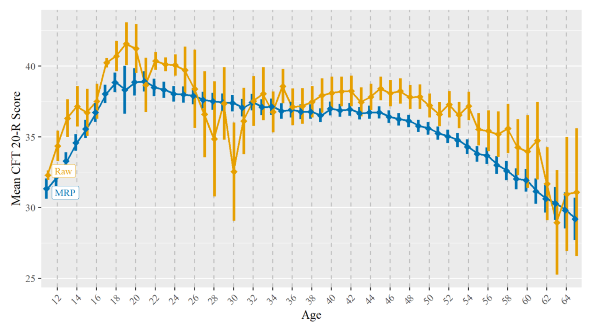

## This time

1. Predictions for new groups and MrP (multilevel regression and poststratification)
2. Missing data: multiple imputation and imputation during model fitting
3. Measurement error
4. Meta-analysis

```{r, echo = FALSE}
library(tidyverse)
library(tidybayes)
library(brms)
library(modelr)
library(marginaleffects)
```

## Making predictions

We often want to make predictions for different groups or individuals. We make predictions using/borrowing information from other individuals, through partial pooling. This improves our predictions.

Can we improve it further? Do we stick with standard MLM based predictions? What if we want to look at sub samples in our data, especially rarer ones (e.g., gay black republicans) or are we worried some are over-represented (e.g., age and high education/SES)

## Hypothetical groups

```{r}
#| code-fold: true
esm <- read_csv("esm.csv")  # also at https://josh-jackson.github.io/bayes27/esm.csv

esm$PA <- esm$esm.NQ11.w1
esm$W.other <- esm$esm.ST04.w1
esm$ID <- esm$esm.IDnum.w1

mlm.5 <-
  brm(family = gaussian,
      PA ~ 1 + W.other  + (1 + W.other  | ID),
      prior = c(prior(normal(3, 1), class = Intercept),
                prior(normal(0, 1), class = b),
                prior(exponential(1), class = sd),
                prior(exponential(1), class = sigma),
                prior(lkj(2), class = cor)),
      iter = 4000, warmup = 1000, chains = 4, cores = 4,
      file = "mlm.5b",  # same model as in Multilevel models 2
      backend = "cmdstanr",
      data = esm)

```

## Predicting a new person

Draw from the (assumed Gaussian) population distribution of random effects by asking `predictions()` for a new "level" of the grouping variable. This "integrates out" the random effects.

```{r}
#| code-fold: true
predictions(
    mlm.5,
    newdata = datagrid(W.other = 0:1, ID = "ralph"),
    allow_new_levels = TRUE)
```

## New person vs. average person

Notice the extra uncertainty for a new person compared with the average person (`re_formula = NA`):

```{r}
#| code-fold: true
predictions(
    mlm.5,
    re_formula = NA,
    newdata = datagrid(W.other = 0:1))
```

## A known person

Even for a person in the data, there is more uncertainty for an individual than for the average:

```{r}
#| code-fold: true
predictions(
    mlm.5,
    newdata = datagrid(W.other = 0:1, ID = 10472))
```


## MrP

Improving predictions by incorporating outside (of the model) information. MRP = multilevel regression with poststratification

One of the biggest problems with psych data is that it is unrepresentative. (Do you trust undergrads or adults off the street wanting to help science?)

If we know the distribution of the broader population, we can weight (post-stratify) our results to get more accurate estimates. We take the observed sample to reconstruct the rest of the population

## MrP: the pieces

Mr = Multi-level regression aka MLM

P = poststratification, with post for posterior and stratification for stratify.

You take your posterior and make predictions based on different strata

Weighted average of predicted values, where weights are the population shares of each category

## Weighting vs poststratifying

Weighting is done all the time with data. It gives more or less "weight" to observations that are over or under sampled. Some people "count" more than others in the service of getting data that represents some population.

Poststratification is similar in that it weights the posterior samples rather than the observations.

Why is this preferred? A few reasons, but mainly one can make generalization to new groups or groups with little data. Rather than weighting those specific (potentially unrepresentative) individuals, partial pooling from other information will help with learning

## What MrP needs

What do we need? A reliable data source (such as a census) that gives us the population weights. Data can be re-weighted based on many different categories, not just one: for example, we could post-stratify based on age, education, state of residence, etc.

Don't need to even attempt a representative sample. All we need is a sample that is large and diverse enough + population data (e.g., from the census).

## Example: keeping one's name after marriage

Estimating the proportion of heterosexual women who kept their maiden name after marriage.

https://www.monicaalexander.com/posts/2019-08-07-mrp/ https://bookdown.org/content/4857/models-with-memory.html#summary-bonus-post-stratification-in-an-example

## The survey data

```{r}

# survey responses (one row per woman) and census counts (one row per cell)
d <- read_csv("mrp_survey.csv", col_types = cols(.default = "c", kept_name = "d"))
cell_counts <- read_csv("mrp_census.csv", col_types = cols(.default = "c", n = "d"))
d
```

## The census data

```{r}
cell_counts
```

## Fitting the MrP model

```{r}
mlm.mrp <-
  brm(family = binomial,
      kept_name | trials(1) ~ 1 + (1 | age_group) + (1 | decade_married) + (1 | educ_group) + (1 | state_name),
      prior = c(prior(normal(-1, 1), class = Intercept),
                prior(exponential(1), class = sd)),
      iter = 2000, warmup = 1000, chains = 4, cores = 4,
      control = list(adapt_delta = .98),
      data = d,
      backend = "cmdstanr",
      file = "mlm.mrp")
```

## `mlm.mrp` summary

```{r}
summary(mlm.mrp)
```

## Average prediction (unweighted)

```{r}
avg_predictions(mlm.mrp)
```

The intercept is on the log-odds scale; `plogis()` turns it into a probability:

```{r}
plogis(fixef(mlm.mrp)["Intercept", "Estimate"])
```


## Variables in the posterior

```{r}
get_variables(mlm.mrp)
```


## Predictions for one state

```{r}
predictions(mlm.mrp,
    variables = "educ_group",
    newdata = datagrid(state_name = "missouri"))
```


## Census proportions within age groups {.smaller}

Census data we will use to make predictions. We will make predictions for every combination of variable we are interested in (state, age, decade married, edu)

```{r}
#| code-fold: true
age_prop <-
  cell_counts %>%
  group_by(age_group) %>%
  mutate(prop = n / sum(n)) %>%
  ungroup()

age_prop
```

## Poststratifying

For each age group, average the predictions over every census cell in it, weighting each cell by its share of the population:

$$\hat p_{\text{age}} = \frac{\sum_c N_c \, \hat p_c}{\sum_c N_c}$$

Do it draw by draw and you get a full posterior for each age group.

## Poststratifying with marginaleffects {.smaller}

{marginaleffects} does this with `wts =`:

```{r}
pred <- predictions(mlm.mrp,
                    newdata = age_prop,
                    by = "age_group",
                    wts = "prop",
                    allow_new_levels = TRUE)
pred
```

(The long way, with `add_predicted_draws()` on all 6,058 cells × 4,000 draws, gives the same answer and builds a 24-million-row table.)

## Raw data vs. MLM vs. MrP

```{r}
#| code-fold: true
#| fig-height: 4.2
library(patchwork)
levels <- c("raw data", "multilevel", "MrP")

p1 <-
  d %>%
  group_by(age_group, kept_name) %>%
  summarise(n = n(), .groups = "drop_last") %>%
  mutate(prop = n / sum(n), type = factor("raw data", levels = levels)) %>%
  filter(kept_name == 1, age_group < 80, age_group > 20) %>%
  ggplot(aes(x = prop, y = age_group)) +
  geom_point() +
  scale_x_continuous(breaks = c(0, .5, 1), limits = c(0, 1)) +
  facet_wrap(~type)

nd <- distinct(d, age_group) %>% arrange(age_group)
p2 <-
  predictions(mlm.mrp, newdata = nd, re_formula = ~ (1 | age_group)) %>%
  mutate(type = factor("multilevel", levels = levels)) %>%
  filter(age_group < 80, age_group > 20) %>%
  ggplot(aes(x = estimate, xmin = conf.low, xmax = conf.high, y = age_group)) +
  geom_pointrange(color = "#4C78A8") +
  scale_x_continuous(breaks = c(0, .5, 1), limits = c(0, 1)) +
  scale_y_discrete(labels = NULL) +
  facet_wrap(~type)

p3 <-
  pred %>%
  mutate(type = factor("MrP", levels = levels)) %>%
  filter(age_group < 80, age_group > 20) %>%
  ggplot(aes(x = estimate, xmin = conf.low, xmax = conf.high, y = age_group)) +
  geom_pointrange(color = "#E45756") +
  scale_x_continuous(breaks = c(0, .5, 1), limits = c(0, 1)) +
  scale_y_discrete(labels = NULL) +
  facet_wrap(~type)

(p1 | p2 | p3) +
  plot_annotation(title = "Proportion of women keeping their name after marriage, by age")
```

## MrP estimates by state

```{r}
#| code-fold: true
 predictions(mlm.mrp,
                 newdata = age_prop,
                 by = "state_name",
                wts = "prop",
                allow_new_levels = T) %>%
  get_draws(shape = "rvar") |>
  sort_by(~ estimate) |>
  transform(state = factor(state_name, levels = state_name)) %>%
ggplot(aes(y = state, xdist = rvar)) +
  stat_slab(height = 2, color = "white") +
  labs(x = "Posterior density", y = NULL)
```


## MrP is not limited to surveys

Example (using brms) with experimental data -- can you generalize from your sample of undergraduates to other undergraduates at your university, let alone undergraduates in general, let alone young adults, to say nothing about the population of humans. https://arxiv.org/pdf/1906.11323.pdf

## A recent example with norms

https://osf.io/preprints/psyarxiv/fcm3n/





## Missing data

How to solve?
1. Listwise
2. Estimation algorithm eg FIML
3. Multiple Imputation (before you run the model)
4. Bayesian (while you run the model).


## brms and multiple imputation

Each missing value is imputed N times leading to a total of N fully imputed data sets. The imputation for each dataset is similar to our predict function, using variables to make a prediction. Sometimes this is an iterative process.

The model is then fit to  N dataset separately and results are pooled across models.

Assumes the probability that a value is missing depends only on observed values and not on unobserved values (MAR)

```{r}
library(mice)  # multivariate imputation by chained equations
```

## How chained imputation works {.smaller}

1. Replace (or impute) the missing values in each variable with temporary "place holder" values derived solely from the non-missing values available for that variable. e.g start with the mean

2. A variable at a time use the other variables (including the place holder means) to make predictions using multiple regression. E.g., find the general association, and then plug in an individuals score on those to predict the missing value.

3. Repeat #2 with all other variables that have missing data, using the newly imputed data to make predictions.

4. Once complete, use the new imputed dataset to predict the missing values that you predicted in #2, plus some random noise. Rinse and repeat for other variables. This constitutes one iteration. Do several iterations (e.g., 5)

5. Do 1-4 separately to create different imputed datasets.

## The nhanes data

National Health and Nutrition Examination Survey
```{r}

data("nhanes")
nhanes
```

## Imputing 10 datasets

```{r}
nhanes.imp <- mice(nhanes, m = 10, seed = 2027, printFlag = FALSE)
```

## The imputed object

```{r}
nhanes.imp
```
mids = multiply imputed data set

pmm = predictive mean matching

## Pooling the results

Once you have the 10 datasets, you run the model separately in each of them.

Then you need to pool your estimates.

Common issue is how to pool?
Some options:
mice::pool() combines them Rubin's rules.
broom.mixed (and other packages) can take the mids object and do it for you


## brm_multiple

works well with mice objects, but brm_multiple also takes any list of dataframes. Helpful if you use amelia or mi.
```{r}
imp.1 <- brm_multiple(family = gaussian,
                      bmi ~ age*chl,
                      data = nhanes.imp,
                      cores = 4,
                      backend = "cmdstanr",
                      file = "imp.1")
```


## `imp.1` summary {.smaller}

Pooling across models is trivial in a Bayesian framework but not in frequentist.
40 chains! 40,000 draws! (10 datasets × 4 chains × 1,000 post-warmup draws)
```{r}
summary(imp.1)
```


## `imp.1` trace plots

```{r}
#| code-fold: true
plot(imp.1)
```


## Revisiting Bayesian updating

Remember the posterior can be thought of as a new prior for your next data acquisition. You could do this one datapoint at a time (remember globe tossing model in SR?), or a dataset at the time.

MI is sort of like that. You could instead run 1 model with a single imputed dataset, estimate the posterior, use that posterior as a prior for a new model and then iterate through the rest of the imputed datasets


## Bayesian imputation within brms

1) Which variables contain missingness? 2) Which variables should predict missingness 3) what imputed variables are used as predictors

Taking care of this in brms ends up creating a multivariate model!
```{r}
bform <- bf(bmi | mi() ~ age * mi(chl)) +
  bf(chl | mi() ~ age) + set_rescor(FALSE)
imp.2 <- brm(bform, data = nhanes, backend = "cmdstanr", file = "imp.2")
```

Missingness is treated as a lack-of-information problem: each missing value becomes a parameter, and the model for that variable (here, chl ~ age) is its prior.

## `imp.2` summary

```{r}
summary(imp.2)
```


## Pros and cons

Pros: Can use multilevel structure and complex non-linear relationships for the imputation of missing values, which is not achieved as easily in standard multiple imputation software

Cons: cannot impute discrete values within brms/Stan

## A parameter for every missing value

parameter for each missing variable

```{r}
posterior_summary(imp.2)
```

## The missing values' posteriors

```{r}
#| code-fold: true
imp.2 %>%
  spread_draws(Ymi_chl[ID])
```

4,000 draws × 10 missing chl values = 40,000 rows

## Imputed cholesterol values


```{r}
#| code-fold: true
imp.2 %>%
  spread_draws(Ymi_chl[ID]) %>%
  ggplot(aes(x = Ymi_chl,
             y = reorder(ID, Ymi_chl))) +
  stat_slab(fill = "black", alpha = 3/4, height = 1.6, slab_color = "black", slab_size = 1/4) +
  labs(x = "Chl imputed values", y = "IDs")
```


## Imputed BMI values

```{r}
#| code-fold: true
imp.2 %>%
  spread_draws(Ymi_bmi[ID]) %>%
  ggplot(aes(x = Ymi_bmi,
             y = reorder(ID, Ymi_bmi))) +
  stat_slab(fill = "black", alpha = 3/4, height = 1.6, slab_color = "black", slab_size = 1/4) +
  labs(x = "BMI imputed values", y = "IDs")
```

## Making our own missing data

```{r}
#| code-fold: true
MI <- read.csv("hw3.csv")  # also at https://josh-jackson.github.io/bayes27/hw3.csv

set.seed(7474)
MI.missing <- MI %>%
    mutate(happiness =  replace(happiness, sample(row_number(),
           size = ceiling(0.3 * n()), replace = FALSE), NA)) %>%
  mutate(schoool.success =  replace(schoool.success, sample(row_number(),
           size = ceiling(0.3 * n()), replace = FALSE), NA))
MI.missing
```

## Complete data regression

```{r}
summary(lm(schoool.success ~ happiness, data = MI))
```


## Listwise deletion

```{r}
summary(lm(schoool.success ~ happiness, data = MI.missing))
```


## Imputing during model fitting


```{r}

imp.3 <- bf(schoool.success | mi() ~ mi(happiness)) +
        bf(happiness | mi() ~ friendship.quality + SES)

imp.3 <- brm(imp.3,
    data = MI.missing,
    iter = 2000, warmup = 1000, chains = 4, cores = 4,
    backend = "cmdstanr",
    file = "imp.3")

```

## `imp.3` summary

```{r}
summary(imp.3)
```

## Three answers to one question {.smaller}

```{r}
#| code-fold: true
lm_full <- lm(schoool.success ~ happiness, data = MI)
lm_listwise <- lm(schoool.success ~ happiness, data = MI.missing)
imp_slope <- fixef(imp.3)["schooolsuccess_mihappiness", ]

tibble(approach = c("Complete data (the truth here)", "Listwise deletion", "Imputation during fitting (imp.3)"),
       n_used   = c(nrow(MI), nobs(lm_listwise), nrow(MI.missing)),
       slope    = c(coef(lm_full)["happiness"], coef(lm_listwise)["happiness"], imp_slope["Estimate"]),
       se       = c(summary(lm_full)$coefficients["happiness", "Std. Error"],
                    summary(lm_listwise)$coefficients["happiness", "Std. Error"], imp_slope["Est.Error"])) %>%
  knitr::kable(digits = 2)
```

-   Listwise deletion throws away every row with *any* missing value: 57 of 118 people here. Imputation keeps all 118, and its SE is smaller.
-   We deleted values completely at random, so neither approach is biased on average; in this particular sample both happen to land above the complete-data slope.
-   When missingness depends on other variables (MAR), listwise deletion *is* biased; imputation that uses those variables (friendship quality and SES here) is not.

## doing it the "long" way

We could impute missing values for any variable via posterior prediction. We can set up any model with variables we think are related to the variable we want to impute. After fitting the model we can make predictions for a) people who have existing data but missing on our DV or b) completely new people who have some set of predictors.


## Measurement error

Most measurements are taken with some error, especially in psychology.

Often require alpha > .7. Advanced approaches (SEM) use latent variables.

When measurement error is large relative to the quantity being measured, or when very precise relations can be estimated between measured quantities, it is useful to introduce an explicit model of measurement error such as latent measurement model in SEM.

In Bayes it is related to missing data: a missing value can be thought of as a value with infinite measurement error.

## Replace data with distributions

With measurement error, the insight is to realize that any uncertain piece of data can be replaced by a distribution that reflects uncertainty.

Classical Test Theory (CTT) defines this as: observed value = true value + error

Think of a distribution centered on the true value with error around it: e.g., the true value is 10 but measured with error, y ~ N(10, 2)


## Measurement error in the outcome

$$\text{schoool.success (observed)} \sim \text{Normal}( \text{True.SS}_i, \text{SE.SS}_i )$$

$$\text{True.SS}_i \sim \text{Normal}(\mu_i , \sigma )$$

$\mu_i$ = $\beta_0$ + $\beta_1$ $\text{Happiness}_i$

$\beta_0$ \~ Normal(0, 5)\
$\beta_1$ \~ Normal(0, 5)\
$\sigma$ \~ HalfCauchy(0,10)


## The standard error of measurement {.smaller}

Where do we get the SE of the DV? What do we know about standard error of measurement?

SEM = SD × √(1 − reliability)

With SD = 3.28 and reliability (α) = .70: 3.28 × √.30 ≈ 1.80

```{r}
MI <- MI %>%
  mutate(se_ss    = sd(schoool.success) * sqrt(1 - .7),   # SEM of school success, alpha = .70
         se_happy = sd(happiness) * sqrt(1 - .8))          # SEM of happiness, alpha = .80 (used below)
psych::describe(MI[, c("schoool.success", "happiness")])
```


## A baseline model

```{r}

# no missing values and no SE yet, so mi() does nothing here: this is a plain regression
ME.1 <- brm(schoool.success | mi() ~ happiness,
            data = MI,
            iter = 2000, warmup = 1000, chains = 4, cores = 4,
            backend = "cmdstanr",
            file = "ME.1")

```


## `ME.1` summary

```{r}
summary(ME.1)
```

## Error in the outcome

```{r}

ME.2 <- brm(schoool.success | mi(se_ss) ~ happiness,
            prior = c(prior(normal(0, 5), class = Intercept),
                      prior(normal(0, 5), class = b),
                      prior(cauchy(0, 10), class = sigma)),
            data = MI,
            iter = 2000, warmup = 1000, chains = 4, cores = 4,
            backend = "cmdstanr",
            file = "ME.2b")

```

## `ME.2` summary

```{r}
summary(ME.2)
```


## Measurement error on the predictor {.smaller}

Give the predictor its own measurement model, `x | mi(se) ~ 1`, and use `mi(x)` on the right-hand side. (Older code uses `me()`, which is soft-deprecated.)

```{r}
ME.2a <- brm(bf(schoool.success | mi(se_ss) ~ mi(happiness)) +
               bf(happiness | mi(se_happy) ~ 1) +
               set_rescor(FALSE),
             prior = c(prior(normal(0, 5), class = Intercept, resp = schooolsuccess),
                       prior(normal(0, 5), class = b, resp = schooolsuccess),
                       prior(cauchy(0, 10), class = sigma, resp = schooolsuccess),
                       prior(normal(5, 3), class = Intercept, resp = happiness),
                       prior(exponential(1), class = sigma, resp = happiness)),
             data = MI,
             iter = 2000, warmup = 1000, chains = 4, cores = 4,
             backend = "cmdstanr",
             file = "ME.2c")
```

## `ME.2a` summary {.smaller}

```{r}
summary(ME.2a)
```

## What measurement error did {.smaller}

```{r}
#| code-fold: true
tibble(model = c("ME.1: no error", "ME.2: error in the outcome", "ME.2a: error in outcome and predictor"),
       slope = c(fixef(ME.1)["happiness", "Estimate"], fixef(ME.2)["happiness", "Estimate"],
                 fixef(ME.2a)["schooolsuccess_mihappiness", "Estimate"]),
       residual_sd = c(VarCorr(ME.1)$residual__$sd[1], VarCorr(ME.2)$residual__$sd[1],
                       VarCorr(ME.2a)$residual__$sd[1])) %>%
  knitr::kable(digits = 2)
```

-   Error in the **outcome** leaves the slope alone but shrinks the residual SD: part of what looked like unexplained variance was measurement error.
-   Error in the **predictor** makes the slope steeper: unreliable predictors attenuate (shrink) slopes toward 0, and the model corrects for it.


## Meta-analysis

Meta-analysis plays out statistically very much like measurement error models, where the inferences drawn from multiple data sets are combined to do inference over all of them.

Meta analysis are also basically a multilevel model!

Learn more: https://osf.io/preprints/psyarxiv/7tbrm/

## Meta-analysis as a model

We can think of a meta analysis as our goal is estimating some population effect theta, with individual studies differing in how well they capture the theta. We should model each study specific error, which is easy because each sample already has this estimate.

$$y_i \sim \operatorname{Normal}(\theta_i, \sigma_i)$$
We will not model sigma directly as we already have study specific estimates. However, if we had raw data we could use a distributional model to do so!

## Studies vary around a population effect {.smaller}

$$y_i \sim \operatorname{Normal}(\theta_i, \sigma_i)$$
We can break theta down into two components, a Mu which provides us estimates of the mean. And tau, which provides us the between study heterogeneity.

$$\theta_i \sim N(\mu, \tau)$$
Hopefully you can see that meta-analyses are multilevel models as this is a hyperprior where we need prior distributions for mu and tau

## The spanking data

```{r}
#| code-fold: true

spank <- read.csv("spank.csv")  # also at https://josh-jackson.github.io/bayes27/spank.csv
spank <-
  spank %>%
  mutate(se = (ul - ll) / 3.92)
spank
```


## The model

Modeling the difference between spanking and not spanking with cohen's d

$$ \begin{eqnarray} \text{d}_i & \sim & \text{Normal}(\theta_i, \sigma_i = \text{se}_i) \\ \theta_i & \sim & \text{Normal} (\mu, \tau) \\ \mu & \sim & \text{Normal} (0, 1) \\ \tau & \sim & \text{HalfCauchy} (0, 1) \end{eqnarray} $$

## Effect sizes with known standard errors

Each d is an estimate at the population, and we already have uncertainty estimates that we can directly incorporate into the model with the se() function. This is very similar to our MI standard error of the measurement procedure.

```{r}
meta.1 <-
  brm(family = gaussian,
      d | se(se) ~ 1 + (1 | study),
      prior = c(prior(normal(0, 1), class = Intercept),
                prior(cauchy(0, 1), class = sd)),
      iter = 2000, warmup = 1000, cores = 4, chains = 4,
      data = spank,
      backend = "cmdstanr",
      file = "meta.1")
```

## `meta.1` summary

```{r}
summary(meta.1)
```


## Variables in `meta.1`

```{r}
#| code-fold: true
get_variables(meta.1)
```


## Trying to get study estimates

```{r, eval = FALSE}
#| code-fold: true
meta.1 %>%
  spread_draws(b_Intercept, r_study[study,Intercept])
```
```
Warning: Expected 2 pieces. Additional pieces discarded in 30 rows [1, 3, 9, 12, ...].
Error in `spread()`:
! Each row of output must be identified by a unique combination of keys.
ℹ Keys are shared for 4 rows
```

wut? Several studies contribute more than one effect size, so `study` doesn't identify a row.

## Several effects per study

We can account for this two ways. 1. modeling each estimate rather than study so as there is a random intercept for each value in the dataset. 2. Or, in this dataset, we can model each different DV as studies have two samples often have different DVs.

```{r}

spank <- spank %>% mutate(id = row_number())


```

## Adding an effect-level intercept

```{r}
meta.2 <-
  brm(family = gaussian,
      d | se(se) ~ 1 + (1 | study) + (1 | id),
      prior = c(prior(normal(0, 1), class = Intercept),
                prior(cauchy(0, 1), class = sd)),
      iter = 2000, warmup = 1000, cores = 4, chains = 4,
      data = spank,
      backend = "cmdstanr",
      file = "meta.2")
```


## `meta.2` summary

```{r}
summary(meta.2)
```

## Variables in `meta.2`

```{r}
get_variables(meta.2)
```


## Average effect and heterogeneity {.smaller}

Two questions: what is the average effect (μ), and how much do true effects vary from study to study (τ)?

```{r}
#| code-fold: true
as_draws_df(meta.2) %>%
  mutate(mu = b_Intercept,
         tau_study = sd_study__Intercept,
         tau_effect = sd_id__Intercept,
         new_study = rnorm(n(), mu, sqrt(tau_study^2 + tau_effect^2))) %>%
  select(mu, tau_study, tau_effect, new_study) %>%
  pivot_longer(everything(), names_to = "quantity") %>%
  group_by(quantity) %>%
  median_qi(value) %>%
  select(quantity, median = value, lower = .lower, upper = .upper) %>%
  mutate(across(where(is.numeric), \(x) round(x, 2)))
```

-   μ is the average effect of spanking in d units (positive = worse outcomes for spanked children): about .36, reliably above 0.
-   The τ's say true effects differ quite a bit between studies and between outcomes within studies.
-   `new_study`: the **prediction interval** for the effect in the next study. It's much wider than μ's interval, and that is the honest answer to "what will a new study find?"

## A forest plot {.smaller}

```{r}
#| code-fold: true
#| fig-height: 4.6
#| fig-width: 9
set.seed(1)
shown <- spank %>% slice_sample(n = 25)
pooled <- predictions(meta.2, newdata = shown)   # each effect's estimate after partial pooling

ggplot(pooled, aes(y = reorder(paste(study, outcome, sep = ": "), d))) +
  geom_vline(xintercept = fixef(meta.2)["Intercept", "Estimate"], linetype = "dashed", colour = "grey50") +
  geom_pointrange(aes(x = d, xmin = ll, xmax = ul), colour = "grey60", shape = 1) +
  geom_pointrange(aes(x = estimate, xmin = conf.low, xmax = conf.high), colour = "#4C78A8",
                  position = position_nudge(y = -.3), size = .3) +
  labs(x = "Cohen's d", y = NULL,
       caption = "Grey: each study's reported d and 95% CI. Blue: estimate after partial pooling. Dashed: μ. 25 of 111 effects.") +
  theme_classic(base_size = 10) +
  theme(plot.caption = element_text(hjust = 0))
```

## Outcomes as another level

Given that some papers have multiple DVs (and not just multiple samples), we could account for this dependence

```{r}

meta.3 <-
  brm(family = gaussian,
      d | se(se) ~ 1 + (1 | study) + (1 | outcome) + (1 | id),
      prior = c(prior(normal(0, 1), class = Intercept),
                prior(cauchy(0, 1), class = sd)),
      iter = 2000, warmup = 1000, cores = 4, chains = 4,
      data = spank,
      backend = "cmdstanr",
      file = "meta.3")

```


## `meta.3` summary

```{r}
summary(meta.3)
```

## Effects by outcome

```{r}
#| code-fold: true
#|
meta.3 %>%
  spread_draws(b_Intercept, r_outcome[outcome,]) %>%
  mutate(mu = b_Intercept + r_outcome) %>%
  ggplot(aes(x = mu, y = reorder(outcome, mu))) +
  stat_halfeye(.width = .95, size = 2/3) +
  labs(x = expression(italic("Cohen's d")),
       y = NULL) + xlim(-.1, .8)
```

## Effects by outcome, labeled

```{r}
#| code-fold: true
#|
ind <- meta.3 %>%
  spread_draws(b_Intercept, r_outcome[outcome,]) %>%
  mutate(mu = b_Intercept + r_outcome)

out_all_sum <- ind %>% group_by(outcome) %>%
      mean_qi(mu)


meta.3 %>%
  spread_draws(b_Intercept, r_outcome[outcome,]) %>%
  mutate(mu = b_Intercept + r_outcome) %>%
  ggplot(aes(x = mu, y = reorder(outcome, mu))) +
  stat_halfeye(.width = .95, size = 2/3) +
  labs(x = expression(italic("Cohen's d")),
       y = NULL) + xlim(-.1, .9)+
    geom_text(
    data = mutate_if(out_all_sum, is.numeric, round, 2),
    aes(label = glue::glue("{mu} [{.lower}, {.upper}]"), x = Inf),
    hjust = "inward")


```


## Meta-regression

Can we predict these variables?

```{r}
#| code-fold: true
meta.4 <-
  brm(family = gaussian,
      d | se(se) ~ 1 + between + (1 | study) + (1 | outcome) + (1 | id),
      prior = c(prior(normal(0, 1), class = Intercept),
                prior(cauchy(0, 1), class = sd)),
      iter = 2000, warmup = 1000, cores = 4, chains = 4,
      data = spank,
      backend = "cmdstanr",
      file = "meta.4")

```


## `meta.4` summary

```{r}
summary(meta.4)
```


