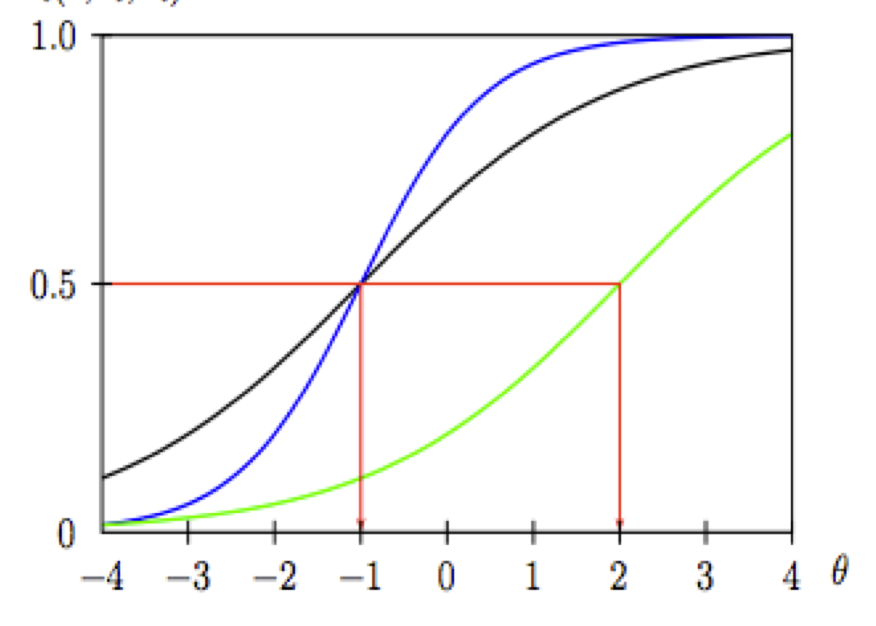
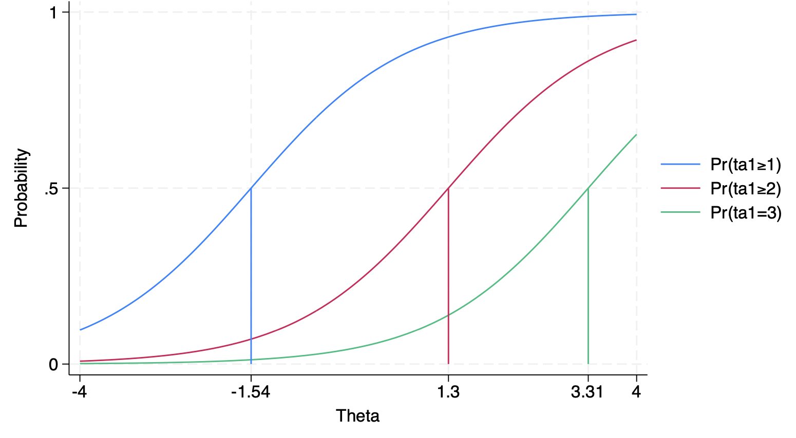

## This time

1. Item response theory (IRT) as a (multilevel, sometimes nonlinear) regression
2. 1PL, 2PL and graded response models in brms
3. A glimpse of cognitive models: the drift diffusion model

```{r, echo = FALSE}
library(tidyverse)
library(tidybayes)
library(brms)
library(modelr)
library(marginaleffects)
```

## IRT {.smaller}
Item response theory is no more than a regression model to predict item responses

Map items onto a latent construct. Unlike classical test theory (CTT), we assume:

1) items are not interchangeable (in CTT, more items = better reliability, whatever the items)
2) some items are better suited for different levels of the latent construct, e.g., hard vs. easy items
3) precision can differ across levels of the trait, so we focus on test information instead of one reliability number

## IRT, continued

- Attempts to simultaneously assess parameters of the item along with parameters of the person

- In this way it is similar to a multivariate/SEM model, a distributional model, and an MLM.

## What do these regression models look like?

Use different parameters to predict scores:
1. Difficulty
2. Discrimination
3. Guessing

Use different response options:
1. Logistic
2. Categorical (multinomial)
3. Graded response or partial credit (ordered categorical)
4. Ex-Gaussian and shifted lognormal distribution
5. Wiener drift diffusion model

## Item difficulty {.smaller}
Difficulty is one factor that influences performance (think hard math problems). We assume that those who have high levels of the construct (cog ability, neuroticism) are more likely to correctly answer hard problems than those that are low on the construct (theta).

An item's difficulty is defined as the trait level required for someone to have a probability of 50% correctly answering/endorsing.

An item with a difficulty of 0 (standardized values), person with a 0 theta has a 50:50 shot, whereas someone with a 1 theta will have a greater probability. For an item difficulty of 1.5, a person needs a 1.5 theta to have a 50:50 chance.

## brms easiness

In the following code we will estimate easiness rather than difficulty. It is just the reverse-scored version; the likelihood and model fit are the same.

Why? Because it fits the regression form (everything is added) without a minus sign (see below).

## Discrimination

How well items can differentiate a person who has high theta levels from a person who has low theta levels. This is related to how strongly the item is associated with the latent construct. E.g., is it a good item? Does it have construct irrelevant content?

Akin to item construct correlation. Or item factor loadings.

Positive discrimination means item is associated with the latent trait. Zero means there is no association. Negative means people high on theta are *less* likely to endorse the item (often a reverse-keyed item that wasn't recoded).

## 1-PL (Rasch Model)

$$ y_{pi}  \sim  \text{Bernoulli}(p_{pi})$$
$$ logit(p_{pi}) = \beta_0 + \theta_p + \delta_i $$

Here $\delta_i$ is item easiness; IRT texts usually write difficulty $b_i = -\delta_i$, i.e., $\theta_p - b_i$.

$$ \theta_p  \sim \text{Normal}(0, \sigma_\theta)$$
$$ \delta_i  \sim \text{Normal}(0, \sigma_\delta)$$

## IRT in brms {.smaller}
316 participants on 24 items of a questionnaire on verbal aggression. `r2` is our DV, measured Yes/No.
```{r}
library(lme4)
data("VerbAgg", package = "lme4")
IRT <- VerbAgg
IRT
```


## Fitting the 1PL

```{r}
irt.1 <- brm(
  family = brmsfamily("bernoulli", "logit"),
  r2 ~ 1 + (1 | item) + (1 | id),
  prior = c(prior(normal(0, 3), class = Intercept),
            prior(normal(0, 3), class = "sd", group = "item"),
            prior(normal(0, 3), class = "sd", group = "id")),
    iter = 2000, warmup = 1000, cores = 4, chains = 4,
      data = IRT,
      backend = "cmdstanr",
      file = "irt.1")
```


## `irt.1` summary

```{r}
summary(irt.1)
```

## Variables in `irt.1`

```{r}
get_variables(irt.1)
```

## Item Characteristic Curves (ICCs) {.smaller}
It plots the probability of endorsement as a function of latent theta. The sigmoid shape will be parallel across items in the 1pl.

We want to specify the relevant part of the parameter space for θ, averaging across people. Since the 1PL model has a logit link, most of theta will span roughly [−4, 4].

$$ logit(p_{pi}) = \beta_0 + \theta_p + \delta_i $$
$$ p(y = 1) = \text{logit}^{-1}(\beta_0 + \theta_p + \delta_i) $$
$$ \text{logit}^{-1} = \frac{\text{exp(x)}}{1+\text{exp(x)}}$$


## ICCs from the 1PL

```{r}
#| code-fold: true
irt.1 %>%
  spread_draws(b_Intercept, r_item[item,]) %>%
  ungroup() %>%
  tidyr::expand(nesting(.draw, b_Intercept, item, r_item), theta = seq(from = -6, to = 6, length.out = 100)) %>%
  mutate(p = inv_logit_scaled(b_Intercept + r_item + theta)) %>%
  group_by(theta, item) %>%
  summarise(p = mean(p)) %>%
  ggplot(aes(x = theta, y = p, color = item)) +
  geom_line() +
  labs(title = "ICCs",
       x = expression(theta~('ability on the logit scale')),
       y = expression(italic(p)(y==1)))
```


## Item Information Curves

Item information tells us how precisely an item measures θ at each level of θ. For a 1PL item it is $p(1-p)$, which is also the slope of the ICC: it peaks where the item's probability is .5.

The y axis is information. In 1PL models every IIC has the same shape, just shifted.


## IICs from the 1PL

```{r}
#| code-fold: true
irt.1 %>%
  spread_draws(b_Intercept, r_item[item,]) %>%
  ungroup() %>%
  tidyr::expand(nesting(.draw, b_Intercept, item, r_item), theta = seq(from = -6, to = 6, length.out = 100)) %>%
  mutate(p = inv_logit_scaled(b_Intercept + r_item + theta)) %>%
mutate(i = p * (1 - p)) %>%
  group_by(theta, item) %>%
  summarise(i = mean(i)) %>%
  ggplot(aes(x = theta, y = i, color = item)) +
  geom_line() +
  labs(title = "IICs",
       x = expression(theta~('ability on the logit scale')),
       y = "information")
```


## Test Information Curve

The test information curve sums the item information scores to provide a summary of information for the full scale. We can see what levels of theta may or may not be captured by the scale.

```{r}
#| code-fold: true
irt.1 %>%
  spread_draws(b_Intercept, r_item[item,]) %>%
  ungroup() %>%
  tidyr::expand(nesting(.draw, b_Intercept, item, r_item), theta = seq(from = -6, to = 6, length.out = 100)) %>%
  mutate(p = inv_logit_scaled(b_Intercept + r_item + theta)) %>%
mutate(i = p * (1 - p)) %>%
  group_by(theta, .draw) %>%
  summarise(sum_i = sum(i)) %>%
  group_by(theta) %>%
  summarise(i = median(sum_i)) %>%
  ggplot(aes(x = theta, y = i)) +
  geom_line() +
  labs(title = "The test information curve",
       x = expression(theta~('ability on the logit scale')),
       y = "information")
```


## 2PL (Two parameter logistic)

$$ y_{pi}  \sim  \text{Bernoulli}(p_{pi})$$
$$ \text{logit}(p_{pi}) =  \alpha_i(\theta_p + \delta_i) $$
Alpha is our discrimination parameter. In the 1PL it is held constant at 1. The i subscript indicates the discrimination parameter varies across the items, not across persons.

$$ \theta_p  \sim \text{Normal}(0, \sigma_\theta)$$
$$ \delta_i  \sim \text{Normal}(0, \sigma_\delta)$$

## What discrimination does

What does discrimination do?

The item characteristic curves are no longer parallel: steeper for more discriminating items.

The 1PL is like fixing all factor loadings to 1 in SEM; the 2PL relaxes that constraint. Item information becomes $\alpha_i^2 p(1-p)$.


## 2PL item curves





## Nonlinear models

While we are only predicting one parameter, p, we can think of these more complex models as similar to distributional models. That is because they will become non-linear!

All regression models are linear in that they consist of a set of linear combinations. b3 X1 * X2 is totally fine as interactions are linear in the parameters (they are just a parameter multiplied by a new variable X1 * X2, added to other parameters) even if they are not linear in the curves

Nonlinear models are widespread and can be thought of as anything not linear e.g., B1 * B2 or cos(b1 * X).


## The 2PL as a nonlinear model

In our 2PL, we have two parameters per our repeated item measure: difficulty and discrimination, which are related in a non-linear way.

$$ \text{logit}(p(y_{pi} = 1)) =  \alpha_i(\theta_p + \delta_i) $$
We will model these much like we do distributional models but instead of distributional parameters from the likelihood, it will be different parameters from our model


## Non-linear syntax
`delta` is the easiness-plus-ability part (it gets item *and* person effects); `logalpha` is the log of discrimination (item effects only), exponentiated so discrimination stays positive. They multiply, which is what makes the model nonlinear.
```{r}
#| code-fold: true
irt.2 <- brm(
  family = brmsfamily("bernoulli", "logit"),
  bf(r2 ~ exp(logalpha) * delta, # discrimination fixed >0
    delta ~ 1 + (1 |i| item) + (1 | id),
    logalpha ~ 1 + (1 |i| item),
    nl = TRUE),
  prior = c(prior(normal(0, 1.5), class = b, nlpar = delta),
            prior(normal(0, 1), class = b, nlpar = logalpha),
            prior(student_t(10, 0, 1), class = sd, nlpar = delta),
            prior(student_t(10, 0, 1), class = sd, nlpar = logalpha),
            prior(lkj(2), class = cor)),
    iter = 2000, warmup = 1000, cores = 4, chains = 4,
    data = IRT,
    backend = "cmdstanr",
    file = "irt.2",
  control = list(adapt_delta = .99))

```

## `irt.2` summary

```{r}
summary(irt.2)
```

## Variables in `irt.2`

Random effect estimates for each id__delta item__delta and item__alpha
```{r}
get_variables(irt.2)
```


## 2PL predicted probabilities

```{r}
#| code-fold: true
irt2.dat <- irt.2 %>%
  spread_draws(b_delta_Intercept, b_logalpha_Intercept, r_item__logalpha[item,],r_item__delta[item,]) %>%
  ungroup() %>%
  tidyr::expand(nesting(.draw, b_delta_Intercept, b_logalpha_Intercept, item, r_item__logalpha,r_item__delta), theta = seq(from = -6, to = 6, length.out = 100)) %>%
  mutate(p = inv_logit_scaled(exp(b_logalpha_Intercept + r_item__logalpha) * (b_delta_Intercept + theta + r_item__delta)))
irt2.dat
```

## ICCs from the 2PL

```{r}
#| code-fold: true
irt.2 %>%
  spread_draws(b_delta_Intercept, b_logalpha_Intercept, r_item__logalpha[item,],r_item__delta[item,]) %>%
  ungroup() %>%
  tidyr::expand(nesting(.draw, b_delta_Intercept, b_logalpha_Intercept, item, r_item__logalpha,r_item__delta), theta = seq(from = -6, to = 6, length.out = 100)) %>%
  mutate(p = inv_logit_scaled(exp(b_logalpha_Intercept + r_item__logalpha) * (b_delta_Intercept + theta + r_item__delta))) %>%
  group_by(theta, item) %>%
  summarise(p = mean(p)) %>%
  ggplot(aes(x = theta, y = p, color = item)) +
  geom_line() +
  labs(title = "ICCs",
       x = expression(theta~('ability on the logit scale')),
       y = expression(italic(p)(y==1)))
```


## IICs from the 2PL

```{r}
#| code-fold: true
irt.2 %>%
  spread_draws(b_delta_Intercept, b_logalpha_Intercept, r_item__logalpha[item,],r_item__delta[item,]) %>%
  ungroup() %>%
  tidyr::expand(nesting(.draw, b_delta_Intercept, b_logalpha_Intercept, item, r_item__logalpha,r_item__delta), theta = seq(from = -6, to = 6, length.out = 100)) %>%
  mutate(p = inv_logit_scaled(exp(b_logalpha_Intercept + r_item__logalpha) * (b_delta_Intercept + theta + r_item__delta))) %>%
  mutate(i = exp(b_logalpha_Intercept + r_item__logalpha)^2 * p * (1 - p)) %>%  # 2PL information: alpha^2 p (1 - p)
  group_by(theta, item) %>%
  summarise(i = mean(i)) %>%
  ggplot(aes(x = theta, y = i, color = item)) +
  geom_line() +
  labs(title = "IICs",
       x = expression(theta~('ability on the logit scale')),
       y = "information")
```


## Test information from the 2PL

```{r}
#| code-fold: true
irt.2 %>%
  spread_draws(b_delta_Intercept, b_logalpha_Intercept, r_item__logalpha[item,],r_item__delta[item,]) %>%
  ungroup() %>%
  tidyr::expand(nesting(.draw, b_delta_Intercept, b_logalpha_Intercept, item, r_item__logalpha,r_item__delta), theta = seq(from = -6, to = 6, length.out = 100)) %>%
  mutate(p = inv_logit_scaled(exp(b_logalpha_Intercept + r_item__logalpha) * (b_delta_Intercept + theta + r_item__delta))) %>%
  mutate(i = exp(b_logalpha_Intercept + r_item__logalpha)^2 * p * (1 - p)) %>%  # 2PL information: alpha^2 p (1 - p)
  group_by(theta, .draw) %>%
  summarise(sum_i = sum(i)) %>%
  group_by(theta) %>%
  summarise(i = mean(sum_i)) %>%
  ggplot(aes(x = theta, y = i)) +
  geom_line() +
  labs(title = "The test information curve",
       x = expression(theta~('ability on the logit scale')),
       y = "information")
```


## Graded Response Model

From a binary setting to one with multiple, ordered response categories, as with Likert items. As in the GLM lecture, we use the cumulative likelihood (SR calls it ordered logit).

We want to estimate the cutpoints where someone goes from answering a 1 to a 2 or a 2 to a 3, etc.

$$\text{logit}(Pr(y_i \leq k)) = \log\left(\dfrac{Pr(y_i \leq k)}{1-Pr(y_i \leq k)}\right)= \alpha_k$$

## Cut points in a graded response model




## The graded response model

$$\text{response}_{pi} \sim \operatorname{Ordered-logit}(\phi_{pi}, \boldsymbol\alpha)$$
$$\text{logit}(Pr(\text{response}_{pi} \leq k)) = \alpha_k - \phi_{pi}$$
$$\phi_{pi} = \theta_p + \delta_i$$

The $\alpha_k$ are the cut points (one fewer than the number of categories); $\phi$ holds the person and item effects.

## Fitting it

`resp` has three ordered options: no, perhaps, yes.

```{r}
irt.3 <- brm(
  family = brmsfamily("cumulative", "logit"),
  bf(resp ~ 1 + (1 | item) + (1 | id)),
  prior = c(prior("normal(0, 3)", class = "sd", group = "id"),
            prior("normal(0, 3)", class = "sd", group = "item")),
    iter = 2000, warmup = 1000, cores = 4, chains = 4,
    data = IRT,
    backend = "cmdstanr",
    file = "irt.3",
  control = list(adapt_delta = .99))
```

## `irt.3` summary

```{r}
summary(irt.3)
```

## Variables in `irt.3`

```{r}
get_variables(irt.3)
```


## Item-specific thresholds

```{r}
irt.3a <- brm(
  family = brmsfamily("cumulative", "logit"),
  bf(resp | thres(gr = item) ~ 1 + (1 | item) + (1 | id)),
  prior = c(prior("normal(0, 3)", class = "sd", group = "id"),
            prior("normal(0, 3)", class = "sd", group = "item")),
    iter = 2000, warmup = 1000, cores = 4, chains = 4,
    data = IRT,
    backend = "cmdstanr",
    file = "irt.3a",
  control = list(adapt_delta = .99))
```


## `irt.3a` summary

```{r}
summary(irt.3a)
```


## Variables in `irt.3a`
```{r}
get_variables(irt.3a)
```

## Thresholds by item

```{r}
#| code-fold: true
irt.3a %>%
gather_draws(b_Intercept[item,cut]) %>%
  group_by(item, cut) %>%
  summarise(mean = mean(.value),
            sd   = sd(.value),
            ll   = quantile(.value, probs = .025),
            ul   = quantile(.value, probs = .975)) %>%
   ggplot(aes(y = factor(cut), x = mean, xmin = ll, xmax = ul, group = item, color = item)) +
  geom_pointinterval(position = position_dodge(width = -0.5)) +xlab("theta")
```


## Adding discrimination

```{r}
#| code-fold: true
irt.4 <- brm(
  family = brmsfamily("cumulative", "logit"),
  bf(resp ~ 1 + (1 |i| item) + (1 | id),
  disc ~ 1 + (1 |i| item)),
  prior = c(prior("constant(1)", class = "sd", group = "id"),
            prior("normal(0, 3)", class = "sd", group = "item"),
            prior("normal(0, 1)", class = "sd", group = "item", dpar = "disc")),
    iter = 2000, warmup = 1000, cores = 4, chains = 4,
    data = IRT,
    backend = "cmdstanr",
    file = "irt.4",
  control = list(adapt_delta = .99))


```


## `irt.4` summary

```{r}
summary(irt.4)
```


## Pros and Cons of IRT
Pro: computerized adaptive testing (CAT); items and people on the same metric; precision can differ across the trait (rather than one reliability number); item banks; differential item functioning (DIF); linking separate tests

Con: more complex, and IRT and CTT scores are often very highly correlated anyway.

## Drift diffusion models

(1) the drift rate that describes a person’s tendency towards one or the other two alternatives
(2) the boundary separation that describes how much evidence needs to be accumulated until a decision is made
(3) the non-decision times that describes the time spent at processing the items and executing a motor response (i.e., everything non-decision related)
(4) the initial bias that describes persons tendency towards one of the two alternatives independent of the item properties

## The DDM, pictured


## The DDM in brms

A sketch of a drift diffusion model in brms, from Singmann's brms DDM tutorial (`speed_acc` is in {rtdists}):

```{r, eval = F}
formula <- bf(rt | dec(response2) ~ 0 + condition:frequency +
                (0 + condition:frequency|p|id),
               bs ~ 0 + condition + (0 + condition|p|id),
               ndt ~ 0 + condition + (0 + condition|p|id),
               bias ~ .5)

fit_wiener <- brm(formula,
                  data = speed_acc,
                  family = wiener(link_bs = "identity",
                                  link_ndt = "identity",
                                  link_bias = "identity"),
                  prior = prior, init = initfun,  # `prior` and `initfun` defined in the vignette
                  iter = 1000, warmup = 500,
                  chains = 4, cores = 4,
                  control = list(max_treedepth = 15))

```


