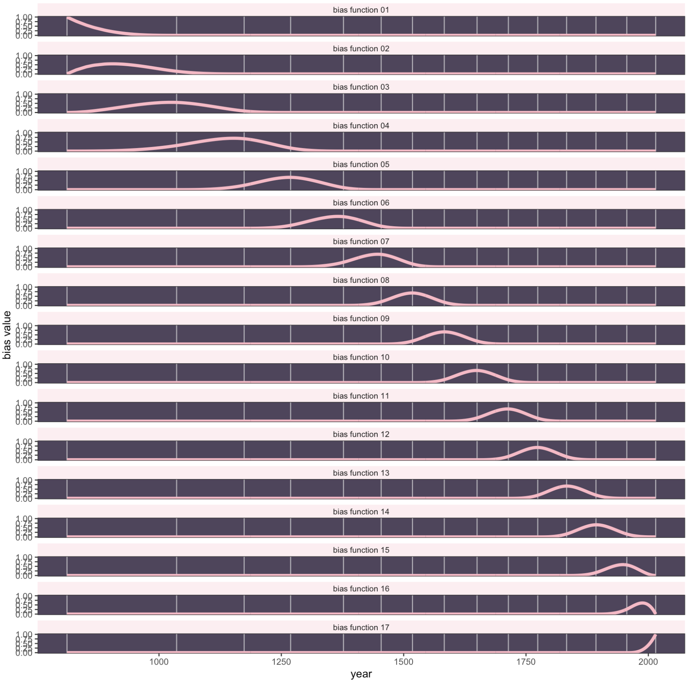

```{r, echo = FALSE, message = FALSE}
library(tidyverse)
library(tidybayes)
library(brms)
library(modelr)
library(marginaleffects)
```

## Why GAMs? {.smaller}
- Standard models are simple to understand (lines!), but fail to capture complex associations. There are downsides to polynomial models, as they end up making bad predictions at the ends

- We can do localized regression such as lowess, but it is nonparametric, so we can't do standard inference with it

- GAMs offer a middle ground: they can be fit to complex, nonlinear relationships and make good predictions in these cases, but we are still able to do inferential statistics and understand and explain the underlying structure of our models


## Generalized additive models {.smaller}
Similar to going from general linear model to generalized linear model. One more generalization.

$$y \sim ExpoFam(\mu, etc.)$$ $$E(y) = \mu$$

$$g(\mu) = b_0 + f(x_1) + f(x_2) \;...\;+f(x_p)$$

y still follows an exponential-family distribution, and μ is still related to the predictors via a link function. The key difference is that the linear predictor now incorporates smooth functions of at least some (possibly all) features, represented as f(x), and this will allow for nonlinear relationships between the features and the target variable y.

## When to use?

-   Take a look at your scatter plots: are they roughly linear?
-   Residuals vs fitted look off? QQ plot looking bent?
-   Transformations help in general but make edge cases even worse?
-   Polynomial not cutting it
-   You want to be as flexible as possible

## Simplified GAM

$$y = f(x) + \epsilon$$

Fitting $f$ means choosing a basis: a set of functions that $f$ is built from.

$$y = f(x) + \epsilon = \sum_{j=1}^{d}F_j(x)\beta_j + \epsilon$$ Each Fj is a basis function that is the transformed x depending on the type of basis considered, and the b are the corresponding regression coefficients.

## Basis functions

Think of the basis functions as, for example, the terms of a polynomial ($x$, $x^2$, …), though splines are more common.

$$f(x) = b_0 + w_1 B_{i, 1} + w_2 B_{i, 2} + w_3 B_{i, 3} + \dots$$ These basis functions become extra variables used to predict, though each of them is often "hidden" behind the overly bland name "basis function"


## From polynomials to splines {.smaller}
- We often want to fit flexible (non-linear) curves. What are options?

- polynomial, but they make bad predictions at the ends
- Localized regression such as lowess, but those are nonparametric
- Piecewise: fit segments to different parts of the data, with breakpoints (knots) at predetermined places. But what if you don't know where they go? What if you want the segments to connect?
- "Continuous piecewise" = splines.

## Triceps by age


```{r}
library(MultiKink)
library(ggplot2)
data("triceps")
 tri.age.plot <- ggplot(triceps, aes(x=age, y=triceps)) +
                 geom_point(alpha=0.55, color="black") +
                 theme_minimal()
 tri.age.plot
```


## Basis functions, formally

Basis function

$$y = \beta_0 + \beta_1 x +  \beta_2 (x-k_1)_{+}  + \beta_3 (x-k_2)_{+} + ... + \beta_6 (x-k_p)_{+} + \varepsilon$$

$$(x-k)_{+} =  \begin{cases}
                  0, & \text{ if  } x < k \\
                  x-k, & \text{ if  } x \geq k\\
                 \end{cases}$$

regression model is written as a linear combination of these basis functions

## The GAM middle ground

GAMs offer a middle ground: they can be fit to complex, nonlinear relationships and make good predictions in these cases, but we are still able to do inferential statistics and understand and explain the underlying structure of our models

## Cherry blossom data

```{r}
#| code-fold: true
#|
d <- read_csv("cherry_blossoms.csv")  # rethinking's cherry_blossoms; also at https://bayes27.netlify.app/cherry_blossoms.csv

d %>%
  ggplot(aes(x = year, y = doy)) +
  geom_point(color = "#ffb7c5", alpha = 1/2) +
  theme_bw() +
    theme(panel.background = element_rect(fill = "#4f455c"),
        panel.grid = element_blank())


```

## B-splines {.smaller}
$$f(x) = w_1 B_{i, 1} + w_2 B_{i, 2} + w_3 B_{i, 3} + \dots$$

- B-splines do not directly transform the predictor by squaring or cubing it.

- Instead they invent a series of entirely new, synthetic predictor variables. Each of these synthetic variables exists only to gradually turn a specific parameter on and off within a specific range of the real predictor variable.

- Each synthetic variable is called a basis function; the model estimates a weight ($w$) for each


## Knots

How wiggly do you want it?

```{r}
#| code-fold: true
d2 <-
  d %>%
  drop_na(doy)

num_knots <- 15
knot_list <- quantile(d2$year, probs = seq(from = 0, to = 1, length.out = num_knots))
knot_list
```

## Knots on the data

```{r}
#| code-fold: true
d %>%
  ggplot(aes(x = year, y = doy)) +
  geom_vline(xintercept = knot_list, color = "white", alpha = 1/2) +
  geom_point(color = "#ffb7c5", alpha = 1/2) +
  theme_bw() +
  theme(panel.background = element_rect(fill = "#4f455c"),
        panel.grid = element_blank())
```

## Linear basis

- We no longer use year directly as the predictor; we use basis functions built from the knots.

- The simplest (degree 1) basis functions are tents: each rises to 1 at its knot and falls back to 0 at the neighboring knots.

```{r, echo = FALSE}
library(splines2)
# redo the `B` splines

knot_list2 <- quantile(d2$year, probs = seq(from = 0, to = 1, length.out = 5))

B3 <- bSpline(d2$year,
        knots = knot_list2[-c(1, 5)],
        # degree 1: linear pieces rather than cubic
        degree = 1,
        intercept = TRUE)

b4 <-
  as_tibble(unclass(B3)) %>%
  set_names(str_c("B", seq_len(ncol(B3)))) %>%
  mutate(year = d2$year) %>%
  pivot_longer(starts_with("B"),
               names_to = "basis_function",
               values_to = "basis")

# plot
b4 %>%
  ggplot(aes(x = year, y = basis, group = basis_function)) +
  geom_vline(xintercept = knot_list2, color = "grey60", alpha = 1/2) +
  geom_line(color = "#ffb7c5", linewidth = 1.5) +
  ylab("basis value")
```


## Cubic basis functions

For degree 3 (cubic), four basis functions overlap at each point.

```{r}
#| code-fold: true
library(splines)

B <- bs(d2$year, knots = knot_list[-c(1, num_knots)],
        degree = 3,
        intercept = TRUE)

B %>% str()
knot_list[c(1, num_knots)]
```


## Basis functions across years

Basis functions turn on parameters over different ranges of the x-axis. Parameters influence the shape.
```{r}
#| code-fold: true
# wrangle a bit

b <-B %>%
  data.frame() %>%
  set_names(str_c(0, 1:9), 10:17) %>%
  bind_cols(dplyr::select(d2,year)) %>%
  pivot_longer(-year,
               names_to = "basis_function",
               values_to = "basis")

# plot
b %>%
  ggplot(aes(x = year, y = basis, group = basis_function)) +
  geom_vline(xintercept = knot_list, color = "white", alpha = 1/2) +
  geom_line(color = "#ffb7c5", alpha = 1/2, linewidth = 1.5) +
  ylab("basis value") +
  theme_bw() +
  theme(panel.background = element_rect(fill = "#4f455c"),
        panel.grid = element_blank())
```


## Each basis function

```{r}
#| code-fold: true
#|
b %>%
  mutate(basis_function = str_c("basis function ", basis_function)) %>%

  ggplot(aes(x = year, y = basis)) +
  geom_vline(xintercept = knot_list, color = "white", alpha = 1/2) +
  geom_line(color = "#ffb7c5", linewidth = 1.5) +
  ylab("basis value") +
  theme_bw() +
  theme(panel.background = element_rect(fill = "#4f455c"),
        panel.grid = element_blank(),
        strip.background = element_rect(fill = scales::alpha("#ffb7c5", .25), color = "transparent"),
        strip.text = element_text(size = 8, margin = margin(0.1, 0, 0.1, 0, "cm"))) +
  facet_wrap(~ basis_function, ncol = 1)
```


## Fitting the B-spline {.smaller}

The basis functions become predictors; the model estimates one weight per basis function.

$$
\begin{aligned}
\text{doy}_i &\sim \text{Normal}(\mu_i, \sigma) \\
\mu_i &= \alpha + \textstyle\sum_{k=1}^{17} w_k B_{k,i} \\
\alpha &\sim \text{Normal}(100, 10) \qquad w_k \sim \text{Normal}(0, 10) \qquad \sigma \sim \text{Exponential}(1)
\end{aligned}
$$

```{r}
d2 <- d2 %>% mutate(B = B)   # the 17 cubic basis functions as one matrix column
spline.1 <-
  brm(doy ~ 1 + B, family = gaussian, data = d2,
      prior = c(prior(normal(100, 10), class = Intercept),
                prior(normal(0, 10), class = b),
                prior(exponential(1), class = sigma)),
      iter = 2000, warmup = 1000, chains = 4, cores = 4, seed = 4,
      backend = "cmdstanr", file = "spline.1")
```

## The fitted spline

```{r}
#| code-fold: true
#| fig-height: 4
fitted(spline.1) %>%
  as_tibble() %>%
  bind_cols(d2) %>%
  ggplot(aes(x = year)) +
  geom_point(aes(y = doy), colour = "#ffb7c5", alpha = .5) +
  geom_ribbon(aes(ymin = Q2.5, ymax = Q97.5), fill = "grey40", alpha = .4) +
  geom_line(aes(y = Estimate)) +
  labs(y = "Day of first bloom") +
  theme_classic(base_size = 13)
```

The wiggliness comes from our choice of 15 knots. More knots = wigglier; fewer = smoother. Can the model choose?

## GAMs in brms: `s()` {.smaller}

`s(x)` builds a penalized spline basis (via {mgcv}). The basis weights get a hierarchical prior whose SD, `sds()`, is *estimated*: a small `sds` shrinks the weights toward a straight line. It's partial pooling again, this time for wiggliness.

```{r}
d2 <- d2 %>% mutate(year_c = (year - mean(year)) / 100)   # centuries from the mean year
gam.1 <-
  brm(doy ~ 1 + s(year_c), family = gaussian, data = d2,
      prior = c(prior(normal(100, 10), class = Intercept),
                prior(exponential(1), class = sigma)),
      iter = 2000, warmup = 1000, chains = 4, cores = 4, seed = 4,
      control = list(adapt_delta = .95),
      backend = "cmdstanr", file = "gam.1")
```

## `gam.1` summary {.smaller}

```{r}
summary(gam.1)
```

`sds(syear_c_1)` is the wiggliness. The `syear_c_1` coefficient is the linear part of the smooth; the rest of the curve lives in the penalized basis weights.

## The GAM fit

```{r}
#| code-fold: true
#| fig-height: 4
predictions(gam.1, newdata = datagrid(year_c = seq(min(d2$year_c), max(d2$year_c), length.out = 200))) %>%
  mutate(year = year_c * 100 + mean(d2$year)) %>%
  ggplot(aes(x = year)) +
  geom_point(data = d2, aes(y = doy), colour = "#ffb7c5", alpha = .5) +
  geom_ribbon(aes(ymin = conf.low, ymax = conf.high), fill = "grey40", alpha = .4) +
  geom_line(aes(y = estimate)) +
  labs(y = "Day of first bloom") +
  theme_classic(base_size = 13)
```

## More basis functions, same curve {.smaller}

Give the smooth 40 basis functions instead of the default 10:

```{r}
#| code-fold: true
gam.2 <-
  brm(doy ~ 1 + s(year_c, k = 40), family = gaussian, data = d2,
      prior = c(prior(normal(100, 10), class = Intercept),
                prior(exponential(1), class = sigma)),
      iter = 2000, warmup = 1000, chains = 4, cores = 4, seed = 4,
      control = list(adapt_delta = .95),
      backend = "cmdstanr", file = "gam.2")
spline.1 <- add_criterion(spline.1, "loo")
gam.1 <- add_criterion(gam.1, "loo")
gam.2 <- add_criterion(gam.2, "loo")
loo_compare(spline.1, gam.1, gam.2)
```

-   The three fits predict about equally well (differences within a couple of SEs). With `s()`, the penalty decides how wiggly the curve gets, so you don't have to agonize over the number of knots.
-   `gam.2` had a handful of divergent transitions: smooths with many basis functions can be hard to sample. Raise `adapt_delta` (e.g., .99) before trusting it.

## A fitted spline





