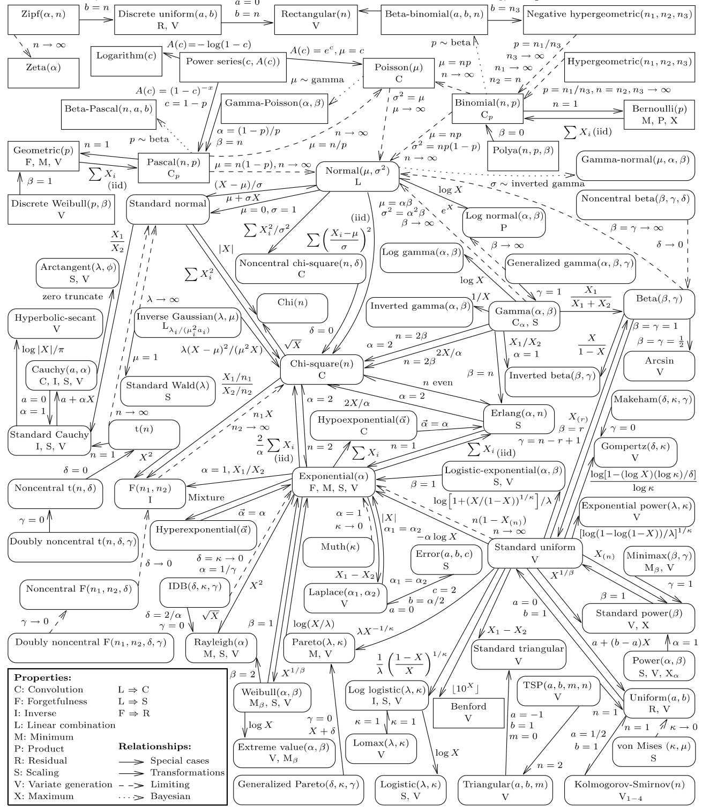

## This time

-   work with distributions other than Gaussian/t

-   introduce GLM families with link functions

-   logistic (binary) and multinomial (unordered categories) regression

-   next time: counts and ordered categories

## Generalized linear model

-   Used to describe different Data Generating Processes (DGPs) "likelihoods" other than the Gaussian (normal)

-   Need to use if we cannot use the Gaussian normal e.g. the range of Y is restricted (e.g. binary, count) and/or the variance of Y depends on the mean

-   Often there is a maximum entropy distribution that serves as the default likelihood, helping us guide our choice

## Why not just use `lm()`? {.smaller .nostretch}

Our example: does IQ, along with risky behavior, predict *not* dying prematurely (1 = no, 0 = yes)? Fit it both ways and compare each person's predicted probability:

```{r}
#| code-fold: true
#| fig-height: 3.3
#| fig-width: 6.5
#| out-width: "60%"
#| message: false
library(tidyverse)
mort0 <- read.csv("mortality.csv") %>%
  mutate(IQ_c = IQ - mean(IQ), risky_c = Risky.behavior - mean(Risky.behavior))
ols       <- lm(NOT.premature ~ IQ_c + risky_c, data = mort0)
logit_fit <- glm(NOT.premature ~ IQ_c + risky_c, family = binomial, data = mort0)
lpm <- tibble(logistic = fitted(logit_fit), lm = fitted(ols), impossible = fitted(ols) > 1)
ggplot(lpm, aes(logistic, lm, colour = impossible)) +
  geom_abline(linetype = "dashed") +
  geom_hline(yintercept = 1, colour = "firebrick") +
  geom_point(alpha = .6, size = 2) +
  scale_colour_manual(values = c(`FALSE` = "grey40", `TRUE` = "firebrick"), guide = "none") +
  labs(x = "Logistic regression: predicted Pr(not premature)", y = "lm(): predicted") +
  theme_classic(base_size = 14)
```

Each dot is a real person. `lm()` predicts a probability above 1 for `r sum(lpm$impossible)` of them (red, up to `r sprintf("%.2f", max(lpm$lm))`). That's not extrapolation: these are people in our data.

## What goes wrong with `lm()` {.smaller}

-   **Impossible predictions.** A straight line has no ceiling or floor, so it runs past 1 (or below 0) wherever the predictors push it far enough.
-   **Wrong where it matters most.** For the riskiest person, `lm()` predicts `r sprintf("%.2f", min(lpm$lm))`; the logistic model says `r sprintf("%.2f", min(lpm$logistic))`. The line can't bend, so it understates risk at one end and overstates survival at the other.
-   **Wrong variance.** A 0/1 outcome has variance p(1 − p), which changes with p, so `lm()`'s constant-variance assumption can't hold.
-   A GLM keeps the linear model but runs it through a link, so predictions stay in (0, 1) and bend where they should.

## Two ingredients

Need to:

1.  Specify your DGP distribution (likelihood)

2.  Specify a link function. We do this so we can continue to use a typical linear regression model. The relationship between the predictors and the outcome's mean is now non-linear, so we need to map it onto a linear one.

## Which likelihood? {.smaller}

::: {style="font-size: 80%"}
| Outcome | brms family | Link | exp(coefficient) |
|---------|-------------|------|------------------|
| Continuous | `gaussian`, `student` | identity | — |
| Binary, or *k* of *n* | `bernoulli`, `binomial` | logit | odds ratio |
| Unordered categories | `categorical` | logit | odds ratio vs. reference |
| Count, var ≈ mean | `poisson` | log | rate ratio |
| Count, var > mean | `negbinomial` | log | rate ratio |
| Count, extra zeros | `zero_inflated_*`, `hurdle_*` | log + logit | rate ratio + odds ratio |
| Ordered categories | `cumulative` | logit | cumulative odds ratio |
| Positive, skewed | `lognormal`, `Gamma` | log | multiplicative change |
:::

This week: binary and unordered categories. Next week (the next deck): counts and ordered categories.

## Binomial {.smaller}

$$y_i \sim \operatorname{Binomial} (n, p_i)$$

$$f(p_i) = \alpha + \beta (x_i - \bar x)$$

-   The f of the $f(p_i)$ is a link function, typically logistic

-   A link function is needed because the linear model on the right can produce any number, but $p_i$ must stay between 0 and 1. The link maps one onto the other, so the model never makes improper probability predictions (ie outside of 0-1)

## Link function for binomial

-   Our number of trials is a fixed N, (here it is 1, a Bernoulli) so we are predicting the probability of y. Probabilities are bounded between 0 and 1

-   Because our variables are not in probability units we need to "link" them via a function. The linear right side of the equation is not in the same units as the non-linear left side.

-   Instead of predicting probabilities directly, we are instead predicting the log of the odds. Other link functions: probit, negative inverse, cloglog.

## The logit link

-   We need to map the s shaped ogive that goes between (0,1) to linear looking line that falls between $(-\infty, \infty)$

-   Probabilities live in (0, 1); odds, $p/(1-p)$, live in (0, ∞); log odds live in (−∞, ∞).

-   Think of it as a transformation of Y-hats $$f(p) = logit(p) = log (\frac {p_{i}}{1-p_{i}})$$

-   Logits are now in a shape similar to a normal regression (ie a line/plane that goes to infinity)

## Odds, briefly {.smaller}

Odds = p / (1 − p): how many times more likely the event is to happen than not.

| p   | odds          | log odds |
|-----|---------------|----------|
| .50 | 1 (1 to 1)    | 0        |
| .80 | 4 (4 to 1)    | 1.39     |
| .20 | 0.25 (1 to 4) | −1.39    |
| .95 | 19 (19 to 1)  | 2.94     |

-   Odds run from 0 to ∞; log odds from −∞ to ∞, symmetric around p = .5.
-   In our data 83% did not die prematurely: odds ≈ .83 / .17 ≈ 4.9.

## Inverse link {.smaller}

-   It is easier to think of transforming the probabilities but computationally the right side of the equation usually gets transformed. Note these two are equivalent.

$$f(p_i) = \alpha + \beta (x_i - \bar x)$$

$$p_i = f^{-1}(\alpha + \beta (x_i - \bar x))$$

-   For the logit link, the inverse link is the logistic function: $p = \frac{1}{1 + e^{-x}}$ (`plogis()` or brms's `inv_logit_scaled()`). For the log link (counts), the inverse is `exp()`.

## Exponential Family

```{r}
#| code-fold: true
library(patchwork)
library(tidyverse)
library(brms)

E1 <- ggplot(data.frame(x = c(0, 15)), aes(x = x))  +
    stat_function(fun = dexp, args = list(rate = 0.2), geom = "area", fill = "blue", alpha = 0.25) + ggtitle("Exponential with lambda = 0.2")

G1 <- ggplot(data.frame(x = c(0, 5)), aes(x = x))  +
    stat_function(fun = dgamma, args=list(shape=2, rate=2), geom = "area", fill = "blue", alpha = 0.25) + ggtitle("Gamma with lambda = 2, kappa = 2")

p1 <- tibble(x = 0:12) %>%
  mutate(density = dpois(x, lambda = 3),
         strip   = "y %~% Poisson(lambda)") %>%
  ggplot(aes(x = x, y = density)) +
  geom_col(fill = "blue", alpha = 0.25,width = 1/2) +
  ggtitle("Poisson with lambda = 3")

b1 <-tibble(x = 0:10) %>%
  mutate(density = dbinom(x, size = 10, prob = .3),
         strip   = "y %~% Binomial(n, p)") %>%
  ggplot(aes(x = x, y = density)) +
  geom_col(fill = "blue", alpha = 0.25, width = 1/2) +
  ggtitle("binomial with N = 10, p = .3")

(E1 + G1) /
  (p1 + b1)
```

## Exponential family members {.smaller}

-   Exponential is constrained to be above zero. The waiting time until an event that happens at a constant rate follows an exponential. Used a lot in survival models.

-   Gamma is positive but its peak needn't be at zero. It arises as the sum of several exponential waiting times (e.g., time until the *k*th event). Common for skewed positive outcomes like reaction times or costs.

-   Poisson for counts, when p is low and the number of trials is large or unknown. It is the limit of the binomial as n → ∞ with np fixed. Used a lot in health, epidemiology and sport applications where counts are used.

## Distributions and their relationships



## brms families

gaussian, student, binomial, bernoulli, poisson, negbinomial, geometric, gamma, skew_normal, lognormal, shifted_lognormal, exgaussian, wiener, inverse.gaussian, exponential, weibull, frechet, Beta, dirichlet, von_mises, asym_laplace, gen_extreme_value, categorical, multinomial, cumulative, cratio, sratio, acat, hurdle_poisson, hurdle_negbinomial, hurdle_gamma, hurdle_lognormal, zero_inflated_binomial, zero_inflated_beta, zero_inflated_negbinomial, zero_inflated_poisson, and zero_one_inflated_beta

## Example

```{r}
#| code-fold: true
library(readr)
mortality <- read_csv("mortality.csv")  # also at https://josh-jackson.github.io/bayes27/mortality.csv

mortality <- mortality %>%
  mutate(IQ_c = IQ - mean(IQ)) %>%
  select(-'...1')
mortality

```

## Describing the data {.smaller}

-   300 people. `NOT.premature` = 1 if the person did *not* die prematurely (`premature.d` is the same thing as a label).
-   `IQ` is an Otis IQ score minus 100: add 100 to get the familiar IQ scale (mean ≈ `r round(mean(mortality$IQ) + 100)`). `IQ_c` centers it, so one unit is still one IQ point.

```{r}
library(psych)
describe(mortality)
```

## The model {.smaller}

$$\text{NOT.premature}_i  \sim \operatorname{Binomial} (1, p_i)$$\
or $$\text{NOT.premature}_i  \sim \operatorname{Bernoulli} (p_i)$$

where $\text{NOT.premature}_i = 1$ if person *i* did *not* die prematurely.

$$\operatorname{logit} (p_i)= \beta_0 + \beta_1 \text{IQ}_{c,i}$$

$$\beta_0\sim \operatorname{Normal} (0, ?) \qquad \beta_1\sim \operatorname{Normal} (0, ?)$$

## Intercept-only logistic model

```{r}
glm.1 <-
  brm(family = binomial,
      NOT.premature | trials(1) ~ 1,
      prior(normal(0, 10), class = Intercept),
      sample_prior = "yes",
      data = mortality,
      backend = "cmdstanr",
      file = "glm.1")
```

```{r, eval = FALSE}
glm.1 <-
  brm(family = bernoulli(),
      NOT.premature ~ 1,
      prior(normal(0, 10), class = Intercept),
      sample_prior = "yes",
      data = mortality,
      backend = "cmdstanr",
      file = "glm.1b")
```

## A Normal(0, 10) prior on the probability scale

```{r}
#| code-fold: true
prior_draws(glm.1) %>%
  mutate(p = inv_logit_scaled(Intercept)) %>%
  ggplot(aes(x = p)) +
  geom_density( )
```

## Why so extreme?

-   Before we see the data, do we think the event happens all the time or never?

-   Why is it distributed like that? Think of what logits are

## Logits vs probabilities


## Picking an intercept prior with `qlogis()` {.smaller}

Think on the probability scale, then convert. `qlogis()` is the logit; `plogis()` is the inverse logit.

-   Say I expect about 80% of people *not* to die prematurely, and I'd be surprised if it were below 50% or above 95%:

```{r}
qlogis(.80)            # center of the prior, on the logit scale
qlogis(c(.50, .95))    # the range I find plausible
```

-   So something like `normal(1.4, 0.75)` puts most of its mass between 0 and 2.9 logits, i.e., 50% to 95%. Check it with `plogis(rnorm(1e4, 1.4, .75))`.
-   Below we use the looser `normal(0, 2)`, centered on 50%, which still keeps the probabilities off the walls.

## A tighter intercept prior

```{r}
glm.2 <-
  brm(family = binomial,
      NOT.premature | trials(1) ~ 1,
      prior(normal(0, 2), class = Intercept),
      sample_prior = "yes",
      data = mortality,
      backend = "cmdstanr",
      file = "glm.2")
```

## The Normal(0, 2) prior on the probability scale

```{r}
#| code-fold: true
prior_draws(glm.2) %>%
  mutate(p = inv_logit_scaled(Intercept)) %>%
  ggplot(aes(x = p)) +
  geom_density( )
```

## Adding IQ

```{r}
glm.3 <-
  brm(family = bernoulli(link = "logit"),
      NOT.premature ~ 1 + IQ_c,
      prior = c(prior(normal(0, 2), class = Intercept),
      prior(normal(0, 3), class = b)),
      sample_prior = "yes",
      data = mortality,
      backend = "cmdstanr",
      file = "glm.3")
```

## Prior predictive lines (logit scale)

```{r}
#| code-fold: true
prior_draws(glm.3)%>%
  slice_sample(n = 100) %>%
  rownames_to_column("draw") %>%
  expand(nesting(draw, Intercept, b),
         a = c(-9, 9)) %>%
  mutate(d = Intercept + b * a) %>%
  ggplot(aes(x = a, y = d)) +
  geom_line(aes(group = draw), alpha = .4) +
  labs(x = "IQ (centered)",
       y = "logit(Not-premature death)") +
  coord_cartesian(ylim = c(-10, 10)) +
  theme_bw() +
  theme(panel.grid = element_blank())
```

## Prior predictive lines (probability scale)

scaled to probability

```{r}
#| code-fold: true
a <- seq(-9,9, .2)

prior_draws(glm.3)%>%
  slice_sample(n = 100) %>%
  rownames_to_column("draw") %>%
  expand(nesting(draw, Intercept, b), a) %>%
  mutate(d = inv_logit_scaled(Intercept + b * a)) %>%
  ggplot(aes(x = a, y = d)) +
  geom_line(aes(group = draw), alpha = .4) +
  labs(x = "IQ (centered)",
       y = "prob(Not-premature death)") +
  coord_cartesian(ylim = c(0, 1))
```

## A tighter slope prior

Instead of normal(0, 3), let's try normal(0, .5) for our prior

```{r}
#| code-fold: true

glm.4 <-
  brm(family = bernoulli(link = "logit"),
      NOT.premature ~ 1 + IQ_c,
      prior = c(prior(normal(0, 2), class = Intercept),
      prior(normal(0, .5), class = b)),
      sample_prior = "yes",
      data = mortality,
      backend = "cmdstanr",
      file = "glm.4")
```

## Prior predictive lines with Normal(0, .5)

```{r}
#| code-fold: true

a <- seq(-9,9, .2)

prior_draws(glm.4)%>%
  slice_sample(n = 100) %>%
  rownames_to_column("draw") %>%
  expand(nesting(draw, Intercept, b), a) %>%
  mutate(d = inv_logit_scaled(Intercept + b * a)) %>%
  ggplot(aes(x = a, y = d)) +
  geom_line(aes(group = draw), alpha = .4) +
  labs(x = "IQ (centered)",
       y = "prob(Not-premature death)") +
  coord_cartesian(ylim = c(0, 1))
```

## `glm.4` summary {.smaller}

```{r}
summary(glm.4)
```

The looser Normal(0, 3) prior (`glm.3`) gives the same IQ slope, `r sprintf("%.2f", fixef(glm.3)["IQ_c", "Estimate"])`: with 300 people, the data dominate either prior. The tighter prior mainly rules out absurd prior predictions.

## Where's σ?

-   Every Gaussian model so far had a `sigma`. The logistic summary doesn't. Why?
-   A Bernoulli outcome has one parameter, p. Once you know p, the variance is fixed: var(y) = p(1 − p).
-   So the spread isn't estimated separately; it comes along with the mean. That's what "the variance of Y depends on the mean" meant at the start. (Next week: for a Poisson count, the variance *equals* the mean.)

## Separation: a Bayesian bonus {.smaller}

When a predictor perfectly splits the 0s from the 1s, maximum likelihood breaks: the "best" slope is infinite.

```{r}
set.seed(7)
sep <- tibble(x = round(rnorm(20), 2)) %>% mutate(y = as.integer(x > 0))   # every x > 0 is a 1
coef(summary(glm(y ~ x, family = binomial, data = sep)))
```

```{r}
#| code-fold: true
glm.sep <-
  brm(family = bernoulli, y ~ 1 + x,
      prior = c(prior(normal(0, 2), class = Intercept),
                prior(normal(0, 2.5), class = b)),
      data = sep, backend = "cmdstanr", file = "glm.sep")
fixef(glm.sep)
```

-   `glm()` warns and returns a slope in the hundreds with an enormous SE. A weakly informative prior keeps it finite and says something honest: large, positive, uncertain.
-   Separation is common with small samples, rare outcomes, or many predictors.

## Interpreting logistic coefficients

Interpretation of coefficients is not straight forward. Easier to plot predictions.

Why are they hard?

1. Logits are not on a natural scale
2. The association is nonlinear on the probability scale
3. So the change in probability depends on where you start (and on the other predictors)

## From logits to probabilities by hand

```{r}
# posterior means from glm.4; ±3.73 = ±1 SD of IQ
tibble(b0   = fixef(glm.4)["Intercept", "Estimate"],
       b1   = fixef(glm.4)["IQ_c", "Estimate"],
       IQ_c = c(-3.73, -2, 0, 2, 3.73)) %>%
  mutate(logit_mu = b0 + b1 * IQ_c ) %>%
  mutate(Not_premature   = 1 / (1 + exp(-logit_mu))) %>%
  mutate(Not_premature2   = inv_logit_scaled(logit_mu))
```

Because IQ is centered, the intercept is the log odds at *average* IQ: plogis(`r sprintf("%.2f", fixef(glm.4)["Intercept", "Estimate"])`) = `r sprintf("%.3f", plogis(fixef(glm.4)["Intercept", "Estimate"]))`, the `IQ_c = 0` row.

## Predictions with marginaleffects

```{r}
library(marginaleffects)
predictions(glm.4, newdata = datagrid(IQ_c = c(-3.73, -2, 0, 2, 3.73)))
```

Same numbers as by hand (up to rounding), plus uncertainty: marginaleffects does the inverse link for every posterior draw.

## One slope, three scales {.smaller}

The IQ slope from `glm.4` on the logit and odds scales (the third scale, probability, is next):

```{r}
#| code-fold: true
draws_4 <- as_draws_df(glm.4)
tibble(scale = c("logit (log odds per IQ point)", "odds ratio, exp(b)"),
       median = c(median(draws_4$b_IQ_c), median(exp(draws_4$b_IQ_c))),
       lower  = c(quantile(draws_4$b_IQ_c, .025), quantile(exp(draws_4$b_IQ_c), .025)),
       upper  = c(quantile(draws_4$b_IQ_c, .975), quantile(exp(draws_4$b_IQ_c), .975))) %>%
  knitr::kable(digits = 3)
```

-   Exponentiate the **draws**, then summarize. Don't exponentiate the summary (the median survives, the mean and intervals don't always).
-   Each IQ point multiplies the odds of *not* dying prematurely by about `r sprintf("%.2f", median(exp(draws_4$b_IQ_c)))` (95% CI `r sprintf("%.2f", quantile(exp(draws_4$b_IQ_c), .025))` to `r sprintf("%.2f", quantile(exp(draws_4$b_IQ_c), .975))`, so 1, no change, is just inside).

## On the probability scale {.smaller}

```{r}
avg_slopes(glm.4)
```

-   On the probability scale: averaged over the sample, one more IQ point raises Pr(not premature) by about 1 percentage point.
-   Quick check, *divide by 4*: the logistic curve is steepest at p = .5, where the probability slope is b/4. Here `r sprintf("%.3f", fixef(glm.4)["IQ_c", "Estimate"])` / 4 ≈ `r sprintf("%.1f", 100 * fixef(glm.4)["IQ_c", "Estimate"] / 4)` points, the most one IQ point can ever move the probability. We're up near p = .83, so the real slope is smaller.

## The probability slope isn't constant {.smaller}

The logit slope is one number, but the probability slope depends on where you are on the curve:

```{r}
slopes(glm.4, newdata = datagrid(IQ_c = c(-7.46, 0, 7.46)))  # −2 SD, mean, +2 SD
```

```{r}
#| echo: false
sl_4 <- slopes(glm.4, newdata = datagrid(IQ_c = c(-7.46, 0, 7.46)))
pr_4 <- predictions(glm.4, newdata = datagrid(IQ_c = c(-7.46, 7.46)))
```

-   At low IQ (−2 SD), predicted survival is lower (about `r sprintf("%.2f", pr_4$estimate[1])`), where the logistic curve is steeper: about `r sprintf("%.1f", 100 * sl_4$estimate[1])` percentage points per IQ point.
-   At high IQ (+2 SD) it's closer to the ceiling (about `r sprintf("%.2f", pr_4$estimate[2])`), so each extra IQ point buys less (about `r sprintf("%.1f", 100 * sl_4$estimate[3])` points).
-   This is why "the effect" in a logistic regression needs a scale *and* a location.

## Odds ratios aren't risk ratios {.smaller}

Compare people 1 SD above and below average IQ, for every posterior draw:

```{r}
#| code-fold: true
library(tidybayes)
p_iq <- posterior_epred(glm.4, newdata = tibble(IQ_c = c(-3.73, 3.73)))   # draws x 2
iq_contrast <- tibble(p_lo = p_iq[, 1], p_hi = p_iq[, 2]) %>%
  mutate(`odds ratio`                    = (p_hi / (1 - p_hi)) / (p_lo / (1 - p_lo)),
         `risk ratio (p_hi / p_lo)`      = p_hi / p_lo,
         `risk difference (p_hi − p_lo)` = p_hi - p_lo)
iq_contrast %>%
  select(-p_lo, -p_hi) %>%
  pivot_longer(everything()) %>%
  group_by(name) %>%
  median_qi(value) %>%
  select(name, median = value, lower = .lower, upper = .upper) %>%
  knitr::kable(digits = 2)
```

```{r}
#| echo: false
iqc <- iq_contrast %>% summarise(across(everything(), median))
```

-   An odds ratio of `r sprintf("%.2f", iqc$"odds ratio")` sounds like "`r round(100 * (iqc$"odds ratio" - 1))`% more likely to survive." But the probability only rises by about `r round(100 * (iqc$"risk ratio (p_hi / p_lo)" - 1))`% (risk ratio), or `r round(100 * iqc$"risk difference (p_hi − p_lo)")` percentage points.
-   OR ≈ RR only when the outcome is rare. Here 83% survive, so they're far apart. Report probabilities (or their difference) alongside any odds ratio.

## A second predictor {.smaller}

Add risky behavior (centered):

$$\operatorname{logit}(p_i) = \beta_0 + \beta_1 \text{IQ}_{c,i} + \beta_2 \text{Risky}_{c,i} \qquad \beta_0 \sim \operatorname{Normal}(0, 2) \qquad \beta_1, \beta_2 \sim \operatorname{Normal}(0, 0.5)$$

```{r}
#| code-fold: true
mortality <- mortality %>% mutate(risky_c = Risky.behavior - mean(Risky.behavior))
glm.4r <-
  brm(family = bernoulli(link = "logit"),
      NOT.premature ~ 1 + IQ_c + risky_c,
      prior = c(prior(normal(0, 2), class = Intercept),
                prior(normal(0, .5), class = b)),
      data = mortality, backend = "cmdstanr", file = "glm.4r")
```

```{r}
fixef(glm.4r)
```

-   More risky behavior, lower odds of survival. And IQ's slope grows from `r sprintf("%.2f", fixef(glm.4)["IQ_c", "Estimate"])` to `r sprintf("%.2f", fixef(glm.4r)["IQ_c", "Estimate"])`: IQ and risky behavior are positively correlated (r = `r sprintf("%.2f", cor(mortality$IQ, mortality$Risky.behavior))`), so leaving risky behavior out masked part of IQ's association, just as in `lm()`.
-   Logistic coefficients can also shift when you add a predictor unrelated to the others (*non-collapsibility*). Compare models on predicted probabilities, not raw coefficients.

## IQ's effect depends on risky behavior {.smaller}

There's no interaction in `glm.4r`, but on the probability scale:

```{r}
cmp_r <- comparisons(glm.4r, variables = "IQ_c",
                     newdata = datagrid(risky_c = c(-6.94, 0, 6.94)))   # −2 SD, mean, +2 SD
cmp_r
```

-   One more IQ point is worth about `r sprintf("%.1f", 100 * cmp_r$estimate[1])` percentage points for low-risk people (already near the ceiling) and `r sprintf("%.1f", 100 * cmp_r$estimate[3])` for high-risk people, whose survival is lower and where the curve is steeper.
-   The logit slope is the same for everyone; the probability effect isn't. So with several predictors, "the effect of IQ" depends on where the others are set. `avg_comparisons(glm.4r, variables = "IQ_c")` averages over everyone in the sample.

## Trace plots

```{r}
plot(glm.4)
```

## Posterior predictive check

```{r}
pp_check(glm.4, type = "bars")
```

For a 0/1 outcome, compare the observed counts of 0s and 1s (bars) with the model's replications (points and intervals). The default density overlay isn't meaningful for binary data.

## A better check: calibration {.smaller .nostretch}

The bars only check that the model gets the overall share of 1s right, which almost any model with an intercept does. Calibration asks: when the model says 80%, do about 80% survive? Here for `glm.4r` (IQ + risky behavior):

```{r}
#| code-fold: true
#| fig-height: 3.4
#| fig-width: 5
#| out-width: "38%"
tibble(predicted = colMeans(posterior_epred(glm.4r)),
       observed  = mortality$NOT.premature) %>%
  mutate(bin = ntile(predicted, 6)) %>%
  group_by(bin) %>%
  summarise(n = n(), predicted = mean(predicted), observed = mean(observed),
            se = sqrt(observed * (1 - observed) / n)) %>%
  ggplot(aes(predicted, observed)) +
  geom_abline(linetype = "dashed") +
  geom_pointrange(aes(ymin = observed - 2 * se, ymax = observed + 2 * se)) +
  coord_equal(xlim = c(.4, 1), ylim = c(.4, 1)) +
  labs(x = "Predicted Pr(not premature), binned", y = "Observed proportion") +
  theme_classic(base_size = 14)
```

Sort people by predicted probability into 6 bins of 50. Points near the dashed line mean the predicted probabilities can be taken at face value.

## Does risky behavior help predict?

Same tools as last week, now for a binary outcome:

```{r}
glm.4  <- add_criterion(glm.4, "loo")
glm.4r <- add_criterion(glm.4r, "loo")
loo_compare(glm.4, glm.4r)
```

```{r}
#| echo: false
cmp_4r <- loo_compare(glm.4, glm.4r)
```

-   elpd_loo here is the summed log of the probability each model gave each person's *actual* outcome, for people it hadn't seen.
-   Adding risky behavior improves expected prediction by `r sprintf("%.1f", abs(cmp_4r[2, "elpd_diff"]))` (se `r sprintf("%.1f", cmp_4r[2, "se_diff"])`).

## Fitted probability curves

```{r}
#| code-fold: true

library(tidybayes)
library(modelr)

mortality %>%
   data_grid(IQ_c = seq_range(IQ_c, n = 100)) %>%
  add_epred_draws(glm.4) %>%
  sample_draws(100) %>%
    ggplot(aes(x = IQ_c)) +
  geom_line(aes(y = .epred, group = .draw),
            color = "grey50", linewidth = 1/3, alpha = 2/3) +
  geom_jitter(data = mortality, aes(y = NOT.premature),
              height = .03, width = 0, alpha = .3) +   # jitter so the 0s and 1s don't pile up
  coord_cartesian(ylim = c(-.05, 1.05))
```

## Distribution of predicted probabilities

```{r}
#| code-fold: true
predictions(glm.4) %>%
  ggplot() +
  geom_histogram(aes(estimate)) +
  labs(x = "Pr(outcome = 1)", y = "Count")

```

## Predicted probability with uncertainty

```{r}
#| code-fold: true

predictions(glm.4, newdata = datagrid(IQ_c = seq(from = min(mortality$IQ_c), to = max(mortality$IQ_c)))) %>%
  get_draws() %>%
    ggplot(aes(y = draw, x = IQ_c)) +
  stat_lineribbon(.width = c(.95), alpha = .4) + geom_point(data = mortality,
               aes(y = NOT.premature),
               alpha = .3)
```

## epred vs prediction vs linear prediction {.smaller}

-   When we want to create fitted values we run into an extra complication. Do we want to plot probabilities (original metric) or logits (our transformed metric)? We haven't had to deal with this before because we didn't do any transformations with a Gaussian normal.

-   epred: the expected value on the response scale (here, a probability)

-   linpred: the linear predictor on the link scale (here, log odds)

-   predict: a simulated new observation on the response scale (here, a 0 or 1)

## epred vs linpred

```{r}
#| code-fold: true
# posterior medians at -1 SD, the mean, and +1 SD of IQ
grid <- tibble(IQ_c = c(-3.73, 0, 3.73))

epred   <- grid %>% add_epred_draws(glm.4)   %>% median_qi(.epred)
linpred <- grid %>% add_linpred_draws(glm.4) %>% median_qi(.linpred)

tibble(IQ_c = grid$IQ_c, epred = epred$.epred, linpred = linpred$.linpred,
       `plogis(linpred)` = plogis(linpred))
```

## Linear predictor (logit scale)

```{r}
#| code-fold: true

mortality %>%
  data_grid(IQ_c = seq_range(IQ_c, n = 100)) %>%
  add_linpred_draws(glm.4) %>%
  sample_draws(100) %>%
    ggplot(aes(x = IQ_c)) +
  geom_line(aes(y = .linpred, group = .draw),
            color = "grey50", linewidth = 1/3, alpha = 2/3) +
  ylab("logit")
```

## Link vs response scale with marginaleffects

```{r}
predictions(glm.4, newdata = datagrid(IQ_c = c(-3.73, 0, 3.73)), type = "link")
```

```{r}
predictions(glm.4, newdata = datagrid(IQ_c = c(-3.73, 0, 3.73)))
```

## Same model, aggregated data {.smaller}

Data often come as counts: *k* successes out of *n* per group. Use `binomial` with `trials(n)`:

```{r}
mort_agg <- mortality %>% group_by(IQ_c) %>% summarise(k = sum(NOT.premature), n = n())
head(mort_agg, 3)
```

```{r}
#| code-fold: true
glm.4agg <-
  brm(family = binomial, k | trials(n) ~ 1 + IQ_c,
      prior = c(prior(normal(0, 2), class = Intercept),
                prior(normal(0, .5), class = b)),
      data = mort_agg, backend = "cmdstanr", file = "glm.4agg")
rbind(`one row per person (glm.4)` = fixef(glm.4)[, "Estimate"],
      `one row per IQ value (glm.4agg)` = fixef(glm.4agg)[, "Estimate"])
```

Same likelihood, same estimates (up to MCMC noise), `r nrow(mort_agg)` rows instead of 300. (LOO differs, though: it leaves out a whole group, not a person.)

## Writing it up {.smaller}

Report the coefficient on an interpretable scale *and* the probabilities. For example:

> Higher IQ was associated with higher odds of not dying prematurely (OR = `r sprintf("%.2f", median(exp(draws_4$b_IQ_c)))` per IQ point, 95% CI [`r sprintf("%.2f", quantile(exp(draws_4$b_IQ_c), .025))`, `r sprintf("%.2f", quantile(exp(draws_4$b_IQ_c), .975))`]). People 1 SD above average IQ had a predicted probability of `r sprintf("%.2f", median(iq_contrast$p_hi))` of not dying prematurely, versus `r sprintf("%.2f", median(iq_contrast$p_lo))` for people 1 SD below (difference = `r round(100 * median(iq_contrast$"risk difference (p_hi − p_lo)"))` percentage points, 95% CI [`r round(100 * quantile(iq_contrast$"risk difference (p_hi − p_lo)", .025))`, `r round(100 * quantile(iq_contrast$"risk difference (p_hi − p_lo)", .975))`]).

-   In the methods: the likelihood (Bernoulli), the link (logit), and the priors.
-   Show the fitted probability curve; it carries more than any single number.

## Multinomial logistic regression

-   When you are predicting more than two groups (aka categorical regression aka maximum entropy classifier)

-   Uses a categorical (multinomial) distribution, the generalization of the binomial. Like the binomial but with more events.

-   Need to construct K - 1 linear models for K events, similar to constructing number of dummy variables

## When would you use this?

-   Anytime people have more than two choices in some task. Trying to understand different demographic categories (race/ethnicity/gender identities/etc).

-   Eg, does 401k amount predict whether someone at 62 is retired/part time/ still working? You could use 401k amount as the DV, with two dummy variables as predictors, but what if you wanted to control for years worked? Very different interpretations depending on what is your DV.

## Multinomial example from SR

Career choice predicted by salary

```{r}
#| code-fold: true
#|
softmax <- function(...) { x <- c(...); exp(x) / sum(exp(x)) }  # same as rethinking::softmax

# simulate career choices among 500 individuals
n      <- 500           # number of individuals
income <- c(1, 2, 5)    # expected income of each career
score  <- 0.5 * income  # scores for each career, based on income

# next line converts scores to probabilities
p <- softmax(score[1], score[2], score[3])

# now simulate choice
# outcome career holds event type values, not counts
career <- rep(NA, n)  # empty vector of choices for each individual

# sample chosen career for each individual
set.seed(123)
# sample chosen career for each individual
for(i in 1:n) career[i] <- sample(1:3, size = 1, prob = p)

d <-
  tibble(career = career)

d %>%
  ggplot(aes(x = career)) +
  geom_bar()

```

## K − 1 linear models

For K categories, we estimate K -1 linear models. Think of a logistic regression where K = 2, we fit just a single regression model. Here we are doing multiple regression models simultaneously within the same model.

$$
\begin{aligned}
\text{career}_i &\sim \operatorname{Categorical}(\mathbf{p}) \qquad \mathbf{p} = \operatorname{softmax}(s_1, s_2, 0) \\
s_1 &= a_1 \qquad s_2 = a_2 \qquad \text{(career 3 is the reference, fixed at 0)} \\
a_1, a_2 &\sim \operatorname{Normal}(0, 1)
\end{aligned}
$$

softmax turns scores into probabilities: $p_k = e^{s_k} / \sum_j e^{s_j}$.

## Intercept-only categorical model

Intercept only model, where we will get two intercepts, because it is like we have two models

```{r}

glm.5 <-
  brm(family = categorical(link = logit, refcat = 3), # to match up with book
      career ~ 1,
      prior = c(prior(normal(0, 1), class = Intercept, dpar = mu1),
                prior(normal(0, 1), class = Intercept, dpar = mu2)),
      iter = 2000, warmup = 1000, cores = 4, chains = 4,
      data = d,
      backend = "cmdstanr",
      file = "glm.5")
```

## `glm.5` summary

```{r}
summary(glm.5)
```

## Back to probabilities

```{r}
#| code-fold: true
glm.5 %>%
  spread_draws(b_mu1_Intercept, b_mu2_Intercept) %>%
  mutate(b_mu3_Intercept = 0) %>%
  mutate(p1 = exp(b_mu1_Intercept) / (exp(b_mu1_Intercept) + exp(b_mu2_Intercept) + exp(b_mu3_Intercept)),
         p2 = exp(b_mu2_Intercept) / (exp(b_mu1_Intercept) + exp(b_mu2_Intercept) + exp(b_mu3_Intercept)),
         p3 = exp(b_mu3_Intercept) / (exp(b_mu1_Intercept) + exp(b_mu2_Intercept) + exp(b_mu3_Intercept))) %>%
  pivot_longer(p1:p3) %>%
  group_by(name) %>%
  mean_qi(value) %>%
  mutate_if(is.double, round, digits = 2)
```

The same probabilities that we simulated with!

## Interpreting the intercepts {.smaller}

```{r}
#| echo: false
b5 <- fixef(glm.5)[, "Estimate"]
```

Each intercept is the log odds of that career *versus career 3* (`refcat = 3`).

-   mu1_Intercept = `r sprintf("%.2f", b5["mu1_Intercept"])`, so the odds of career 1 vs. 3 are

```{r}
exp(fixef(glm.5)["mu1_Intercept", "Estimate"])
1 / exp(fixef(glm.5)["mu1_Intercept", "Estimate"])
```

Career 3 is about `r sprintf("%.1f", 1 / exp(b5["mu1_Intercept"]))` times as likely as career 1 (check: .74 / .10 from the last slide).

-   mu2_Intercept = `r sprintf("%.2f", b5["mu2_Intercept"])`: career 3 is about `r sprintf("%.1f", 1 / exp(b5["mu2_Intercept"]))` times as likely as career 2.

## Adding a predictor

```{r}
#| code-fold: true
set.seed(123)
b      <- c(-2, 0, 2)
family_income <- runif(n)


career <- rep(NA, n)  # empty vector of choices for each individual
for (i in 1:n) {
    score     <- 0.5 * (1:3) + b * family_income[i]
    p         <- softmax(score[1], score[2], score[3])
    career[i] <- sample(1:3, size = 1, prob = p)
}

d <-
  tibble(career = career) %>%
  mutate(family_income = family_income)
d

```

## Categorical model with a predictor

```{r}

glm.6 <-
  brm(family = categorical(link = logit, refcat = 3),
      career ~ 1 + family_income,
      prior = c(prior(normal(0, 1), class = Intercept, dpar = mu1),
                prior(normal(0, 1), class = Intercept, dpar = mu2),
                prior(normal(0, .5), class = b, dpar = mu1),
                prior(normal(0, .5), class = b, dpar = mu2)),
      iter = 2000, warmup = 1000, cores = 4, chains = 4,
      data = d,
      backend = "cmdstanr",
      file = "glm.6")

```

## `glm.6` summary

```{r}
summary(glm.6)
```

## A looser slope prior {.smaller}

The simulation's true slopes (relative to career 3) are −4 and −2, far out in the tails of a Normal(0, 0.5) prior. Try Normal(0, 1.5):

$$
\begin{aligned}
\text{career}_i &\sim \operatorname{Categorical}(\mathbf{p}_i) \qquad \mathbf{p}_i = \operatorname{softmax}(s_{1i}, s_{2i}, 0) \\
s_{ki} &= a_k + b_k\,\text{income}_i \qquad k = 1, 2 \\
a_k &\sim \operatorname{Normal}(0, 1) \qquad b_k \sim \operatorname{Normal}(0, 1.5)
\end{aligned}
$$

```{r}
#| code-fold: true
glm.6b <-
  brm(family = categorical(link = logit, refcat = 3),
      career ~ 1 + family_income,
      prior = c(prior(normal(0, 1), class = Intercept, dpar = mu1),
                prior(normal(0, 1), class = Intercept, dpar = mu2),
                prior(normal(0, 1.5), class = b, dpar = mu1),
                prior(normal(0, 1.5), class = b, dpar = mu2)),
      iter = 2000, warmup = 1000, cores = 4, chains = 4,
      data = d,
      backend = "cmdstanr",
      file = "glm.6b")
```

## Did we recover the truth? {.smaller}

```{r}
#| code-fold: true
mle <- nnet::multinom(relevel(factor(career), ref = "3") ~ family_income, data = d, trace = FALSE)
tibble(parameter = c("mu1_Intercept", "mu2_Intercept", "mu1_family_income", "mu2_family_income"),
       truth = c(-1, -0.5, -4, -2),
       `data alone (ML)` = c(coef(mle)[1, 1], coef(mle)[2, 1], coef(mle)[1, 2], coef(mle)[2, 2]),
       `glm.6: N(0, 0.5)` = fixef(glm.6)[parameter, "Estimate"],
       `glm.6b: N(0, 1.5)` = fixef(glm.6b)[parameter, "Estimate"]) %>%
  knitr::kable(digits = 2)
```

-   The tight prior pulled both slopes most of the way to 0, and the intercepts moved to compensate. The looser one gets career 2 right.
-   Career 1 is still off, and even the data alone can't pin it down: only `r sum(d$career == 1)` of 500 people chose it. Rare categories carry little information, so their estimates lean on the prior.
-   From here on we use `glm.6b`.

## Reading the slopes {.smaller}

```{r}
#| echo: false
b6 <- fixef(glm.6b)[, "Estimate"]
```

-   Each slope is the change in the log odds of that career *versus career 3* per unit of family income (0 to 1 here, so one unit is the whole range).
-   mu2_family_income = `r sprintf("%.2f", b6["mu2_family_income"])`: going from the lowest to the highest family income multiplies the odds of career 2 vs. career 3 by about `r sprintf("%.2f", exp(b6["mu2_family_income"]))`.
-   mu1_family_income = `r sprintf("%.2f", b6["mu1_family_income"])`: likewise for career 1 vs. 3 (about `r sprintf("%.2f", exp(b6["mu1_family_income"]))`), but with a wide interval.
-   Careful: a slope says how a career does *relative to the reference*, not whether its own probability goes up or down. Probabilities must sum to 1, so a category with a negative slope can still gain probability if the others fall faster. Plot the predicted probabilities (next).

## Predictions by family income

```{r}
#| code-fold: true
predictions(glm.6b, newdata = datagrid(family_income = c(0, .5, 1)))
```

One row per career (`group`) at each family income: the three probabilities at each income sum to 1.

## Predicted probabilities by career

```{r}
#| code-fold: true
plot_predictions(glm.6b, condition = "family_income", type = "response") + facet_wrap(~group)
```

## All careers on one plot

```{r}
#| code-fold: true
plot_predictions(glm.6b, condition = c("family_income", "group"), type = "response")
```

## On the link scale

```{r}
plot_predictions(glm.6b, condition = c("family_income", "group"), type = "link")
```

## Predictions with uncertainty

```{r}
#| code-fold: true
predictions(glm.6b, newdata = datagrid(family_income = seq(0, 1, by = .05))) %>%
  get_draws() %>%
  ggplot(aes(x = family_income, y = draw, group = group)) +
  stat_lineribbon(.width = .95, alpha = .4)
```

## Average predicted probabilities

```{r}
avg_predictions(glm.6b,type = "response")
```
## Two multinomial notes

-   **The reference category is bookkeeping.** Changing `refcat` changes every coefficient (they're all "vs. the reference") but not the predicted probabilities. Pick the reference that makes the comparisons you care about easy to read.
-   **Ordered categories?** If the categories have a natural order (never / sometimes / often), a multinomial model throws that order away. Use an ordinal (cumulative) model instead: next deck.

