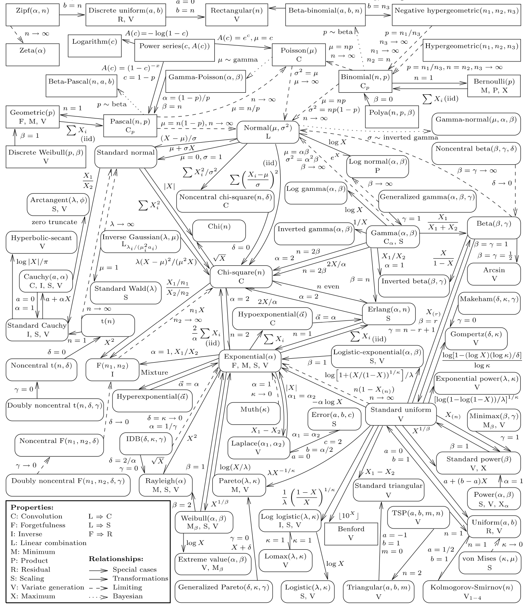
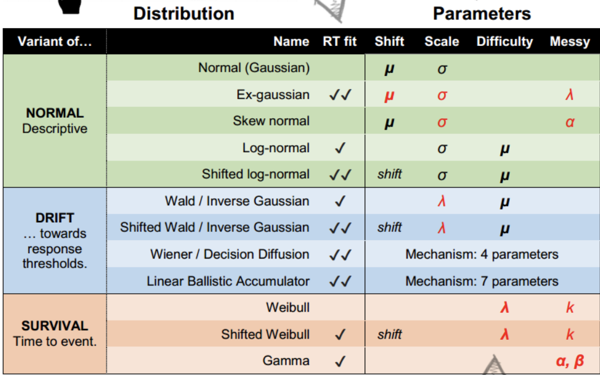
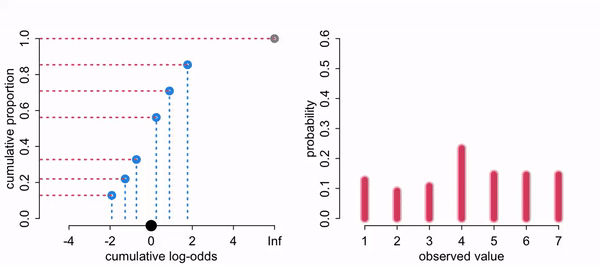
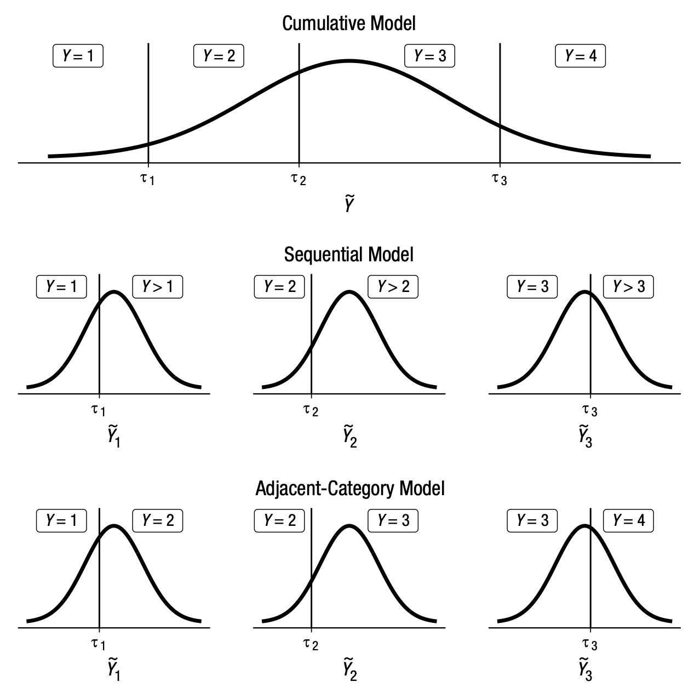

## This time

-   work with distributions other than gaussian/t

-   introduce glm families with link functions

## Generalized linear model

-   Used to describe different Data Generating Processes (DGPs) "likelihoods" other than the Gaussian (normal)

-   Need to use if we cannot use the Gaussian normal e.g. the range of Y is restricted (e.g. binary, count) and/or the variance of Y depends on the mean

-   Often there is a maximum entropy distribution that serves as the default likelihood, helping us guide our choice

## Two ingredients

Need to:

1.  Specify your DGP distribution (likelihood)

2.  Specify a link function. We do this so we can continue to use a typical linear regression model. Our parameters are now often non-linear, so we need to map a non-linear relationship to a linear one.

## Binomial {.smaller}

$$y_i \sim \operatorname{Binomial} (n, p_i)$$

$$f(p_i) = \alpha + \beta (x_i - \bar x)$$

-   The f of the $f(p_i)$ is a link function, typically logistic

-   Link function is needed because the shape of the Binomial distribution is determined by two parameters, neither equivalent to the Gaussian mean (which the right side of the equation is based on).

-   The link function also ensures the model doesn’t make improper probability predictions (ie outside of 0-1)

## Link function for binomial

-   Our number of trials is a fixed N, (here it is 1, a Bernoulli) so we are predicting the probability of y. Probabilities are bounded between 0 and 1

-   Because our variables are not in probability units we need to "link" them via a function. The linear right side of the equation is not in the same units as the non-linear left side.

-   Instead of predicting probabilities directly, we are instead predicting the log of the odds. Other link functions: probit, negative inverse, cloglog.

## The logit link

-   We need to map the s shaped ogive that goes between (0,1) to linear looking line that falls between $(-\infty, \infty)$

-   Probabilities live in (0, 1); odds, $p/(1-p)$, live in (0, ∞); log odds live in (−∞, ∞).

-   Think of it as a transformation of Y-hats $$f(p) = logit(p) = log (\frac {p_{i}}{1-p_{i}})$$

-   Logits are now in a shape similar to a normal regression (ie a line/plane that goes to infinity)

## Inverse link {.smaller}

-   It is easier to think of transforming the probabilities but computationally the right side of the equation usually gets transformed. Note these two are equivalent.

$$f(p_i) = \alpha + \beta (x_i - \bar x)$$

$$p_i = f^{-1}(\alpha + \beta (x_i - \bar x))$$

-   For the logit link, the inverse link is the logistic function: $p = \frac{1}{1 + e^{-x}}$ (`plogis()` or brms's `inv_logit_scaled()`). For the log link (counts), the inverse is `exp()`.

## Exponential Family

```{r}
#| code-fold: true
library(patchwork)
library(tidyverse)
library(brms)

E1 <- ggplot(data.frame(x = c(0, 15)), aes(x = x))  +
    stat_function(fun = dexp, args = list(rate = 0.2), geom = "area", fill = "blue", alpha = 0.25) + ggtitle("Exponential with lambda = 0.2")

G1 <- ggplot(data.frame(x = c(0, 5)), aes(x = x))  +
    stat_function(fun = dgamma, args=list(shape=2, rate=2), geom = "area", fill = "blue", alpha = 0.25) + ggtitle("Gamma with lambda = 2, kappa = 2")

p1 <- tibble(x = 0:12) %>%
  mutate(density = dpois(x, lambda = 3),
         strip   = "y %~% Poisson(lambda)") %>%
  ggplot(aes(x = x, y = density)) +
  geom_col(fill = "blue", alpha = 0.25,width = 1/2) +
  ggtitle("Poisson with lambda = 3")

b1 <-tibble(x = 0:10) %>%
  mutate(density = dbinom(x, size = 10, prob = .3),
         strip   = "y %~% Binomial(n, p)") %>%
  ggplot(aes(x = x, y = density)) +
  geom_col(fill = "blue", alpha = 0.25, width = 1/2) +
  ggtitle("binomial with N = 10, p = .3")

(E1 + G1) /
  (p1 + b1)
```

## Exponential family members {.smaller}

-   Exponential is constrained to be above zero. If probability of some event is constant, it tends to follow an exponential. Used a lot in survival models.

-   Gamma is positive but its peak needn't be at zero. It arises as the sum of several exponential waiting times (e.g., time until the *k*th event). Common for skewed positive outcomes like reaction times or costs.

-   Poisson for counts, when p is low and the number of trials is large or unknown. It is the limit of the binomial as n → ∞ with np fixed. Used a lot in health, epidemiology and sport applications where counts are used.

## Distributions and their relationships



## brms families

gaussian, student, binomial, bernoulli, poisson, negbinomial, geometric, gamma, skew_normal, lognormal, shifted_lognormal, exgaussian, wiener, inverse.gaussian, exponential, weibull, frechet, Beta, dirichlet, von_mises, asym_laplace, gen_extreme_value, categorical, multinomial, cumulative, cratio, sratio, acat, hurdle_poisson, hurdle_negbinomial, hurdle_gamma, hurdle_lognormal, zero_inflated_binomial, zero_inflated_beta, zero_inflated_negbinomial, zero_inflated_poisson, and zero_one_inflated_beta

## common RT distributions



## Example

```{r}
#| code-fold: true
library(readr)
mortality <- read_csv("mortality.csv")  # also at https://bayes27.netlify.app/mortality.csv

mortality <- mortality %>%
  mutate(IQ_c = IQ - mean(IQ)) %>%
  select(-'...1')
mortality

```

## Describing the data

```{r}
library(psych)
describe(mortality)
```

## The model

$$P.Death_i  \sim \operatorname{Binomial} (1, p_i)$$\
or $$P.Death_i  \sim \operatorname{Bernoulli} (p_i)$$

$$\operatorname{logit} (p_i)= \beta_0 + \beta_1*IQ_c $$ $$\beta_0\sim \operatorname{Normal} (0, ?)$$ $$\beta_1\sim \operatorname{Normal} (0, ?)$$

## Intercept-only logistic model

```{r}
glm.1 <-
  brm(family = binomial,
      NOT.premature | trials(1) ~ 1,
      prior(normal(0, 10), class = Intercept),
      sample_prior = "yes",
      data = mortality,
      backend = "cmdstanr",
      file = "glm.1")
```

```{r, eval = FALSE}
glm.1 <-
  brm(family = bernoulli(),
      NOT.premature ~ 1,
      prior(normal(0, 10), class = Intercept),
      sample_prior = "yes",
      data = mortality,
      backend = "cmdstanr",
      file = "glm.1b")
```

## Prior draws

```{r}
prior_draws(glm.1)
```

## A Normal(0, 10) prior on the probability scale

```{r}
#| code-fold: true
prior_draws(glm.1) %>%
  mutate(p = inv_logit_scaled(Intercept)) %>%
  ggplot(aes(x = p)) +
  geom_density( )
```

## Why so extreme?

-   Before we see the data, do we think the event happens all the time or never?

-   Why is it distributed like that? Think of what logits are

## Logits vs probabilities


## A tighter intercept prior

```{r}
glm.2 <-
  brm(family = binomial,
      NOT.premature | trials(1) ~ 1,
      prior(normal(0, 2), class = Intercept),
      sample_prior = "yes",
      data = mortality,
      backend = "cmdstanr",
      file = "glm.2")
```

## The Normal(0, 2) prior on the probability scale

```{r}
#| code-fold: true
prior_draws(glm.2) %>%
  mutate(p = inv_logit_scaled(Intercept)) %>%
  ggplot(aes(x = p)) +
  geom_density( )
```

## Adding IQ

```{r}
glm.3 <-
  brm(family = bernoulli(link = "logit"),
      NOT.premature ~ 1 + IQ_c,
      prior = c(prior(normal(0, 2), class = Intercept),
      prior(normal(0, 3), class = b)),
      sample_prior = "yes",
      data = mortality,
      backend = "cmdstanr",
      file = "glm.3")
```

## Prior draws for `glm.3`

```{r}
prior_draws(glm.3)

```

## Prior predictive lines (logit scale)

```{r}
#| code-fold: true
prior_draws(glm.3)%>%
  slice_sample(n = 100) %>%
  rownames_to_column("draw") %>%
  expand(nesting(draw, Intercept, b),
         a = c(-9, 9)) %>%
  mutate(d = Intercept + b * a) %>%
  ggplot(aes(x = a, y = d)) +
  geom_line(aes(group = draw), alpha = .4) +
  labs(x = "IQ",
       y = "logit(Not-premature death)") +
  coord_cartesian(ylim = c(-10, 10)) +
  theme_bw() +
  theme(panel.grid = element_blank())
```

## Prior predictive lines (probability scale)

scaled to probability

```{r}
#| code-fold: true
a <- seq(-9,9, .2)

prior_draws(glm.3)%>%
  slice_sample(n = 100) %>%
  rownames_to_column("draw") %>%
  expand(nesting(draw, Intercept, b), a) %>%
  mutate(d = inv_logit_scaled(Intercept + b * a)) %>%
  ggplot(aes(x = a, y = d)) +
  geom_line(aes(group = draw), alpha = .4) +
  labs(x = "IQ",
       y = "prob(Not-premature death)") +
  coord_cartesian(ylim = c(0, 1))
```

## `glm.3` summary

```{r}
summary(glm.3)
```

## A tighter slope prior

Instead of normal(0, 3), let's try normal(0, .5) for our prior

```{r}
#| code-fold: true

glm.4 <-
  brm(family = bernoulli(link = "logit"),
      NOT.premature ~ 1 + IQ_c,
      prior = c(prior(normal(0, 2), class = Intercept),
      prior(normal(0, .5), class = b)),
      sample_prior = "yes",
      data = mortality,
      backend = "cmdstanr",
      file = "glm.4")
```

## Prior predictive lines with Normal(0, .5)

```{r}
#| code-fold: true

a <- seq(-9,9, .2)

prior_draws(glm.4)%>%
  slice_sample(n = 100) %>%
  rownames_to_column("draw") %>%
  expand(nesting(draw, Intercept, b), a) %>%
  mutate(d = inv_logit_scaled(Intercept + b * a)) %>%
  ggplot(aes(x = a, y = d)) +
  geom_line(aes(group = draw), alpha = .4) +
  labs(x = "IQ",
       y = "prob(Not-premature death)") +
  coord_cartesian(ylim = c(0, 1))
```

## `glm.4` summary

```{r}
summary(glm.4)
```

## Interpreting logistic coefficients

Interpretation of coefficients is not straight forward. Easier to plot predictions.

Why are they hard?

1. Logits are not on a natural scale
2. The association is nonlinear on the probability scale
3. So the change in probability depends on where you start (and on the other predictors)

## From logits to probabilities by hand

```{r}
# posterior means from summary(glm.4); ±3.73 = ±1 SD of IQ
tibble(b0     = 1.62,
       b1     = .08,
       IQ_c = c(-6,-2,0,2,6)) %>%
  mutate(logit_mu = b0 + b1 * IQ_c ) %>%
  mutate(Not_premature   = 1 / (1 + exp(-logit_mu))) %>%
  mutate(Not_premature2   = inv_logit_scaled(logit_mu))
```

## Predictions with marginaleffects

```{r}
library(marginaleffects)
predictions(glm.4, newdata = datagrid(IQ_c = c(-3.73, -2, 0, 2, 3.73)))
```

## Trace plots

```{r}
plot(glm.4)
```

## Posterior predictive check

```{r}
pp_check(glm.4)
```

## Fitted probability curves

```{r}
#| code-fold: true

library(tidybayes)
library(modelr)

mortality %>%
   data_grid(IQ_c = seq_range(IQ_c, n = 100)) %>%
  add_epred_draws(glm.4) %>%
  sample_draws(100) %>%
    ggplot(aes(x = IQ_c)) +
  geom_line(aes(y = .epred, group = .draw),
            color = "grey50", linewidth = 1/3, alpha = 2/3) +
  ylim(0,1) + geom_point(data = mortality,
               aes(y = NOT.premature),
               alpha = .3)
```

## Distribution of predicted probabilities

```{r}
#| code-fold: true
predictions(glm.4) %>%
  ggplot() +
  geom_histogram(aes(estimate)) +
  labs(x = "Pr(outcome = 1)", y = "Count")

```

## Predicted probability with uncertainty

```{r}
#| code-fold: true

predictions(glm.4, newdata = datagrid(IQ_c = seq(from = min(mortality$IQ_c), to = max(mortality$IQ_c)))) %>%
  get_draws() %>%
    ggplot(aes(y = draw, x = IQ_c)) +
  stat_lineribbon(.width = c(.95), alpha = .4) + geom_point(data = mortality,
               aes(y = NOT.premature),
               alpha = .3)
```

## epred vs prediction vs linear prediction {.smaller}

-   When we want to create fitted values we run into an extra complication. Do we want to plot probabilities (original metric) or logits (our transformed metric)? We haven't had to deal with this prior because we didn't do any transformations with a Gaussian normal.

-   epred: the expected value on the response scale (here, a probability)

-   linpred: the linear predictor on the link scale (here, log odds)

-   predict: a simulated new observation on the response scale (here, a 0 or 1)

## The model, again

$$y_i \sim \operatorname{Binomial} (n, p_i)$$

$$logit(p_i) = \alpha + \beta (x_i - \bar x)$$

## epred vs linpred

```{r}
#| code-fold: true
epred <- mortality %>%
  data_grid(IQ_c, .model = mortality) %>%
  add_epred_draws(glm.4) %>%
  ungroup() %>%
  select(.epred)

linpred <-mortality %>%
  data_grid(IQ_c, .model = mortality) %>%
  add_linpred_draws(glm.4) %>%
  ungroup() %>%
  select(.linpred)

cbind(epred,linpred )
```

## Linear predictor (logit scale)

```{r}
#| code-fold: true

mortality %>%
  data_grid(IQ_c = seq_range(IQ_c, n = 100)) %>%
  add_linpred_draws(glm.4) %>%
  sample_draws(100) %>%
    ggplot(aes(x = IQ_c)) +
  geom_line(aes(y = .linpred, group = .draw),
            color = "grey50", linewidth = 1/3, alpha = 2/3) +
  ylab("logit")
```

## Link vs response scale with marginaleffects

```{r}
predictions(glm.4, newdata = datagrid(IQ_c = c(-3.73, 0, 3.73)), type = "link")
```

```{r}
predictions(glm.4, newdata = datagrid(IQ_c = c(-3.73, 0, 3.73)))
```

## Multinomial logistic regression

-   When you are predicting more than two groups (aka categorical regression aka maximum entropy classifier)

-   Uses a categorical (multinomial) distribution, the generalization of the binomial. Like the binomial but with more events.

-   Need to construct K - 1 linear models for K events, similar to constructing number of dummy variables

## When would you use this?

-   Anytime people have more than two choices in some task. Trying to understand different demographic categories (race/ethnicity/gender identities/etc).

-   Eg, does 401k amount predict whether someone at 62 is retired/part time/ still working? You could use 401k amount as the DV, with two dummy variables as predictors, but what if you wanted to control for years worked? Very different interpretations depending on what is your DV.

## Multinomial example from SR

Career choice predicted by salary

```{r}
#| code-fold: true
#|
softmax <- function(...) { x <- c(...); exp(x) / sum(exp(x)) }  # same as rethinking::softmax

# simulate career choices among 500 individuals
n      <- 500           # number of individuals
income <- c(1, 2, 5)    # expected income of each career
score  <- 0.5 * income  # scores for each career, based on income

# next line converts scores to probabilities
p <- softmax(score[1], score[2], score[3])

# now simulate choice
# outcome career holds event type values, not counts
career <- rep(NA, n)  # empty vector of choices for each individual

# sample chosen career for each individual
set.seed(123)
# sample chosen career for each individual
for(i in 1:n) career[i] <- sample(1:3, size = 1, prob = p)

d <-
  tibble(career = career) %>%
  mutate(career_income = ifelse(career == 3, 5, career))

d %>%
  ggplot(aes(x = career)) +
  geom_bar()

```

## K − 1 linear models

For K categories, we estimate K -1 linear models. Think of a logistic regression where K = 2, we fit just a single regression model. Here we are doing multiple regression models simultaneously within the same model.

## Intercept-only categorical model

Intercept only model, where we will get two intercepts, because it is like we have two models

```{r}

glm.5 <-
  brm(family = categorical(link = logit, refcat = 3), # to match up with book
      career ~ 1,
      prior = c(prior(normal(0, 1), class = Intercept, dpar = mu1),
                prior(normal(0, 1), class = Intercept, dpar = mu2)),
      iter = 2000, warmup = 1000, cores = 4, chains = 4,
      data = d,
      backend = "cmdstanr",
      file = "glm.5")
```

## `glm.5` summary

```{r}
summary(glm.5)
```

## Back to probabilities

```{r}
#| code-fold: true
glm.5 %>%
  spread_draws(b_mu1_Intercept, b_mu2_Intercept) %>%
  mutate(b_mu3_Intercept = 0) %>%
  mutate(p1 = exp(b_mu1_Intercept) / (exp(b_mu1_Intercept) + exp(b_mu2_Intercept) + exp(b_mu3_Intercept)),
         p2 = exp(b_mu2_Intercept) / (exp(b_mu1_Intercept) + exp(b_mu2_Intercept) + exp(b_mu3_Intercept)),
         p3 = exp(b_mu3_Intercept) / (exp(b_mu1_Intercept) + exp(b_mu2_Intercept) + exp(b_mu3_Intercept))) %>%
  pivot_longer(p1:p3) %>%
  group_by(name) %>%
  mean_qi(value) %>%
  mutate_if(is.double, round, digits = 2)
```

The same probabilities that we simulated with!

## Interpreting the intercepts

mu1_Intercept coefficient is -2.01. What does that mean? Remember refcat = 3

```{r}

exp(-2.01)
```

```{r}
1/exp(-2.01)
```

mu2_Intercept coefficient is -1.57. What does that mean?

```{r}
1/exp(-1.57)
```

## Adding a predictor

```{r}
#| code-fold: true
set.seed(123)
b      <- c(-2, 0, 2)
family_income <- runif(n)


career <- rep(NA, n)  # empty vector of choices for each individual
for (i in 1:n) {
    score     <- 0.5 * (1:3) + b * family_income[i]
    p         <- softmax(score[1], score[2], score[3])
    career[i] <- sample(1:3, size = 1, prob = p)
}

d <-
  tibble(career = career) %>%
  mutate(family_income = family_income)
d

```

## Categorical model with a predictor

```{r}

glm.6 <-
  brm(family = categorical(link = logit, refcat = 3),
      career ~ 1 + family_income,
      prior = c(prior(normal(0, 1), class = Intercept, dpar = mu1),
                prior(normal(0, 1), class = Intercept, dpar = mu2),
                prior(normal(0, .5), class = b, dpar = mu1),
                prior(normal(0, .5), class = b, dpar = mu2)),
      iter = 2000, warmup = 1000, cores = 4, chains = 4,
      data = d,
      backend = "cmdstanr",
      file = "glm.6")

```

## `glm.6` summary

```{r}
summary(glm.6)
```

## Predictions by family income

```{r}
#| code-fold: true
library(marginaleffects)
predictions(glm.6,by = "family_income")

```

## Predicted probabilities by career

```{r}
#| code-fold: true
plot_predictions(glm.6, condition = "family_income", type = "response") + facet_wrap(~group)
```

## All careers on one plot

```{r}
#| code-fold: true
plot_predictions(glm.6, condition = c("family_income", "group"), type = "response")
```

## On the link scale

```{r}
plot_predictions(glm.6, condition = c("family_income", "group"), type = "link")
```

## Predictions with uncertainty

```{r}
#| code-fold: true
predictions(glm.6,by = "family_income") %>%
  get_draws() %>%
  ggplot(aes(x = family_income, y = draw, group = group)) +
  stat_lineribbon(.width = .95, alpha = .4)
```

## Average predicted probabilities

```{r}
avg_predictions(glm.6,type = "response")
```

## Predictions for every row

```{r}
glm6_pred <- predictions(glm.6)
glm6_pred
```

## Mixtures

Often the DGP of our data are complex in that there could be multiple reasons someone responds the way they do. Mixture models allows us to fit more than one DGP at a time.

## Negative binomial / Gamma Poisson

-   Used for count data where the variance exceeds the mean, known as overdispersion. Often for the number of failures before a specified number of successes in Bernoulli trials

$$Y \sim \textrm{NB}(\mu,\phi)$$

## Gamma-Poisson

-   The Poisson distribution has just one parameter and presumes the mean/rate is associated with the spread. The negative binomial distribution relaxes this assumption and estimates the shape ($\phi$) of a gamma distribution (also an exponential family distribution) to describe the Poisson rates across cases.

-   The gamma distribution is a non-negative, continuous, two-parameter probability distribution.

## The NB as a mixture

$$
\begin{aligned}
Y_i &\sim \textrm{Poisson}(\theta_i) \\
\theta_i &\sim \textrm{Gamma}(\text{shape} = \phi,\ \text{rate} = \phi / \mu)
\end{aligned}
\quad \Longleftrightarrow \quad
Y_i \sim \textrm{NB}(\mu, \phi)
$$

-   $\mu$ is the mean count; $\phi$ (brms calls it `shape`) controls overdispersion
-   $\text{Var}(Y) = \mu + \mu^2/\phi$: small $\phi$ = lots of extra variance; as $\phi \to \infty$ it becomes a Poisson

## Many gamma shapes

-   There are multiple ways (different parameter definitions) to define the distribution. This gets confusing. For now just notice that many forms can be taken for the gamma distribution

```{r}
#| code-fold: true
ggplot(data = tibble(x = seq(from = 0, to = 60, by = .1)),
       aes(x = x, y = dgamma(x, shape = 1, rate = 1))) +
  geom_area() +
  scale_x_continuous(NULL) +
  scale_y_continuous(NULL, breaks = NULL) +
  coord_cartesian(xlim = c(0, 30))
```

## Gamma with shape = 10

```{r}
#| code-fold: true
ggplot(data = tibble(x = seq(from = 0, to = 60, by = .1)),
       aes(x = x, y = dgamma(x, shape = 10, rate = 1))) +
  geom_area() +
  scale_x_continuous(NULL) +
  scale_y_continuous(NULL, breaks = NULL) +
  coord_cartesian(xlim = c(0, 30))
```

## Roach example

-   y: number of roaches caught
-   roach1: pretreatment number of roaches
-   treatment: 1 = pest-control treatment, 0 = control
-   senior: 1 = building restricted to elderly residents
-   exposure2: number of days the traps were out (relative to the standard period)

## The roach data {.smaller}

```{r}
#| code-fold: true
roach <- read_csv("roaches.csv")  # also at https://bayes27.netlify.app/roaches.csv
roach
```

## Poisson

$$y_i  \sim \operatorname{Poisson} (\lambda_i)$$\
$$\log (\lambda_i)  = \beta_0 + \beta_1*X_i $$

```{r}

glm.7 <-
  brm(family = poisson,
      y ~ 0 + Intercept + roach1 + treatment,
      prior = c(prior(normal(2, 3), class = b, coef = "Intercept"),
                prior(normal(0, 1), class = b)),
      iter = 2000, warmup = 1000, cores = 4, chains = 4,
      sample_prior = "yes",
      data = roach,
      backend = "cmdstanr",
      file = "glm.7")


```

## Why 0 + Intercept?

-   With the default `1 + ...`, brms centers the predictors behind the scenes, so your `class = Intercept` prior is a prior for the outcome *at the predictors' means* (the summary converts it back for you).

-   With `0 + Intercept + ...`, the intercept is a regular coefficient (`class = b, coef = "Intercept"`), and its prior is for the outcome when all predictors are 0.

-   Use `0 + Intercept` when "all predictors = 0" is the value you can actually set a prior for (here: no roaches before, control group).

## `glm.7` summary

```{r}
summary(glm.7)
```

## Average predictions by treatment

```{r}
predictions(glm.7,by = "treatment")
```

## Predictions on the response scale

These predictions are on the original scale

```{r}
predictions(glm.7)
```

## Predictions on the link scale

These predictions are on the log link scale.

```{r}
predictions(glm.7, type = "link")
```

## Prediction by hand {.smaller}

```{r}
predictions(glm.7, newdata = datagrid(roach1 = 10, treatment = unique))
```

By hand, for roach1 = 10 in the treatment group:

```{r}
b <- fixef(glm.7)[, "Estimate"]
log_rate <- b["Intercept"] + b["roach1"] * 10 + b["treatment"] * 1
c(log_rate = log_rate, rate = exp(log_rate))
```

```{r}
predictions(glm.7, newdata = datagrid(roach1 = 10, treatment = unique), type = "link")
```

## Posterior predictive check: Poisson

```{r}
pp_check(glm.7)
```

## Predicted roaches by pretreatment count

```{r}
#| code-fold: true
predictions(glm.7,by = c("roach1", "treatment")) %>%
  get_draws() %>%
  mutate(treatment = as.factor(treatment)) %>%
  ggplot(aes(x = roach1, y = draw, color = treatment)) +
  stat_lineribbon(.width = .95, alpha = .4) + ylab("roaches")
```

## Treatment effect at the mean

```{r}
comparisons(glm.7, variables = "treatment", newdata = "mean")
```

## Offsets {.smaller}

Because we are counting numbers it assumes that the time period of counting is the same across observations. However, this may not be the case.

Luckily, the Poisson (and other count distributions) assume that the rate of events is constant in time (or space), so we can adjust for it.

$$\log(\lambda_i) = \log(\text{exposure}_i) + \beta_0 + \beta_1 x_i \quad\Rightarrow\quad \lambda_i = \text{exposure}_i \times e^{\beta_0 + \beta_1 x_i}$$

This is an offset: a term with its coefficient fixed at 1. Because of the log link, the offset is the **log** of exposure, `offset(log(exposure2))`, and the other coefficients are now about the rate per unit of exposure.

## Poisson with an offset

```{r}


glm.7o <-
  brm(family = poisson,
      y ~ 0 + Intercept + roach1 + treatment + offset(log(exposure2)),
      prior = c(prior(normal(2, 3), class = b, coef = "Intercept"),
                prior(normal(0, 1), class = b)),
      iter = 2000, warmup = 1000, cores = 4, chains = 4,
      data = roach,
      save_pars = save_pars(all = TRUE), # for loo(moment_match = TRUE) later
      backend = "cmdstanr",
      file = "glm.7o2")


```

## `glm.7o` summary

Note the offset is not a coefficient.

```{r}
summary(glm.7o)
```

## Predictions with the offset

```{r}
#| code-fold: true
predictions(glm.7o, newdata = datagrid(roach1 = unique, treatment = unique)) %>%
  get_draws() %>%
  mutate(treatment = as.factor(treatment)) %>%
  ggplot(aes(x = roach1, y = draw, color = treatment)) +
  stat_lineribbon(.width = .95, alpha = .4) + ylab("roaches")
```

## Posterior predictive check with the offset

```{r}
pp_check(glm.7o)
```

## Negative binomial model

Negative binomial (Gamma Poisson) model

```{r}
#| code-fold: true

glm.8 <-
  brm(family = negbinomial,
      y ~ 0 + Intercept + roach1 + treatment,
      prior = c(prior(normal(2, 3), class = b, coef = "Intercept"),
                prior(normal(0, 1), class = b)),
      iter = 2000, warmup = 1000, cores = 4, chains = 4,
      sample_prior = "yes",
      data = roach,
      backend = "cmdstanr",
      file = "glm.8")


```

## `glm.8` summary

```{r}
summary(glm.8)
```

## Posterior predictive check: NB

```{r}
predictions(glm.8,
            type = "prediction")  %>%
  get_draws() %>%
    sample_draws(50, draw = "drawid") %>%
    ggplot(aes(draw, group = drawid)) +
   geom_line(stat = "density", alpha = .1) +
  geom_density(aes(y))+
  theme_classic()
```

## NB with tighter priors

```{r}
#| code-fold: true


glm.8b <-
  brm(family = negbinomial,
      y ~ 0 + Intercept + roach1 + treatment,
      prior = c(prior(normal(2, 1), class = b, coef = "Intercept"),
                prior(normal(0, .5), class = b),
                prior(exponential(1), class = shape)),
      iter = 2000, warmup = 1000, cores = 4, chains = 4,
      sample_prior = "yes",
      data = roach,
      file = "glm.8b",
      backend = "cmdstanr")


```

## Posterior predictive check: `glm.8b`

```{r}
predictions(glm.8b,
            type = "prediction")  %>%
  get_draws() %>%
    sample_draws(50, draw = "drawid") %>%
    ggplot(aes(draw, group = drawid)) +
   geom_line(stat = "density", alpha = .1) +
  geom_density(aes(y))+ xlim(0,100) +
  theme_classic()
```

## `glm.8b` summary

```{r}
summary(glm.8b)
```

## NB vs Poisson predictions

```{r}
predictions(glm.8b,by = "treatment")
```

```{r}
predictions(glm.7,by = "treatment")
```

## Treatment effects compared {.smaller}

The treatment effect (on the count scale) from each model, for a household with average pretreatment roaches:

```{r}
comparisons(glm.8b, variables = "treatment", newdata = "mean")
```

```{r}
comparisons(glm.7, variables = "treatment", newdata = "mean")
```

## AME vs MEM {.smaller}

-   `avg_comparisons(model, variables = "treatment")`: compute the treatment effect for every row of the real data, then average. This is the **average marginal effect (AME)**.

-   `comparisons(model, variables = "treatment", newdata = "mean")`: set the other predictors to their means, then compute the effect once. This is the **marginal effect at the mean (MEM)**.

-   In a Gaussian model without interactions they're the same. With a nonlinear link they differ, because the effect on the count scale depends on where you start. AME is the usual default in economics, political science and epidemiology; emmeans-style output is closer to MEM.

## AME for the NB model

```{r}
avg_comparisons(glm.8b, variables = "treatment")
```

## Predictions for every row: NB {.smaller}

```{r}
predictions(glm.8b)
```

## Predictions for every row: Poisson {.smaller}

```{r}
predictions(glm.7)
```

## The roach data

```{r}
describe(roach)
```

## Predictions at chosen roach1 values: NB {.smaller}

```{r}
predictions(glm.8b, newdata = datagrid(roach1 = c(0,10,100,450), treatment = unique))
```

## Predictions at chosen roach1 values: Poisson {.smaller}

```{r}
predictions(glm.7, newdata = datagrid(roach1 = c(0,10,100,450), treatment = unique))
```

## NB predictions across roach1

```{r}
#| code-fold: true
predictions(glm.8b, newdata = datagrid(roach1 = seq(from = min(roach$roach1), to = max(roach$roach1)), treatment = unique)) %>%
  get_draws() %>%
  mutate(treatment = as.factor(treatment)) %>%
  ggplot(aes(x = roach1, y = draw, color = treatment)) +
  stat_lineribbon(.width = .95, alpha = .4) + ylab("roaches")
```

## Poisson predictions across roach1

```{r}
#| code-fold: true
predictions(glm.7,by = c("roach1", "treatment")) %>%
  get_draws() %>%
  mutate(treatment = as.factor(treatment)) %>%
  ggplot(aes(x = roach1, y = draw, color = treatment)) +
  stat_lineribbon(.width = .95, alpha = .4) + ylab("roaches")
```

## NB predictions, zoomed in

```{r}
#| code-fold: true
predictions(glm.8b,by = c("roach1", "treatment")) %>%
  get_draws() %>%
  mutate(treatment = as.factor(treatment)) %>%
  ggplot(aes(x = roach1, y = draw, color = treatment)) +
  stat_lineribbon(.width = .95, alpha = .4) + ylab("roaches") +ylim(0,400)
```

## Zero-inflated models

Use when there are different causes for the same observation -- a mixture of DGPs.

Lots of ways to get zero counts: Missed observation or the rate is low -- hard to distinguish.

```{r}
#| code-fold: true

prob_drink <- 0.2  # 20% of days
rate_work  <- 1    # average 1 manuscript per day
# sample one year of production
n <- 365
# simulate days monks drink
set.seed(365)
drink <- rbinom(n, 1, prob_drink)
# simulate manuscripts completed
y <- (1 - drink) * rpois(n, rate_work)

x <- rnorm(n = 365, mean = 3, sd = 1)


zips <-tibble(drink = factor(drink, levels = 1:0), y = y, x = x)

x2 <- zips$y + zips$x

zips <-tibble(drink = factor(drink, levels = 1:0), y = y, x = x2)


ggplot(data = zips, aes(x = y)) +
  geom_histogram(aes(fill = drink),
                 binwidth = 1, linewidth = 1/10, color = "grey92") +
  scale_fill_manual(values = 1:2) +
  xlab("Manuscripts completed") +
  theme(legend.position = "none")
```

## ZIP Zero inflated poisson

p = the probability of drinking (vs working). If drinking we know no manuscripts are created. If working, manuscripts still may not be created. The count is modeled as a Poisson with rate λ, and drinking as a Bernoulli with probability p

$$\operatorname{Pr} (y = 0 | p, \lambda)  = \operatorname{Pr} (\text{drink} | p) + \operatorname{Pr} (\text{work} | p) \times \operatorname{Pr} (0 | \lambda)$$ $$= p + (1 - p) \exp (- \lambda)$$

## Zeros and non-zeros

The probability of observing a zero is the probability that the monks drank, OR the probability that the monks worked AND failed to finish anything

$$\operatorname{Pr} (y | y > 0, p, \lambda) = $$ $$ \operatorname{Pr} (\text{drink} | p) (0) + \operatorname{Pr} (\text{work} | p) \operatorname{Pr} (y | \lambda) = (1 - p) \frac {\lambda^y \exp (- \lambda)}{y!}$$ Since drinking monks never produce, the expression above is the chance the monks both work (1-p), and finish y manuscripts

## The ZIP model

$$y_i  \sim \operatorname{ZIPoisson} (p_i, \lambda_i)$$ $$\operatorname{logit} (p_i)      = \alpha_p + \beta_p x_i$$ $$\log (\lambda_i)  = \alpha_\lambda + \beta_\lambda x_i$$

## Intercept-only ZIP

```{r}
glm.9 <-
  brm(family = zero_inflated_poisson,
      y ~ 1,
      prior = c(prior(normal(-1.5, 1), class = Intercept),
                prior(beta(2, 6), class = zi)),
      iter = 2000, warmup = 1000, chains = 4, cores = 4,
      data = zips,
      backend = "cmdstanr",
      file = "glm.9")
```

## Priors for zi

```{r}
#| code-fold: true
zip.priors <-
  c(prior(beta(1, 1), class = zi),
    prior(beta(2, 6), class = zi))
zip.priors %>%
  parse_dist(prior) %>%
  ggplot(aes(y = prior, dist = .dist, args = .args, fill = prior)) +
  stat_dist_halfeye(.width = .95) +
  scale_x_continuous("zi", breaks = c(0, .5, 1)) +
  ylab(NULL) +
  theme(legend.position = "none")
```

## `glm.9` summary {.smaller}

Note: when there are no predictors for zi, brms estimates zi directly as a probability (identity link). With predictors it uses a logit link, so interpret those coefficients like a logistic regression. The count part uses a log link: an Intercept of −.02 means λ = exp(−.02) ≈ .98 manuscripts per working day (we simulated 1).

```{r}
summary(glm.9)
```

## Predictors for both parts

Adding predictors. Do not necessarily need to have the same predictors for each process. One can predict the excess zeros, the other can predict the counts.

```{r}
glm.10 <-
  brm(bf(y ~ 1 + x,
      zi ~ 1 + x),
      family = zero_inflated_poisson,
      iter = 2000, warmup = 1000, chains = 4, cores = 4,
      data = zips,
      backend = "cmdstanr",
      file = "glm.10a")
```

## `glm.10` summary

```{r}
summary(glm.10)
```

Often the associations can go in different directions (because they are modeling different processes!)

## Plotting both parts

```{r}
#| code-fold: true
plot_predictions(glm.10, condition = "x") + labs(y = "expected manuscripts") +
plot_predictions(glm.10, condition = "x", dpar = "zi") + labs(y = "zi: Pr(structural zero)")
```


## Revisit roaches

```{r}
#| code-fold: true

glm.8c <-
  brm(family = zero_inflated_poisson,
      y ~ 0 + Intercept + roach1 + treatment + offset(log(exposure2)),
      prior = c(prior(normal(2, 1), class = b, coef = "Intercept"),
                prior(normal(0, .5), class = b),
                prior(beta(1, 1), class = zi)),
      iter = 2000, warmup = 1000, cores = 4, chains = 4,
      init = 0, # random inits up to ±2 make exp(b * 450 roaches) explode
      save_pars = save_pars(all = TRUE),
      data = roach,
      file = "glm.8c2",
      backend = "cmdstanr")
```

## `glm.8c` summary

```{r}
summary(glm.8c)
```

## Posterior predictive check: ZIP

```{r}
predictions(glm.8c,
            type = "prediction")  %>%
  get_draws() %>%
    sample_draws(50, draw = "drawid") %>%
    ggplot(aes(draw, group = drawid)) +
   geom_line(stat = "density", alpha = .1) +
  geom_density(aes(y))+ xlim(0,100) +
  theme_classic()
```

## Predictors for the zero part too

```{r}
#| code-fold: true

glm.8d <-
  brm(bf(y ~ 0 + Intercept + roach1 + treatment + offset(log(exposure2)),
         zi ~ 0 + Intercept + roach1 + treatment),
      family = zero_inflated_poisson,
      prior = c(prior(normal(2, 1), class = b, coef = "Intercept"),
                prior(normal(0, .5), class = b),
                prior(normal(0, 1), class = b, dpar = "zi")),
      iter = 2000, warmup = 1000, cores = 4, chains = 4,
      init = 0,
      save_pars = save_pars(all = TRUE),
      data = roach,
      file = "glm.8d3",
      backend = "cmdstanr")
```

## `glm.8d` summary

```{r}
summary(glm.8d)
```

## Posterior predictive check: `glm.8d`

```{r}
predictions(glm.8d,
            type = "prediction")  %>%
  get_draws() %>%
    sample_draws(100, draw = "drawid") %>%
    ggplot(aes(draw, group = drawid)) +
   geom_line(stat = "density", alpha = .1) +
  geom_density(aes(y))+ xlim(0,100) +
  theme_classic()
```

## `glm.8d` predictions

```{r}
#| code-fold: true
predictions(glm.8d,newdata = datagrid(roach1 = seq(from = min(roach$roach1), to = max(roach$roach1)), treatment = unique)) %>%
  get_draws() %>%
  mutate(treatment = as.factor(treatment)) %>%
  ggplot(aes(x = roach1, y = draw, color = treatment)) +
  stat_lineribbon(.width = .95, alpha = .4) + ylab("roaches")
```

## Log-transforming roach1

```{r}
#| code-fold: true

glm.8e <-
  brm(bf(y ~ 0 + Intercept + I(log(roach1 + 1)) + treatment + offset(log(exposure2)),
         zi ~ 0 + Intercept + I(log(roach1 + 1)) + treatment),
      family = zero_inflated_poisson,
      prior = c(prior(normal(2, 1), class = b, coef = "Intercept"),
                prior(normal(0, 1), class = b),
                prior(normal(0, 1), class = b, dpar = "zi")),
      iter = 2000, warmup = 1000, cores = 4, chains = 4,
      save_pars = save_pars(all = TRUE),
      data = roach,
      file = "glm.8e2",
      backend = "cmdstanr")
```

## `glm.8e` summary

```{r}
summary(glm.8e)
```

## Posterior predictive check: `glm.8e`

```{r}
predictions(glm.8e,
            type = "prediction")  %>%
  get_draws() %>%
    sample_draws(100, draw = "drawid") %>%
    ggplot(aes(draw, group = drawid)) +
   geom_line(stat = "density", alpha = .1) +
  geom_density(aes(y))+ xlim(0,100) +
  theme_classic()
```

## `glm.8e` predictions

Big difference from before

```{r}
#| code-fold: true
predictions(glm.8e,newdata = datagrid(roach1 = seq(from = min(roach$roach1), to = max(roach$roach1)), treatment = unique)) %>%
  get_draws() %>%
  mutate(treatment = as.factor(treatment)) %>%
  ggplot(aes(x = roach1, y = draw, color = treatment)) +
  stat_lineribbon(.width = .95, alpha = .4) + ylab("roaches")
```

## Compare roach models

To compare fairly, all three need the same offset. `glm.8b2` is `glm.8b` plus `offset(log(exposure2))`:

```{r}
#| code-fold: true
glm.8b2 <-
  brm(family = negbinomial,
      y ~ 0 + Intercept + roach1 + treatment + offset(log(exposure2)),
      prior = c(prior(normal(2, 1), class = b, coef = "Intercept"),
                prior(normal(0, .5), class = b),
                prior(exponential(1), class = shape)),
      iter = 2000, warmup = 1000, cores = 4, chains = 4,
      save_pars = save_pars(all = TRUE),
      data = roach,
      file = "glm.8b2",
      backend = "cmdstanr")
```

```{r}
loo_p   <- loo(glm.7o, moment_match = TRUE)
loo_nb  <- loo(glm.8b2, moment_match = TRUE)
loo_zip <- loo(glm.8e, moment_match = TRUE)
loo_compare(loo_p, loo_nb, loo_zip)
```

## Hurdle models/zero augmented

Also mixture (two-part) models, which specify one process for zero counts and another process for positive counts. The idea is that positive counts occur once a threshold is crossed.

## Intercept-only hurdle model

```{r}
glm.11 <-
  brm(family = hurdle_poisson,
      y ~ 1,
      prior = c(prior(normal(-1.5, 1), class = Intercept),
               prior(beta(1, 1), class = hu)),
      iter = 2000, warmup = 1000, chains = 4, cores = 4,
      data = zips,
      backend = "cmdstanr",
      file = "glm.11")

```

## `glm.11` summary

```{r}
summary(glm.11)
```

## Hurdle model with a predictor

```{r}

glm.11x <-
  brm(family = hurdle_poisson,
      y ~ 1 + x,
      prior = c(prior(normal(-1.5, 1), class = Intercept),
               prior(normal(-1.5, 3), class = b),
                prior(beta(1, 1), class = hu)),
      iter = 2000, warmup = 1000, chains = 4, cores = 4,
      data = zips,
      backend = "cmdstanr",
      file = "glm.11x3")

```

## `glm.11x` summary

```{r}
summary(glm.11x)
```

## Expected counts with tidybayes

```{r}
#| code-fold: true
zips %>%
  data_grid(x = seq_range(x, n = 30)) %>%
  add_epred_draws(glm.11x) %>%
  ggplot(aes(x = x, y = .epred)) +
  stat_lineribbon(.width = 0.95, alpha = .4)
```

## Both parts with marginaleffects

With {marginaleffects}

```{r}
#| code-fold: true

plot_predictions(
    glm.11x,
    condition = "x") +
    labs(y = "mu") +
plot_predictions(
    glm.11x,
    dpar = "hu",
    condition = "x") +
    labs(y = "hu")
```

## Posterior predictive check: hurdle

```{r}
pp_check(glm.11x)
```

## Ordinal regression models

likert scales never, sometimes, often no degree, hs degree, some college, college degree

discrete, defined order, distance between categories is unknown

common assumption is to treat differences as the same and model it as continuous with a Gaussian

## Log cumulative odds link

```{r}
#| code-fold: true

trolley <- read_csv("trolley.csv")  # rethinking's Trolley data; also at https://bayes27.netlify.app/trolley.csv
p2a <-
  trolley %>%
  ggplot(aes(x = response)) +
  geom_histogram()
p2a
```

## Proportion of each response

```{r}
#| code-fold: true
p2 <-
  trolley %>%
  count(response) %>%
  mutate(pr_k     = n / nrow(trolley),
         cum_pr_k = cumsum(pr_k)) %>%
  ggplot(aes(x = response, y = pr_k,
             fill = response)) +
  geom_line() +
  geom_point(shape = 21, color = "grey92",
             size = 2.5, stroke = 1) +
  scale_x_continuous(breaks = 1:8) +
  scale_y_continuous(" proportion",
                     limits = c(0, .35)) +
  theme(axis.ticks = element_blank(),
        axis.title.y = element_text(angle = 90),
        legend.position = "none")
p2
```

## Cumulative proportions

Cumulative proportion. Each choice is larger than the previous

```{r}
#| code-fold: true
p2b <-
  trolley %>%
  count(response) %>%
  mutate(pr_k     = n / nrow(trolley),
         cum_pr_k = cumsum(pr_k)) %>%
  ggplot(aes(x = response, y = cum_pr_k,
             fill = response)) +
  geom_line() +
  geom_point(shape = 21, color = "grey92",
             size = 2.5, stroke = 1) +
  scale_x_continuous(breaks = 1:8) +
  scale_y_continuous("cumulative proportion",
                     breaks = c(0, .25, .5, .75, 1), limits = c(0, 1.1)) +
  theme(axis.ticks = element_blank(),
        axis.title.y = element_text(angle = 90),
        legend.position = "none")

p2b
```

## Cumulative probability

-   The cumulative probability of a value is the probability of that value or any smaller value. In the context of ordered categories, the cumulative probability of 3 is the sum of the probabilities of 3, 2, and 1

## Probability of each response

Logic: - Probability of any observation is just counting up the cumulative proportion for values to the left of the cut points.

-   Thus option 1 refers to all values up to the first. Option two is values to the left of cut point 2 and to the right of cut point 1.

-   We will discuss in terms of the probability of x being less than or equal to some cut point.

-   Thus what is the probability of getting a 5? It is the cumulative probability of getting a 5 or less subtracting the cumulative probability of getting a 4 or less.

## Cumulative log odds {.smaller}

-   We can change this into cumulative log odds, where each response value is represented as a logit.

-   This changes the x axis, making different cut points that represent the cumulative log odds of getting a 4, for example.

-   The cumulative log odds of a 7 (or less) is infinite, because Pr(y ≤ 7) = 1. A logit of 0 means 50% of responses are at or below that cut point; −2 means about 12%; +2 means about 88%.

-   Why logits? Because we want to predict an ordered outcome.

## Estimating the cut points

We want to estimate the cutpoints

$$\text{logit}(Pr(y_i \leq k)) = \log\left(\dfrac{Pr(y_i \leq k)}{1-Pr(y_i \leq k)}\right)$$

```{r, echo = FALSE}
p2b +  scale_x_continuous(breaks = c(.5,2,3.5,5,6.6), labels = c(-2,-1,0,1,2)) + xlab("cumulative log odds") +  theme(axis.title.y = element_blank(), axis.text.y = element_blank())
```

## Cut points as intercepts

We will have intercepts for each response option, each on the log-cumulative-odds scale. Run through the inverse logit, they are the cumulative probability of each outcome.

$\alpha_k$ is an “intercept” unique to each possible outcome value k. We are estimating the probability of some response $y_i$ being equal to or less than some category. E.g., the cumulative probability of getting a 5? It is the proportion of values that are 5 or less.

$$\log \frac{\operatorname{Pr}(y_i \leq k)}{1 - \operatorname{Pr}(y_i \leq k)} = \alpha_k$$

## Cut points by hand

```{r}
#| code-fold: true
logit <- function(x) log(x / (1 - x))
trolley %>%
  count(response) %>%
  mutate(pr_k     = n / nrow(trolley),
         cum_pr_k = cumsum(n / nrow(trolley))) %>%
  mutate(alpha = logit(cum_pr_k) %>% round(digits = 2))
```

## Counts, proportions, and log-cumulative-odds

```{r}
#| code-fold: true

p1 <-
  trolley %>%
  ggplot(aes(x = response, fill = after_stat(x))) +
  geom_histogram(binwidth = 1/4) +
  scale_fill_gradient(low = "grey",
                       high = "black") +
  scale_x_continuous(breaks = 1:7) +
  theme(axis.ticks = element_blank(),
        axis.title.y = element_text(angle = 90),
        legend.position = "none")


p2 <-
  trolley %>%
  count(response) %>%
  mutate(pr_k     = n / nrow(trolley),
         cum_pr_k = cumsum(pr_k)) %>%
  ggplot(aes(x = response, y = pr_k,
             fill = response)) +
  geom_line() +
  geom_point(shape = 21, color = "grey92",
             size = 2.5, stroke = 1) +
  scale_x_continuous(breaks = 1:8) +
  scale_y_continuous(" proportion",
                     limits = c(0, .35)) +
  theme(axis.ticks = element_blank(),
        axis.title.y = element_text(angle = 90),
        legend.position = "none")


p3 <-
  trolley %>%
  count(response) %>%
  mutate(cum_pr_k = cumsum(n / nrow(trolley))) %>%
  filter(response < 7) %>%
  ggplot(aes(x = response, y = logit(cum_pr_k), fill = response)) +
  geom_line() +
  geom_point(shape = 21, colour = "grey92",
             size = 2.5, stroke = 1) +
  scale_x_continuous(breaks = 1:7, limits = c(1, 7)) +
  ylab("log-cumulative-odds") +
  theme(axis.ticks = element_blank(),
        axis.title.y = element_text(angle = 90),
        legend.position = "none")

(p1 | p2 | p3)

```

## The ordered logit model

$$
\begin{aligned}
\text{response}_i &\sim \operatorname{Ordered-logit}(\phi_i, \boldsymbol\alpha) \\
\text{logit}(Pr(\text{response}_i \leq k)) &= \alpha_k - \phi_i \\
\phi_i &= 0 \\
\alpha_k &\sim \operatorname{Normal}(0, 1.5)
\end{aligned}
$$

Where $\phi$ is a stand-in for regression terms. Right now it is an intercept-only model. The $\alpha_k$ are the cut points: one fewer than the number of categories (6 for a 1–7 scale).

## Fitting it in brms

SR calls this an ordered logit; brms calls it `family = cumulative` (with a logit link by default). Same model.

```{r}
glm.12 <-
  brm(family = cumulative,
      response ~ 1,
      prior(normal(0, 1.5), class = Intercept),
      iter = 2000, warmup = 1000, cores = 4, chains = 4,
      data = trolley,
      backend = "cmdstanr",
      file = "glm.12")
```

## `glm.12` summary

```{r}
#| code-fold: true
summary(glm.12)
```

## Back to cumulative proportions

Bring back into cumulative proportions

```{r}
#| code-fold: true
glm.12 %>%
gather_draws(b_Intercept[cut]) %>%
  mutate(.value = inv_logit_scaled(.value)) %>%
  group_by(cut) %>%
  summarise(mean = mean(.value),
            sd   = sd(.value),
            ll   = quantile(.value, probs = .025),
            ul   = quantile(.value, probs = .975))
```

## Adding predictors {.smaller}


$$\log \frac{\operatorname{Pr}(y_i \leq k)}{1 - \operatorname{Pr}(y_i \leq k)} =  \alpha_k - \phi_i $$


$$ \text{response}_i  \sim \operatorname{Ordered-logit} (\phi_i, \boldsymbol\alpha) $$

$$\phi_i = \beta x_i$$

Why is the linear model ϕ subtracted from each intercept? Because if we decrease the log-cumulative-odds of every outcome value k below the maximum, this necessarily shifts probability mass upwards towards higher outcome values. This way, a positive β value indicates that an increase in the predictor variable x results in an increase in the average response.


## Shifting the cut points




## The model with predictors

$$ \text{response}_i  \sim \operatorname{Ordered-logit} (\phi_i, \boldsymbol\alpha) $$
$$ \text{logit}(Pr(\text{response}_i \leq k)) = \alpha_k - \phi_i $$
$$  \phi_i = \beta_1 \text{action}_i + \beta_2 \text{contact}_i + \beta_3 \text{intention}_i + \beta_4 (\text{action}_i \times \text{intention}_i) + \beta_5 (\text{contact}_i \times \text{intention}_i) $$
$$\alpha_k               \sim \operatorname{Normal}(0, 1.5) $$
$$\beta_1, ..., \beta_5  \sim \operatorname{Normal}(0, 0.5) $$

## Fitting `glm.13`

```{r}
glm.13 <-
  brm(family = cumulative,
      response ~ 1 + action + contact + intention + intention:action + intention:contact,
      prior = c(prior(normal(0, 1.5), class = Intercept),
                prior(normal(0, 0.5), class = b)),
      iter = 2000, warmup = 1000, cores = 4, chains = 4,
      data = trolley,
      backend = "cmdstanr",
      file = "glm.13")
```

## `glm.13` summary

```{r}
summary(glm.13)
```

## Coefficient posteriors

```{r}
#| code-fold: true
glm.13 %>%
gather_draws(`b_action`,`b_contact`,`b_intention`,`b_action:intention`,`b_contact:intention`) %>%
  ggplot(aes(x = .value, y = .variable)) +
  geom_vline(xintercept = 0, alpha = 1, linetype = 3) +
  stat_gradientinterval(.width = .95, point_size = 1, shape = 1) +
  scale_x_continuous("marginal posterior", breaks = -5:0 / 4) +
  coord_cartesian(xlim = c(-1.4, 0))

```

## Predictions by action

```{r}
#| code-fold: true
plot_predictions(glm.13, condition = c("action", "group"))
```

## Predictions by contact

```{r}
#| code-fold: true
plot_predictions(glm.13, condition = c("contact", "group"))
```

## Predictions by intention

```{r}
#| code-fold: true
plot_predictions(glm.13, condition = c("intention", "group"))
```

## Average comparisons

```{r}
#| code-fold: true
library(marginaleffects)
avg_comparisons(glm.13)
```

## Action's effect, by intention {.smaller}

How much does action change the probability of each response, with and without intention?

```{r}
#| code-fold: true
avg_comparisons(glm.13, variables = "action", by = "intention")
```

## Predicted response distributions: action × intention

Each condition should add up to 1

```{r}
#| code-fold: true
trolley %>%
  data_grid(action = c(0,1), intention = c(0,1), contact = .5) %>%
  mutate(x = interaction(action, intention)) %>%
  mutate(x = fct_recode(as.factor(x),
                      No_A_No_I = "0.0",
                      No_A_Y_I = "0.1",
                      Y_A_No_I = "1.0",
                      Y_A_Y_I = "1.1")) %>%
  add_epred_draws(glm.13) %>%
  ggplot(aes(x = .epred, y = .category, fill = x)) +
  stat_slab()
```

## Predicted response distributions: contact × intention

```{r}
#| code-fold: true
trolley %>%
  data_grid(action = .5, intention = c(0,1), contact = c(0,1)) %>%
  mutate(x = interaction(contact, intention)) %>%
  mutate(x = fct_recode(as.factor(x),
                      No_C_No_I = "0.0",
                      Y_C_No_I = "1.0",
                      No_C_Y_I = "0.1",
                      Y_C_Y_I = "1.1")) %>%
  add_epred_draws(glm.13) %>%
  ggplot(aes(x = .epred, y = .category, fill = x)) +
  stat_slab()
```

## Cumulative probabilities by condition

Think as cumulative probability cut points

```{r}
#| code-fold: true
nd <-
  trolley %>%
  distinct(action, contact, intention) %>%
  mutate(combination = str_c(action, contact, intention, sep = "_"))

fit.13 <-
  fitted(glm.13,
         newdata = nd,
         summary = F)

fit.13 <-
  rbind(fit.13[, , 1],
        fit.13[, , 2],
        fit.13[, , 3],
        fit.13[, , 4],
        fit.13[, , 5],
        fit.13[, , 6],
        fit.13[, , 7]) %>%
  data.frame() %>%
  set_names(pull(nd, combination)) %>%
  mutate(response = rep(1:7, each = n() / 7),
         iter     = rep(1:4000, times = 7)) %>%
  pivot_longer(-c(iter, response),
               names_to = c("action", "contact", "intention"),
               names_sep = "_",
               values_to = "pk") %>%
  mutate(intention = intention %>% as.integer())

levels <- c("action=0, contact=0", "action=1, contact=0", "action=0, contact=1")

  fit.13 %>%
  filter(response < 7) %>%
  mutate(facet = factor(str_c("action=", action, ", contact=", contact),
                        levels = levels)) %>%
  group_by(iter, facet, intention) %>%
  arrange(iter, facet, intention, response) %>%
  mutate(probability = cumsum(pk)) %>%
  ungroup() %>%
  nest(data = -iter) %>%
  slice_sample(n = 50) %>%
  unnest(data) %>%

  ggplot(aes(x = intention, y = probability)) +
  geom_line(aes(group = interaction(iter, response), color = probability),
            alpha = 1/10) +
  geom_point(data = trolley %>%
               group_by(intention, contact, action) %>%
               count(response) %>%
               mutate(probability = cumsum(n / sum(n)),
                      facet = factor(str_c("action=", action, ", contact=", contact),
                                     levels = levels)) %>%
               filter(response < 7),) +
  scale_x_continuous("intention", breaks = 0:1) +
  scale_y_continuous(breaks = c(0, .5, 1), limits = c(0, 1)) +
  theme(legend.position = "none") +
  facet_wrap(~facet)
```

## Unequal variances

The parameter related to latent variances is called disc (short for discrimination).

```{r}
glm.14 <-
  brm(family = cumulative,
      bf(response ~ 1 + action + contact + intention + intention:action + intention:contact) +
      lf(disc ~ 0 + action + contact + intention + intention:action + intention:contact, cmc = FALSE),
      prior = c(prior(normal(0, 1.5), class = Intercept),
                prior(normal(0, 0.5), class = b)),
      iter = 2000, warmup = 1000, cores = 4, chains = 4,
      data = trolley,
      backend = "cmdstanr",
      file = "glm.14")
```

## `glm.14` summary

```{r}
summary(glm.14)
```


## Predicted response distributions with unequal variances
```{r}
trolley %>%
  data_grid(action = .5, intention = c(0,1), contact = c(0,1)) %>%
  mutate(x = interaction(contact, intention)) %>%
  mutate(x = fct_recode(as.factor(x),
                      No_C_No_I = "0.0",
                      Y_C_No_I = "1.0",
                      No_C_Y_I = "0.1",
                      Y_C_Y_I = "1.1")) %>%
  add_epred_draws(glm.14) %>%
  ggplot(aes(x = .epred, y = .category, fill = x)) +
  stat_slab()
```


## IRT models (2pl)

When we have multiple items we can fit latent (IRT) models

$$y_{pi} \sim \operatorname{Bernoulli} (p_{pi})$$

$$\text{logit}(p_{pi}) = \alpha_i(\theta_p + \xi_i) = \alpha_i\theta_p + \alpha_i\xi_i$$

$\theta_p$ = person *p*'s ability, $\xi_i$ = item *i*'s easiness, $\alpha_i$ = item *i*'s discrimination. More in HW 13.

## Category specific effects

Do you want to assume similar effects of your predictors across the range of your DV? Or does the effect occur only as certain differences between the categories?

For example, predicting educational attainment. Negative peer influences may have a large effect at graduating HS but little effect compared to whether or not someone goes to graduate school.

```{r, eval = FALSE}
brm(Y ~ cs(X), family = sratio)  # cs() works with sratio, cratio and acat, not cumulative
```


## Sequential and Adjacent category models {.smaller}

For many ordinal variables, the assumption of a single underlying continuous variable, as in cumulative models, may not be appropriate.

sequential: years of marriage where the marriage may continue or end by divorce, but the latter can happen only if it did not happen before. For every category k there is a latent continuous variable.

Adjacent category (partial credit): Sequential models model the decision between Y = k and Y > k, whereas adjacent-category models model the decision
between Y = k and Y = k + 1. Mathematically useful, lack of ordering of the threshold parameters.


## Adjacent category models




## Ordinal predictors {.smaller}

Say you have an exercise variable: (none, 1 time a month, 1 time a week, multiple times a week, everyday). How do you model? Continuous?

Can't you just model ordinal predictors as a series of dummy variables? But what if we want to respect the inherent order?

Monotonic effects, `mo(x)` in brms. Think of it as a compromise between continuous and dummy. We do not assume categories are equidistant with respect to their effect on the response variable (because then we would be using continuous). Instead, the distance between adjacent predictor categories (or integers) is estimated from the data and may vary across categories.

## Extra readings

https://cran.r-project.org/web/packages/brms/vignettes/brms_monotonic.html

https://psyarxiv.com/9qkhj/
