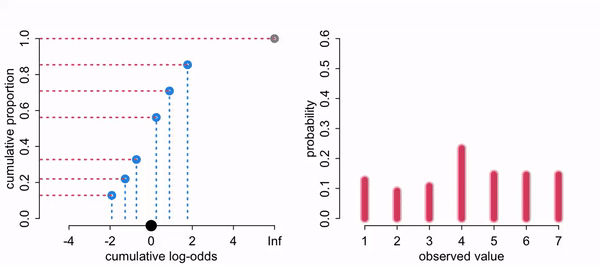
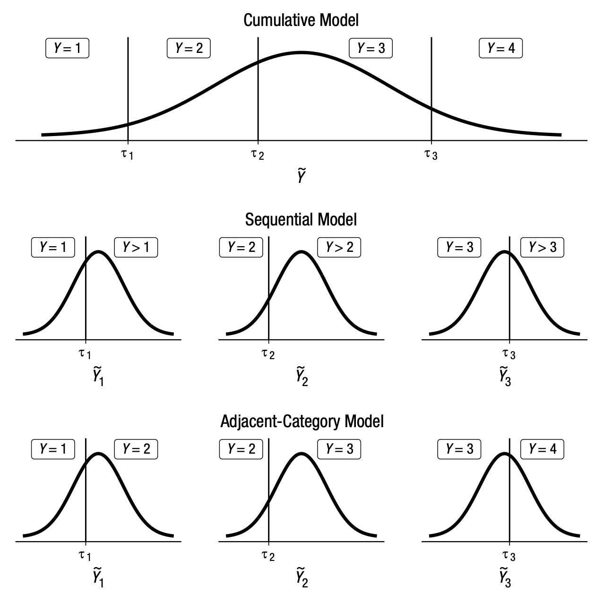

## This time

-   Counts: Poisson, negative binomial, offsets
-   Too many zeros: zero-inflated and hurdle models (mixtures)
-   Ordered categories: cumulative (ordered logit) models
-   Builds on [last time](glm-7.qmd): likelihoods, links, and moving between the link and response scales

```{r, echo = FALSE, message = FALSE}
library(tidyverse)
library(brms)
library(tidybayes)
library(marginaleffects)
library(patchwork)
library(modelr)
library(psych)
```

## Negative binomial / Gamma Poisson

-   Used for count data where the variance exceeds the mean, known as overdispersion. Often for the number of failures before a specified number of successes in Bernoulli trials

$$Y \sim \textrm{NB}(\mu,\phi)$$

## Gamma-Poisson

-   The Poisson distribution has just one parameter and presumes the mean/rate is associated with the spread. The negative binomial distribution relaxes this assumption and estimates the shape ($\phi$) of a gamma distribution (also an exponential family distribution) to describe the Poisson rates across cases.

-   The gamma distribution is a non-negative, continuous, two-parameter probability distribution.

## The NB as a mixture

$$
\begin{aligned}
Y_i &\sim \textrm{Poisson}(\theta_i) \\
\theta_i &\sim \textrm{Gamma}(\text{shape} = \phi,\ \text{rate} = \phi / \mu)
\end{aligned}
\quad \Longleftrightarrow \quad
Y_i \sim \textrm{NB}(\mu, \phi)
$$

-   $\mu$ is the mean count; $\phi$ (brms calls it `shape`) controls overdispersion
-   $\text{Var}(Y) = \mu + \mu^2/\phi$: small $\phi$ = lots of extra variance; as $\phi \to \infty$ it becomes a Poisson

## Many gamma shapes

-   There are multiple ways (different parameter definitions) to define the distribution. This gets confusing. For now just notice that many forms can be taken for the gamma distribution

```{r}
#| code-fold: true
ggplot(data = tibble(x = seq(from = 0, to = 60, by = .1)),
       aes(x = x, y = dgamma(x, shape = 1, rate = 1))) +
  geom_area() +
  scale_x_continuous(NULL) +
  scale_y_continuous(NULL, breaks = NULL) +
  coord_cartesian(xlim = c(0, 30))
```

## Gamma with shape = 10

```{r}
#| code-fold: true
ggplot(data = tibble(x = seq(from = 0, to = 60, by = .1)),
       aes(x = x, y = dgamma(x, shape = 10, rate = 1))) +
  geom_area() +
  scale_x_continuous(NULL) +
  scale_y_continuous(NULL, breaks = NULL) +
  coord_cartesian(xlim = c(0, 30))
```

## Roach example

-   y: number of roaches caught
-   roach1: pretreatment number of roaches
-   treatment: 1 = pest-control treatment, 0 = control
-   senior: 1 = building restricted to elderly residents
-   exposure2: number of days the traps were out (relative to the standard period)

## The roach data {.smaller}

```{r}
#| code-fold: true
roach <- read_csv("roaches.csv")  # also at https://bayes27.netlify.app/roaches.csv
roach
```

## Poisson

$$y_i  \sim \operatorname{Poisson} (\lambda_i)$$\
$$\log (\lambda_i)  = \beta_0 + \beta_1*X_i $$

```{r}

glm.7 <-
  brm(family = poisson,
      y ~ 0 + Intercept + roach1 + treatment,
      prior = c(prior(normal(2, 3), class = b, coef = "Intercept"),
                prior(normal(0, 1), class = b)),
      iter = 2000, warmup = 1000, cores = 4, chains = 4,
      sample_prior = "yes",
      data = roach,
      backend = "cmdstanr",
      file = "glm.7")


```

## Why 0 + Intercept?

-   With the default `1 + ...`, brms centers the predictors behind the scenes, so your `class = Intercept` prior is a prior for the outcome *at the predictors' means* (the summary converts it back for you).

-   With `0 + Intercept + ...`, the intercept is a regular coefficient (`class = b, coef = "Intercept"`), and its prior is for the outcome when all predictors are 0.

-   Use `0 + Intercept` when "all predictors = 0" is the value you can actually set a prior for (here: no roaches before, control group).

## `glm.7` summary

```{r}
summary(glm.7)
```

## Average predictions by treatment

```{r}
predictions(glm.7,by = "treatment")
```

## Predictions on the response scale

These predictions are on the original scale

```{r}
predictions(glm.7)
```

## Predictions on the link scale

These predictions are on the log link scale.

```{r}
predictions(glm.7, type = "link")
```

## Prediction by hand {.smaller}

```{r}
predictions(glm.7, newdata = datagrid(roach1 = 10, treatment = unique))
```

By hand, for roach1 = 10 in the treatment group:

```{r}
b <- fixef(glm.7)[, "Estimate"]
log_rate <- b["Intercept"] + b["roach1"] * 10 + b["treatment"] * 1
c(log_rate = log_rate, rate = exp(log_rate))
```

```{r}
predictions(glm.7, newdata = datagrid(roach1 = 10, treatment = unique), type = "link")
```

## Posterior predictive check: Poisson

```{r}
pp_check(glm.7)
```

## Predicted roaches by pretreatment count

```{r}
#| code-fold: true
predictions(glm.7,by = c("roach1", "treatment")) %>%
  get_draws() %>%
  mutate(treatment = as.factor(treatment)) %>%
  ggplot(aes(x = roach1, y = draw, color = treatment)) +
  stat_lineribbon(.width = .95, alpha = .4) + ylab("roaches")
```

## Treatment effect at the mean

```{r}
comparisons(glm.7, variables = "treatment", newdata = "mean")
```

## Offsets {.smaller}

Because we are counting numbers it assumes that the time period of counting is the same across observations. However, this may not be the case.

Luckily, the Poisson (and other count distributions) assume that the rate of events is constant in time (or space), so we can adjust for it.

$$\log(\lambda_i) = \log(\text{exposure}_i) + \beta_0 + \beta_1 x_i \quad\Rightarrow\quad \lambda_i = \text{exposure}_i \times e^{\beta_0 + \beta_1 x_i}$$

This is an offset: a term with its coefficient fixed at 1. Because of the log link, the offset is the **log** of exposure, `offset(log(exposure2))`, and the other coefficients are now about the rate per unit of exposure.

## Poisson with an offset

```{r}


glm.7o <-
  brm(family = poisson,
      y ~ 0 + Intercept + roach1 + treatment + offset(log(exposure2)),
      prior = c(prior(normal(2, 3), class = b, coef = "Intercept"),
                prior(normal(0, 1), class = b)),
      iter = 2000, warmup = 1000, cores = 4, chains = 4,
      data = roach,
      save_pars = save_pars(all = TRUE), # for loo(moment_match = TRUE) later
      backend = "cmdstanr",
      file = "glm.7o2")


```

## `glm.7o` summary

Note the offset is not a coefficient.

```{r}
summary(glm.7o)
```

## Predictions with the offset

```{r}
#| code-fold: true
predictions(glm.7o, newdata = datagrid(roach1 = unique, treatment = unique)) %>%
  get_draws() %>%
  mutate(treatment = as.factor(treatment)) %>%
  ggplot(aes(x = roach1, y = draw, color = treatment)) +
  stat_lineribbon(.width = .95, alpha = .4) + ylab("roaches")
```

## Posterior predictive check with the offset

```{r}
pp_check(glm.7o)
```

## Negative binomial model

Negative binomial (Gamma Poisson) model

```{r}
#| code-fold: true

glm.8 <-
  brm(family = negbinomial,
      y ~ 0 + Intercept + roach1 + treatment,
      prior = c(prior(normal(2, 3), class = b, coef = "Intercept"),
                prior(normal(0, 1), class = b)),
      iter = 2000, warmup = 1000, cores = 4, chains = 4,
      sample_prior = "yes",
      data = roach,
      backend = "cmdstanr",
      file = "glm.8")


```

## `glm.8` summary

```{r}
summary(glm.8)
```

## Posterior predictive check: NB

```{r}
pp_check(glm.8, ndraws = 50) +
  coord_cartesian(xlim = c(0, 100))
```

## NB with tighter priors

```{r}
#| code-fold: true


glm.8b <-
  brm(family = negbinomial,
      y ~ 0 + Intercept + roach1 + treatment,
      prior = c(prior(normal(2, 1), class = b, coef = "Intercept"),
                prior(normal(0, .5), class = b),
                prior(exponential(1), class = shape)),
      iter = 2000, warmup = 1000, cores = 4, chains = 4,
      sample_prior = "yes",
      data = roach,
      file = "glm.8b",
      backend = "cmdstanr")


```

## Posterior predictive check: `glm.8b`

```{r}
pp_check(glm.8b, ndraws = 50) +
  coord_cartesian(xlim = c(0, 100))
```

## `glm.8b` summary

```{r}
summary(glm.8b)
```

## NB vs Poisson predictions

```{r}
predictions(glm.8b,by = "treatment")
```

```{r}
predictions(glm.7,by = "treatment")
```

## Treatment effects compared {.smaller}

The treatment effect (on the count scale) from each model, for a household with average pretreatment roaches:

```{r}
comparisons(glm.8b, variables = "treatment", newdata = "mean")
```

```{r}
comparisons(glm.7, variables = "treatment", newdata = "mean")
```

## AME vs MEM {.smaller}

-   `avg_comparisons(model, variables = "treatment")`: compute the treatment effect for every row of the real data, then average. This is the **average marginal effect (AME)**.

-   `comparisons(model, variables = "treatment", newdata = "mean")`: set the other predictors to their means, then compute the effect once. This is the **marginal effect at the mean (MEM)**.

-   In a Gaussian model without interactions they're the same. With a nonlinear link they differ, because the effect on the count scale depends on where you start. AME is the usual default in economics, political science and epidemiology; emmeans-style output is closer to MEM.

## AME for the NB model

```{r}
avg_comparisons(glm.8b, variables = "treatment")
```

## Predictions for every row: NB {.smaller}

```{r}
predictions(glm.8b)
```

## Predictions for every row: Poisson {.smaller}

```{r}
predictions(glm.7)
```

## The roach data

```{r}
describe(roach)
```

## Predictions at chosen roach1 values: NB {.smaller}

```{r}
predictions(glm.8b, newdata = datagrid(roach1 = c(0,10,100,450), treatment = unique))
```

## Predictions at chosen roach1 values: Poisson {.smaller}

```{r}
predictions(glm.7, newdata = datagrid(roach1 = c(0,10,100,450), treatment = unique))
```

## NB predictions across roach1

```{r}
#| code-fold: true
predictions(glm.8b, newdata = datagrid(roach1 = seq(from = min(roach$roach1), to = max(roach$roach1)), treatment = unique)) %>%
  get_draws() %>%
  mutate(treatment = as.factor(treatment)) %>%
  ggplot(aes(x = roach1, y = draw, color = treatment)) +
  stat_lineribbon(.width = .95, alpha = .4) + ylab("roaches")
```

## Poisson predictions across roach1

```{r}
#| code-fold: true
predictions(glm.7,by = c("roach1", "treatment")) %>%
  get_draws() %>%
  mutate(treatment = as.factor(treatment)) %>%
  ggplot(aes(x = roach1, y = draw, color = treatment)) +
  stat_lineribbon(.width = .95, alpha = .4) + ylab("roaches")
```

## NB predictions, zoomed in

```{r}
#| code-fold: true
predictions(glm.8b,by = c("roach1", "treatment")) %>%
  get_draws() %>%
  mutate(treatment = as.factor(treatment)) %>%
  ggplot(aes(x = roach1, y = draw, color = treatment)) +
  stat_lineribbon(.width = .95, alpha = .4) + ylab("roaches") +ylim(0,400)
```

## Zero-inflated models

Use when there are different causes for the same observation. These are **mixture models**: more than one data-generating process at once (one that makes zeros, one that makes counts).

Lots of ways to get zero counts: Missed observation or the rate is low -- hard to distinguish.

```{r}
#| code-fold: true

prob_drink <- 0.2  # 20% of days
rate_work  <- 1    # average 1 manuscript per day
# sample one year of production
n <- 365
# simulate days monks drink
set.seed(365)
drink <- rbinom(n, 1, prob_drink)
# simulate manuscripts completed
y <- (1 - drink) * rpois(n, rate_work)

x <- rnorm(n = 365, mean = 3, sd = 1)


zips <-tibble(drink = factor(drink, levels = 1:0), y = y, x = x)

x2 <- zips$y + zips$x

zips <-tibble(drink = factor(drink, levels = 1:0), y = y, x = x2)


ggplot(data = zips, aes(x = y)) +
  geom_histogram(aes(fill = drink),
                 binwidth = 1, linewidth = 1/10, color = "grey92") +
  scale_fill_manual(values = 1:2) +
  xlab("Manuscripts completed") +
  theme(legend.position = "none")
```

## ZIP Zero inflated poisson

p = the probability of drinking (vs working). If drinking we know no manuscripts are created. If working, manuscripts still may not be created. The count is modeled as a Poisson with rate λ, and drinking as a Bernoulli with probability p

$$\operatorname{Pr} (y = 0 | p, \lambda)  = \operatorname{Pr} (\text{drink} | p) + \operatorname{Pr} (\text{work} | p) \times \operatorname{Pr} (0 | \lambda)$$ $$= p + (1 - p) \exp (- \lambda)$$

## Zeros and non-zeros

The probability of observing a zero is the probability that the monks drank, OR the probability that the monks worked AND failed to finish anything

$$\operatorname{Pr} (y | y > 0, p, \lambda) = $$ $$ \operatorname{Pr} (\text{drink} | p) (0) + \operatorname{Pr} (\text{work} | p) \operatorname{Pr} (y | \lambda) = (1 - p) \frac {\lambda^y \exp (- \lambda)}{y!}$$ Since drinking monks never produce, the expression above is the chance the monks both work (1-p), and finish y manuscripts

## The ZIP model

$$y_i  \sim \operatorname{ZIPoisson} (p_i, \lambda_i)$$ $$\operatorname{logit} (p_i)      = \alpha_p + \beta_p x_i$$ $$\log (\lambda_i)  = \alpha_\lambda + \beta_\lambda x_i$$

## Intercept-only ZIP

```{r}
glm.9 <-
  brm(family = zero_inflated_poisson,
      y ~ 1,
      prior = c(prior(normal(-1.5, 1), class = Intercept),
                prior(beta(2, 6), class = zi)),
      iter = 2000, warmup = 1000, chains = 4, cores = 4,
      data = zips,
      backend = "cmdstanr",
      file = "glm.9")
```

## Priors for zi

```{r}
#| code-fold: true
zip.priors <-
  c(prior(beta(1, 1), class = zi),
    prior(beta(2, 6), class = zi))
zip.priors %>%
  parse_dist(prior) %>%
  ggplot(aes(y = prior, dist = .dist, args = .args, fill = prior)) +
  stat_dist_halfeye(.width = .95) +
  scale_x_continuous("zi", breaks = c(0, .5, 1)) +
  ylab(NULL) +
  theme(legend.position = "none")
```

## `glm.9` summary {.smaller}

Note: when there are no predictors for zi, brms estimates zi directly as a probability (identity link). With predictors it uses a logit link, so interpret those coefficients like a logistic regression. The count part uses a log link: an Intercept of −.02 means λ = exp(−.02) ≈ .98 manuscripts per working day (we simulated 1).

```{r}
summary(glm.9)
```

## Predictors for both parts

Adding predictors. Do not necessarily need to have the same predictors for each process. One can predict the excess zeros, the other can predict the counts.

```{r}
glm.10 <-
  brm(bf(y ~ 1 + x,
      zi ~ 1 + x),
      family = zero_inflated_poisson,
      iter = 2000, warmup = 1000, chains = 4, cores = 4,
      data = zips,
      backend = "cmdstanr",
      file = "glm.10a")
```

## `glm.10` summary

```{r}
summary(glm.10)
```

Often the associations can go in different directions (because they are modeling different processes!)

## Plotting both parts

```{r}
#| code-fold: true
plot_predictions(glm.10, condition = "x") + labs(y = "expected manuscripts") +
plot_predictions(glm.10, condition = "x", dpar = "zi") + labs(y = "zi: Pr(structural zero)")
```


## Revisit roaches

```{r}
#| code-fold: true

glm.8c <-
  brm(family = zero_inflated_poisson,
      y ~ 0 + Intercept + roach1 + treatment + offset(log(exposure2)),
      prior = c(prior(normal(2, 1), class = b, coef = "Intercept"),
                prior(normal(0, .5), class = b),
                prior(beta(1, 1), class = zi)),
      iter = 2000, warmup = 1000, cores = 4, chains = 4,
      init = 0, # random inits up to ±2 make exp(b * 450 roaches) explode
      save_pars = save_pars(all = TRUE),
      data = roach,
      file = "glm.8c2",
      backend = "cmdstanr")
```

## `glm.8c` summary

```{r}
summary(glm.8c)
```

## Posterior predictive check: ZIP

```{r}
pp_check(glm.8c, ndraws = 50) +
  coord_cartesian(xlim = c(0, 100))
```

## Predictors for the zero part too

```{r}
#| code-fold: true

glm.8d <-
  brm(bf(y ~ 0 + Intercept + roach1 + treatment + offset(log(exposure2)),
         zi ~ 0 + Intercept + roach1 + treatment),
      family = zero_inflated_poisson,
      prior = c(prior(normal(2, 1), class = b, coef = "Intercept"),
                prior(normal(0, .5), class = b),
                prior(normal(0, 1), class = b, dpar = "zi")),
      iter = 2000, warmup = 1000, cores = 4, chains = 4,
      init = 0,
      save_pars = save_pars(all = TRUE),
      data = roach,
      file = "glm.8d3",
      backend = "cmdstanr")
```

## `glm.8d` summary

```{r}
summary(glm.8d)
```

## Posterior predictive check: `glm.8d`

```{r}
pp_check(glm.8d, ndraws = 50) +
  coord_cartesian(xlim = c(0, 100))
```

## `glm.8d` predictions

```{r}
#| code-fold: true
predictions(glm.8d,newdata = datagrid(roach1 = seq(from = min(roach$roach1), to = max(roach$roach1)), treatment = unique)) %>%
  get_draws() %>%
  mutate(treatment = as.factor(treatment)) %>%
  ggplot(aes(x = roach1, y = draw, color = treatment)) +
  stat_lineribbon(.width = .95, alpha = .4) + ylab("roaches")
```

## Log-transforming roach1

```{r}
#| code-fold: true

glm.8e <-
  brm(bf(y ~ 0 + Intercept + I(log(roach1 + 1)) + treatment + offset(log(exposure2)),
         zi ~ 0 + Intercept + I(log(roach1 + 1)) + treatment),
      family = zero_inflated_poisson,
      prior = c(prior(normal(2, 1), class = b, coef = "Intercept"),
                prior(normal(0, 1), class = b),
                prior(normal(0, 1), class = b, dpar = "zi")),
      iter = 2000, warmup = 1000, cores = 4, chains = 4,
      save_pars = save_pars(all = TRUE),
      data = roach,
      file = "glm.8e2",
      backend = "cmdstanr")
```

## `glm.8e` summary

```{r}
summary(glm.8e)
```

## Posterior predictive check: `glm.8e`

```{r}
pp_check(glm.8e, ndraws = 50) +
  coord_cartesian(xlim = c(0, 100))
```

## `glm.8e` predictions

Big difference from before

```{r}
#| code-fold: true
predictions(glm.8e,newdata = datagrid(roach1 = seq(from = min(roach$roach1), to = max(roach$roach1)), treatment = unique)) %>%
  get_draws() %>%
  mutate(treatment = as.factor(treatment)) %>%
  ggplot(aes(x = roach1, y = draw, color = treatment)) +
  stat_lineribbon(.width = .95, alpha = .4) + ylab("roaches")
```

## Compare roach models

To compare fairly, all three need the same offset. `glm.8b2` is `glm.8b` plus `offset(log(exposure2))`:

```{r}
#| code-fold: true
glm.8b2 <-
  brm(family = negbinomial,
      y ~ 0 + Intercept + roach1 + treatment + offset(log(exposure2)),
      prior = c(prior(normal(2, 1), class = b, coef = "Intercept"),
                prior(normal(0, .5), class = b),
                prior(exponential(1), class = shape)),
      iter = 2000, warmup = 1000, cores = 4, chains = 4,
      save_pars = save_pars(all = TRUE),
      data = roach,
      file = "glm.8b2",
      backend = "cmdstanr")
```

```{r}
loo_p   <- loo(glm.7o, moment_match = TRUE)
loo_nb  <- loo(glm.8b2, moment_match = TRUE)
loo_zip <- loo(glm.8e, moment_match = TRUE)
loo_compare(loo_p, loo_nb, loo_zip)
```

## Checking count models: rootograms {.smaller}

A rootogram compares observed and predicted counts at each value. Bars hanging from the curve that don't reach 0 = the model's frequencies are off.

```{r}
#| code-fold: true
#| fig-height: 4
(pp_check(glm.7o, type = "rootogram", ndraws = 100) + coord_cartesian(xlim = c(0, 60)) + ggtitle("Poisson")) /
(pp_check(glm.8b2, type = "rootogram", ndraws = 100) + coord_cartesian(xlim = c(0, 60)) + ggtitle("Negative binomial"))
```

## Checking count models: variance and zeros {.smaller}

Does the model reproduce the data's **variance** and its **number of zeros**? `type = "stat"` compares one statistic of the data (dark line) to the same statistic in each simulated dataset.

```{r}
#| code-fold: true
#| fig-height: 4.2
#| fig-width: 10
prop_zero <- function(y) mean(y == 0)
log10_var <- function(y) log10(var(y))
(pp_check(glm.7o, type = "stat", stat = "log10_var") + ggtitle("Poisson: log10(variance)")) +
(pp_check(glm.8b2, type = "stat", stat = "log10_var") + ggtitle("NB: log10(variance)")) +
(pp_check(glm.7o, type = "stat", stat = "prop_zero") + ggtitle("Poisson: share of zeros")) +
(pp_check(glm.8b2, type = "stat", stat = "prop_zero") + ggtitle("NB: share of zeros")) +
  plot_layout(ncol = 2, guides = "collect") & theme(legend.position = "none")
```

## What the checks say {.smaller}

-   **Poisson:** simulated variances are about half the real one, and it predicts essentially *no* zeros (the data have 36%).
-   **NB:** gets the zeros right (about 34%), but overshoots the variance, sometimes by orders of magnitude: some simulated datasets contain counts in the thousands (the real maximum is 357).
-   Why? `roach1` enters on the log scale raw, so apartments with 300+ pretreatment roaches get enormous predicted means. Using `log(roach1 + 1)` as the predictor (as in `glm.8e` below) is one fix.
-   A model can win LOO and still fail a check. Do both.

## Rate ratios

With a log link, `exp()` of a coefficient is a **rate ratio**: the multiplicative change in the expected count. As with odds ratios, exponentiate the draws:

```{r}
as_draws_df(glm.8b2) %>%
  mutate(rate_ratio = exp(b_treatment)) %>%
  median_qi(rate_ratio)
```

Treated apartments are expected to have about `r round(100 * (1 - exp(fixef(glm.8b2)["treatment", "Estimate"])))`% fewer roaches per trap-day than control apartments with the same pretreatment count.

## Hurdle models/zero augmented

Also mixture (two-part) models, which specify one process for zero counts and another process for positive counts. The idea is that positive counts occur once a threshold is crossed.

## Intercept-only hurdle model

```{r}
glm.11 <-
  brm(family = hurdle_poisson,
      y ~ 1,
      prior = c(prior(normal(-1.5, 1), class = Intercept),
               prior(beta(1, 1), class = hu)),
      iter = 2000, warmup = 1000, chains = 4, cores = 4,
      data = zips,
      backend = "cmdstanr",
      file = "glm.11")

```

## `glm.11` summary

```{r}
summary(glm.11)
```

## Hurdle model with a predictor

```{r}

glm.11x <-
  brm(family = hurdle_poisson,
      y ~ 1 + x,
      prior = c(prior(normal(-1.5, 1), class = Intercept),
               prior(normal(-1.5, 3), class = b),
                prior(beta(1, 1), class = hu)),
      iter = 2000, warmup = 1000, chains = 4, cores = 4,
      data = zips,
      backend = "cmdstanr",
      file = "glm.11x3")

```

## `glm.11x` summary

```{r}
summary(glm.11x)
```

## Expected counts with tidybayes

```{r}
#| code-fold: true
zips %>%
  data_grid(x = seq_range(x, n = 30)) %>%
  add_epred_draws(glm.11x) %>%
  ggplot(aes(x = x, y = .epred)) +
  stat_lineribbon(.width = 0.95, alpha = .4)
```

## Both parts with marginaleffects

With {marginaleffects}

```{r}
#| code-fold: true

plot_predictions(
    glm.11x,
    condition = "x") +
    labs(y = "mu") +
plot_predictions(
    glm.11x,
    dpar = "hu",
    condition = "x") +
    labs(y = "hu")
```

## Posterior predictive check: hurdle

```{r}
pp_check(glm.11x)
```

## Do we need a zero model at all? {.smaller}

Zero-inflated and hurdle versions of the **negative binomial**, with the same offset and predictors as `glm.8b2`:

```{r}
#| code-fold: true
nb_priors <- c(prior(normal(2, 1), class = b, coef = "Intercept"),
               prior(normal(0, .5), class = b),
               prior(exponential(1), class = shape))
glm.8f <- brm(family = zero_inflated_negbinomial,
              y ~ 0 + Intercept + roach1 + treatment + offset(log(exposure2)),
              prior = c(nb_priors, prior(beta(1, 1), class = zi)),
              iter = 2000, warmup = 1000, cores = 4, chains = 4, init = 0,
              save_pars = save_pars(all = TRUE), data = roach, backend = "cmdstanr", file = "glm.8f")
glm.8g <- brm(family = hurdle_negbinomial,
              y ~ 0 + Intercept + roach1 + treatment + offset(log(exposure2)),
              prior = c(nb_priors, prior(beta(1, 1), class = hu)),
              iter = 2000, warmup = 1000, cores = 4, chains = 4, init = 0,
              save_pars = save_pars(all = TRUE), data = roach, backend = "cmdstanr", file = "glm.8g")
```

```{r}
loo_compare(loo(glm.8b2, moment_match = TRUE),
            loo(glm.8f, moment_match = TRUE),
            loo(glm.8g, moment_match = TRUE))
```

## Often the NB is enough {.smaller}

```{r}
#| code-fold: true
round(summary(glm.8f)$spec_pars[, 1:4], 2)
```

-   The ZINB says only about 7% of apartments are "structural zeros" (interval nearly touching 0), and it predicts no better than the plain NB.
-   The NB's extra variance already produces plenty of zeros. Zero-inflation was needed for the *Poisson*, not for the counts.
-   The hurdle NB does worse here: it says *every* zero comes from the zero process, so it can't use roach1 and treatment to explain the zeros the same way.
-   Lesson: try the NB first, check the zeros with `pp_check(type = "stat")`, and add a zero model only if it is still missing them (or if you have a theory of where the zeros come from).

## Ordinal regression models

likert scales never, sometimes, often no degree, hs degree, some college, college degree

discrete, defined order, distance between categories is unknown

common assumption is to treat differences as the same and model it as continuous with a Gaussian

## Log cumulative odds link

```{r}
#| code-fold: true

trolley <- read_csv("trolley.csv")  # rethinking's Trolley data; also at https://bayes27.netlify.app/trolley.csv
p2a <-
  trolley %>%
  ggplot(aes(x = response)) +
  geom_histogram()
p2a
```

## Proportion of each response

```{r}
#| code-fold: true
p2 <-
  trolley %>%
  count(response) %>%
  mutate(pr_k     = n / nrow(trolley),
         cum_pr_k = cumsum(pr_k)) %>%
  ggplot(aes(x = response, y = pr_k,
             fill = response)) +
  geom_line() +
  geom_point(shape = 21, color = "grey92",
             size = 2.5, stroke = 1) +
  scale_x_continuous(breaks = 1:8) +
  scale_y_continuous(" proportion",
                     limits = c(0, .35)) +
  theme(axis.ticks = element_blank(),
        axis.title.y = element_text(angle = 90),
        legend.position = "none")
p2
```

## Cumulative proportions

Cumulative proportion. Each choice is larger than the previous

```{r}
#| code-fold: true
p2b <-
  trolley %>%
  count(response) %>%
  mutate(pr_k     = n / nrow(trolley),
         cum_pr_k = cumsum(pr_k)) %>%
  ggplot(aes(x = response, y = cum_pr_k,
             fill = response)) +
  geom_line() +
  geom_point(shape = 21, color = "grey92",
             size = 2.5, stroke = 1) +
  scale_x_continuous(breaks = 1:8) +
  scale_y_continuous("cumulative proportion",
                     breaks = c(0, .25, .5, .75, 1), limits = c(0, 1.1)) +
  theme(axis.ticks = element_blank(),
        axis.title.y = element_text(angle = 90),
        legend.position = "none")

p2b
```

## Cumulative probability

-   The cumulative probability of a value is the probability of that value or any smaller value. In the context of ordered categories, the cumulative probability of 3 is the sum of the probabilities of 3, 2, and 1

## Probability of each response {.smaller}

Logic:

-   Probability of any observation is just counting up the cumulative proportion for values to the left of the cut points.

-   Thus option 1 refers to all values up to the first. Option two is values to the left of cut point 2 and to the right of cut point 1.

-   We will discuss in terms of the probability of x being less than or equal to some cut point.

-   Thus what is the probability of getting a 5? It is the cumulative probability of getting a 5 or less subtracting the cumulative probability of getting a 4 or less.

## Cumulative log odds {.smaller}

-   We can change this into cumulative log odds, where each response value is represented as a logit.

-   This changes the x axis, making different cut points that represent the cumulative log odds of getting a 4, for example.

-   The cumulative log odds of a 7 (or less) is infinite, because Pr(y ≤ 7) = 1. A logit of 0 means 50% of responses are at or below that cut point; −2 means about 12%; +2 means about 88%.

-   Why logits? Because we want to predict an ordered outcome.

## Estimating the cut points

We want to estimate the cutpoints

$$\text{logit}(Pr(y_i \leq k)) = \log\left(\dfrac{Pr(y_i \leq k)}{1-Pr(y_i \leq k)}\right)$$

```{r, echo = FALSE}
p2b +  scale_x_continuous(breaks = c(.5,2,3.5,5,6.6), labels = c(-2,-1,0,1,2)) + xlab("cumulative log odds") +  theme(axis.title.y = element_blank(), axis.text.y = element_blank())
```

## Cut points as intercepts

We will have intercepts for each response option, each on the log-cumulative-odds scale. Run through the inverse logit, they are the cumulative probability of each outcome.

$\alpha_k$ is an “intercept” unique to each possible outcome value k. We are estimating the probability of some response $y_i$ being equal to or less than some category. E.g., the cumulative probability of getting a 5? It is the proportion of values that are 5 or less.

$$\log \frac{\operatorname{Pr}(y_i \leq k)}{1 - \operatorname{Pr}(y_i \leq k)} = \alpha_k$$

## Cut points by hand

```{r}
#| code-fold: true
logit <- function(x) log(x / (1 - x))
trolley %>%
  count(response) %>%
  mutate(pr_k     = n / nrow(trolley),
         cum_pr_k = cumsum(n / nrow(trolley))) %>%
  mutate(alpha = logit(cum_pr_k) %>% round(digits = 2))
```

## Counts, proportions, and log-cumulative-odds

```{r}
#| code-fold: true

p1 <-
  trolley %>%
  ggplot(aes(x = response, fill = after_stat(x))) +
  geom_histogram(binwidth = 1/4) +
  scale_fill_gradient(low = "grey",
                       high = "black") +
  scale_x_continuous(breaks = 1:7) +
  theme(axis.ticks = element_blank(),
        axis.title.y = element_text(angle = 90),
        legend.position = "none")


p2 <-
  trolley %>%
  count(response) %>%
  mutate(pr_k     = n / nrow(trolley),
         cum_pr_k = cumsum(pr_k)) %>%
  ggplot(aes(x = response, y = pr_k,
             fill = response)) +
  geom_line() +
  geom_point(shape = 21, color = "grey92",
             size = 2.5, stroke = 1) +
  scale_x_continuous(breaks = 1:8) +
  scale_y_continuous(" proportion",
                     limits = c(0, .35)) +
  theme(axis.ticks = element_blank(),
        axis.title.y = element_text(angle = 90),
        legend.position = "none")


p3 <-
  trolley %>%
  count(response) %>%
  mutate(cum_pr_k = cumsum(n / nrow(trolley))) %>%
  filter(response < 7) %>%
  ggplot(aes(x = response, y = logit(cum_pr_k), fill = response)) +
  geom_line() +
  geom_point(shape = 21, colour = "grey92",
             size = 2.5, stroke = 1) +
  scale_x_continuous(breaks = 1:7, limits = c(1, 7)) +
  ylab("log-cumulative-odds") +
  theme(axis.ticks = element_blank(),
        axis.title.y = element_text(angle = 90),
        legend.position = "none")

(p1 | p2 | p3)

```

## The ordered logit model

$$
\begin{aligned}
\text{response}_i &\sim \operatorname{Ordered-logit}(\phi_i, \boldsymbol\alpha) \\
\text{logit}(Pr(\text{response}_i \leq k)) &= \alpha_k - \phi_i \\
\phi_i &= 0 \\
\alpha_k &\sim \operatorname{Normal}(0, 1.5)
\end{aligned}
$$

Where $\phi$ is a stand-in for regression terms. Right now it is an intercept-only model. The $\alpha_k$ are the cut points: one fewer than the number of categories (6 for a 1–7 scale).

## Fitting it in brms

SR calls this an ordered logit; brms calls it `family = cumulative` (with a logit link by default). Same model.

```{r}
glm.12 <-
  brm(family = cumulative,
      response ~ 1,
      prior(normal(0, 1.5), class = Intercept),
      iter = 2000, warmup = 1000, cores = 4, chains = 4,
      data = trolley,
      backend = "cmdstanr",
      file = "glm.12")
```

## `glm.12` summary

```{r}
#| code-fold: true
summary(glm.12)
```

## Back to cumulative proportions

Bring back into cumulative proportions

```{r}
#| code-fold: true
glm.12 %>%
gather_draws(b_Intercept[cut]) %>%
  mutate(.value = inv_logit_scaled(.value)) %>%
  group_by(cut) %>%
  summarise(mean = mean(.value),
            sd   = sd(.value),
            ll   = quantile(.value, probs = .025),
            ul   = quantile(.value, probs = .975))
```

Quick version: `plogis(fixef(glm.12)[, "Estimate"])`. Compare these to the observed cumulative proportions a few slides back; the model reproduces them.

## Adding predictors {.smaller}


$$\log \frac{\operatorname{Pr}(y_i \leq k)}{1 - \operatorname{Pr}(y_i \leq k)} =  \alpha_k - \phi_i $$


$$ \text{response}_i  \sim \operatorname{Ordered-logit} (\phi_i, \boldsymbol\alpha) $$

$$\phi_i = \beta x_i$$

Why is the linear model ϕ subtracted from each intercept? Because if we decrease the log-cumulative-odds of every outcome value k below the maximum, this necessarily shifts probability mass upwards towards higher outcome values. This way, a positive β value indicates that an increase in the predictor variable x results in an increase in the average response.


## Shifting the cut points




## The model with predictors

$$ \text{response}_i  \sim \operatorname{Ordered-logit} (\phi_i, \boldsymbol\alpha) $$
$$ \text{logit}(Pr(\text{response}_i \leq k)) = \alpha_k - \phi_i $$
$$  \phi_i = \beta_1 \text{action}_i + \beta_2 \text{contact}_i + \beta_3 \text{intention}_i + \beta_4 (\text{action}_i \times \text{intention}_i) + \beta_5 (\text{contact}_i \times \text{intention}_i) $$
$$\alpha_k               \sim \operatorname{Normal}(0, 1.5) $$
$$\beta_1, ..., \beta_5  \sim \operatorname{Normal}(0, 0.5) $$

## Fitting `glm.13`

```{r}
glm.13 <-
  brm(family = cumulative,
      response ~ 1 + action + contact + intention + intention:action + intention:contact,
      prior = c(prior(normal(0, 1.5), class = Intercept),
                prior(normal(0, 0.5), class = b)),
      iter = 2000, warmup = 1000, cores = 4, chains = 4,
      data = trolley,
      backend = "cmdstanr",
      file = "glm.13")
```

## `glm.13` summary

```{r}
summary(glm.13)
```

## Coefficient posteriors

```{r}
#| code-fold: true
glm.13 %>%
gather_draws(`b_action`,`b_contact`,`b_intention`,`b_action:intention`,`b_contact:intention`) %>%
  ggplot(aes(x = .value, y = .variable)) +
  geom_vline(xintercept = 0, alpha = 1, linetype = 3) +
  stat_gradientinterval(.width = .95, point_size = 1, shape = 1) +
  scale_x_continuous("marginal posterior", breaks = -5:0 / 4) +
  coord_cartesian(xlim = c(-1.4, 0))

```

## Predicted response probabilities {.nostretch .smaller}

The clearest summary of an ordinal model. Action and intention each shift probability toward "forbidden" (1–3), and most of all together.

```{r}
#| code-fold: true
#| fig-height: 3.5
#| fig-width: 9
#| out-width: "100%"
predictions(glm.13, newdata = datagrid(action = 0:1, intention = 0:1, contact = 0)) %>%
  mutate(condition = case_when(action == 0 & intention == 0 ~ "Neither",
                               action == 1 & intention == 0 ~ "Action only",
                               action == 0 & intention == 1 ~ "Intention only",
                               action == 1 & intention == 1 ~ "Action + intention"),
         condition = factor(condition, levels = c("Neither", "Action only", "Intention only", "Action + intention"))) %>%
  ggplot(aes(x = group, y = estimate, ymin = conf.low, ymax = conf.high, colour = condition)) +
  geom_pointrange(position = position_dodge(width = .6)) +
  scale_colour_viridis_d(end = .85) +
  labs(x = "Response (1 = forbidden, 7 = permissible)", y = "Predicted probability", colour = NULL,
       caption = "No-contact stories. Points are posterior means with 95% intervals.") +
  theme_classic(base_size = 14) +
  theme(legend.position = "top")
```

## Average comparisons

```{r}
#| code-fold: true
library(marginaleffects)
avg_comparisons(glm.13)
```

## Action's effect, by intention {.smaller}

How much does action change the probability of each response, with and without intention?

```{r}
#| code-fold: true
avg_comparisons(glm.13, variables = "action", by = "intention")
```

## Predicted response distributions: action × intention

Each condition should add up to 1

```{r}
#| code-fold: true
trolley %>%
  data_grid(action = c(0,1), intention = c(0,1), contact = .5) %>%
  mutate(x = interaction(action, intention)) %>%
  mutate(x = fct_recode(as.factor(x),
                      No_A_No_I = "0.0",
                      No_A_Y_I = "0.1",
                      Y_A_No_I = "1.0",
                      Y_A_Y_I = "1.1")) %>%
  add_epred_draws(glm.13) %>%
  ggplot(aes(x = .epred, y = .category, fill = x)) +
  stat_slab()
```

## Predicted response distributions: contact × intention

```{r}
#| code-fold: true
trolley %>%
  data_grid(action = .5, intention = c(0,1), contact = c(0,1)) %>%
  mutate(x = interaction(contact, intention)) %>%
  mutate(x = fct_recode(as.factor(x),
                      No_C_No_I = "0.0",
                      Y_C_No_I = "1.0",
                      No_C_Y_I = "0.1",
                      Y_C_Y_I = "1.1")) %>%
  add_epred_draws(glm.13) %>%
  ggplot(aes(x = .epred, y = .category, fill = x)) +
  stat_slab()
```

## Cumulative probabilities by condition

Think as cumulative probability cut points

```{r}
#| code-fold: true
nd <-
  trolley %>%
  distinct(action, contact, intention) %>%
  mutate(combination = str_c(action, contact, intention, sep = "_"))

fit.13 <-
  fitted(glm.13,
         newdata = nd,
         summary = F)

fit.13 <-
  rbind(fit.13[, , 1],
        fit.13[, , 2],
        fit.13[, , 3],
        fit.13[, , 4],
        fit.13[, , 5],
        fit.13[, , 6],
        fit.13[, , 7]) %>%
  data.frame() %>%
  set_names(pull(nd, combination)) %>%
  mutate(response = rep(1:7, each = n() / 7),
         iter     = rep(1:4000, times = 7)) %>%
  pivot_longer(-c(iter, response),
               names_to = c("action", "contact", "intention"),
               names_sep = "_",
               values_to = "pk") %>%
  mutate(intention = intention %>% as.integer())

levels <- c("action=0, contact=0", "action=1, contact=0", "action=0, contact=1")

  fit.13 %>%
  filter(response < 7) %>%
  mutate(facet = factor(str_c("action=", action, ", contact=", contact),
                        levels = levels)) %>%
  group_by(iter, facet, intention) %>%
  arrange(iter, facet, intention, response) %>%
  mutate(probability = cumsum(pk)) %>%
  ungroup() %>%
  nest(data = -iter) %>%
  slice_sample(n = 50) %>%
  unnest(data) %>%

  ggplot(aes(x = intention, y = probability)) +
  geom_line(aes(group = interaction(iter, response), color = probability),
            alpha = 1/10) +
  geom_point(data = trolley %>%
               group_by(intention, contact, action) %>%
               count(response) %>%
               mutate(probability = cumsum(n / sum(n)),
                      facet = factor(str_c("action=", action, ", contact=", contact),
                                     levels = levels)) %>%
               filter(response < 7),) +
  scale_x_continuous("intention", breaks = 0:1) +
  scale_y_continuous(breaks = c(0, .5, 1), limits = c(0, 1)) +
  theme(legend.position = "none") +
  facet_wrap(~facet)
```

## Why not treat it as continuous? {.smaller}

The common alternative: a Gaussian regression on the 1–7 responses.

```{r}
#| code-fold: true
glm.13g <-
  brm(family = gaussian,
      response ~ 1 + action + contact + intention + intention:action + intention:contact,
      prior = c(prior(normal(4, 2), class = Intercept),
                prior(normal(0, 1), class = b),
                prior(exponential(1), class = sigma)),
      iter = 2000, warmup = 1000, cores = 4, chains = 4,
      data = trolley,
      backend = "cmdstanr",
      file = "glm.13g")
```

```{r}
#| code-fold: true
#| fig-height: 3.6
yrep_g <- posterior_predict(glm.13g, ndraws = 200)
(pp_check(glm.13, type = "bars", ndraws = 200) + ggtitle("Ordinal (cumulative)")) +
(pp_check(glm.13g, ndraws = 50) + ggtitle("Gaussian")) +
  plot_layout(ncol = 2)
```

## What the Gaussian gets wrong

-   It can't produce the lumpy shape (a big spike at 4, few 2s): the ordinal model matches every bar.
-   `r round(100 * mean(yrep_g < 0.5 | yrep_g > 7.5))`% of its simulated responses fall below 1 or above 7, values no one could give.
-   It assumes the distance from 1 to 2 equals the distance from 6 to 7. The ordinal model estimates where the cut points are instead.
-   Effects can be biased, even reversed, when groups differ in variance (Liddell & Kruschke, 2018, *JESP*).

## Unequal variances

The parameter related to latent variances is called disc (short for discrimination).

```{r}
glm.14 <-
  brm(family = cumulative,
      bf(response ~ 1 + action + contact + intention + intention:action + intention:contact) +
      lf(disc ~ 0 + action + contact + intention + intention:action + intention:contact, cmc = FALSE),
      prior = c(prior(normal(0, 1.5), class = Intercept),
                prior(normal(0, 0.5), class = b)),
      iter = 2000, warmup = 1000, cores = 4, chains = 4,
      data = trolley,
      backend = "cmdstanr",
      file = "glm.14")
```

## `glm.14` summary

```{r}
summary(glm.14)
```


## Predicted response distributions with unequal variances
```{r}
trolley %>%
  data_grid(action = .5, intention = c(0,1), contact = c(0,1)) %>%
  mutate(x = interaction(contact, intention)) %>%
  mutate(x = fct_recode(as.factor(x),
                      No_C_No_I = "0.0",
                      Y_C_No_I = "1.0",
                      No_C_Y_I = "0.1",
                      Y_C_Y_I = "1.1")) %>%
  add_epred_draws(glm.14) %>%
  ggplot(aes(x = .epred, y = .category, fill = x)) +
  stat_slab()
```


## Category specific effects

Do you want to assume similar effects of your predictors across the range of your DV? Or does the effect occur only as certain differences between the categories?

For example, predicting educational attainment. Negative peer influences may have a large effect at graduating HS but little effect compared to whether or not someone goes to graduate school.

```{r, eval = FALSE}
brm(Y ~ cs(X), family = sratio)  # cs() works with sratio, cratio and acat, not cumulative
```


## Sequential and Adjacent category models {.smaller}

For many ordinal variables, the assumption of a single underlying continuous variable, as in cumulative models, may not be appropriate.

sequential: years of marriage where the marriage may continue or end by divorce, but the latter can happen only if it did not happen before. For every category k there is a latent continuous variable.

Adjacent category (partial credit): Sequential models model the decision between Y = k and Y > k, whereas adjacent-category models model the decision
between Y = k and Y = k + 1. Mathematically useful, lack of ordering of the threshold parameters.


## Adjacent category models




## Ordinal predictors {.smaller}

Say you have an exercise variable: (none, 1 time a month, 1 time a week, multiple times a week, everyday). How do you model? Continuous?

Can't you just model ordinal predictors as a series of dummy variables? But what if we want to respect the inherent order?

Monotonic effects, `mo(x)` in brms. Think of it as a compromise between continuous and dummy. We do not assume categories are equidistant with respect to their effect on the response variable (because then we would be using continuous). Instead, the distance between adjacent predictor categories (or integers) is estimated from the data and may vary across categories.

## Extra readings

https://cran.r-project.org/web/packages/brms/vignettes/brms_monotonic.html

https://psyarxiv.com/9qkhj/
