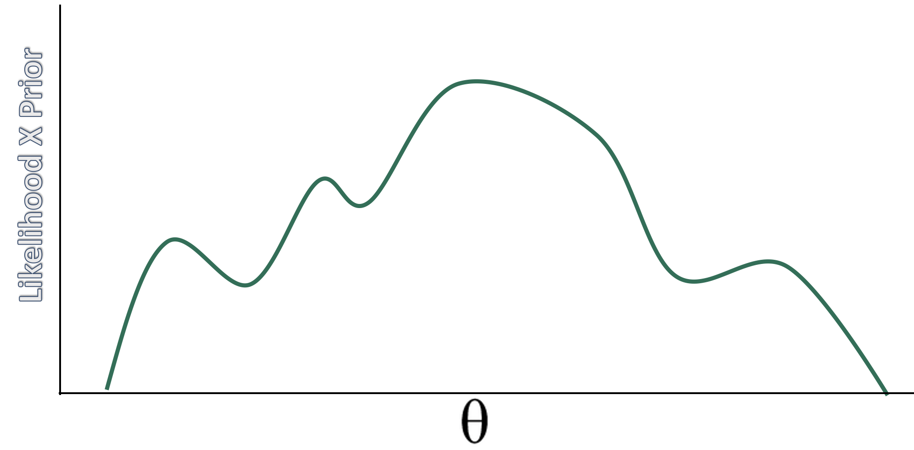
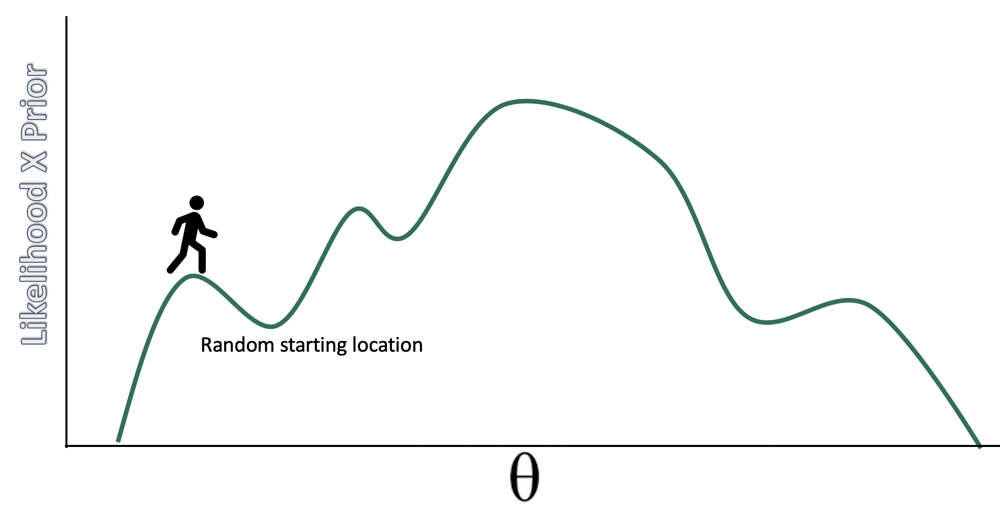
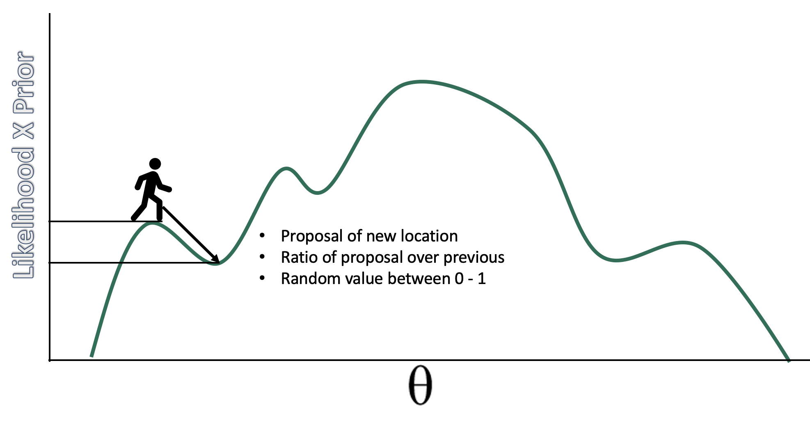
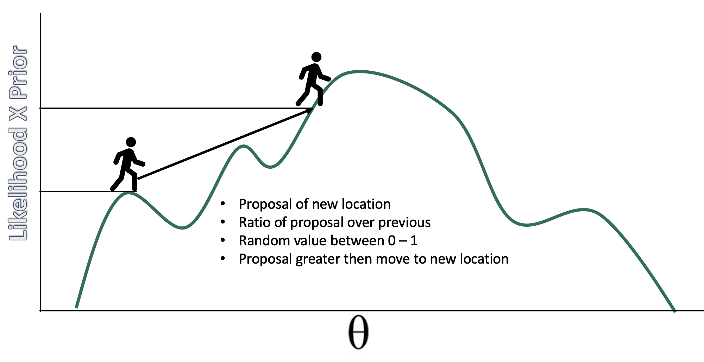
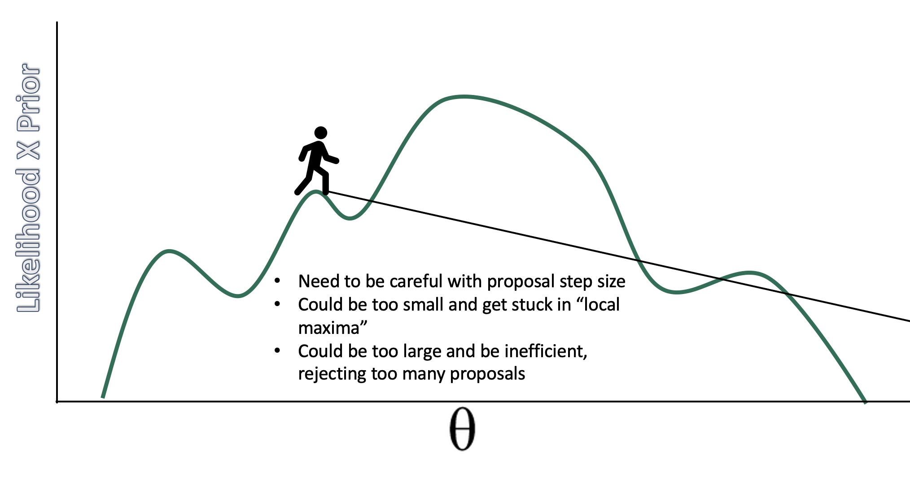
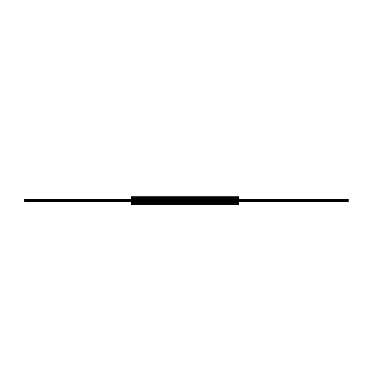
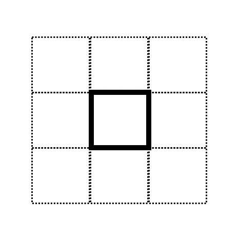
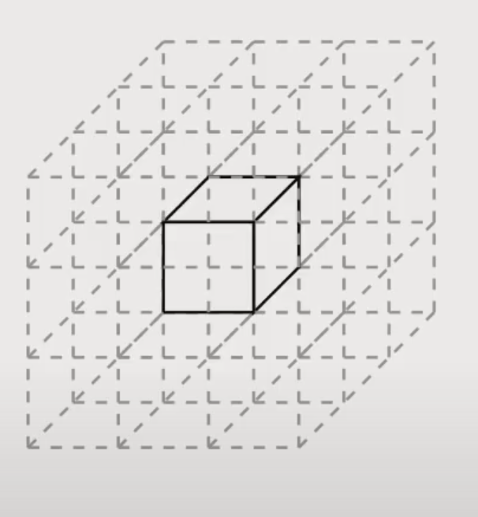
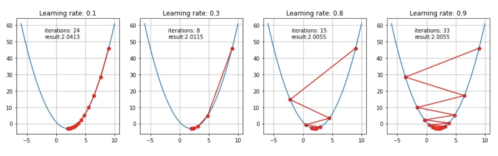

## How do we estimate the posterior? {.smaller}
-   Grid, normal (quadratic) approximations, analytic/conjugate, MCMC

-   MCMC refers to a set of algorithms that sample from a probability distribution

-   Logic: if we don't know a distribution we draw samples from it. Instead of computations to directly specify the shape of the posterior, we get samples from this distribution and use these samples to describe the posterior.

-   Think of marbles in the bag -- we don't know what that looks like but we can sample from it to compute a posterior.

## Why this way? {.smaller}

-   Short answer: computation is difficult.

-   Computation of the posterior requires three terms: a prior, a likelihood and the evidence. The evidence (aka probability of the data; marginal likelihood) normalizes the posterior so it integrates (adds up) to 1.

-   We assume a prior distribution and we can compute a likelihood based on what we know about the distribution we assumed for the DGP (most of the time). The tricky part is the evidence. This makes computation analytically intractable.

$$ p(x) = \int_\theta p(x|\theta)p(\theta)d(\theta) $$

## Conjugate priors {.smaller}

-   With many parameters it is basically impossible to compute analytically. "Bayesian analysis is hard because integrals are hard". Maximization (derivatives) is easier than integrals, which is why frequentist is so popular.

-   Conjugate priors are a less computational heavy approach to solving the integral problem. If posterior is from the same family as prior then it is easier to compute the evidence. E.g., a normal likelihood (with known σ) and a normal prior on the mean give a normal posterior; a binomial likelihood and a beta prior give a beta posterior (what we did on the grid in week 1); for a variance, the conjugate prior is an inverse-gamma. As a result the posterior, p( $\theta$ \| data), becomes analytically tractable.

## Why we can ignore the evidence

$$p(\theta | data) = \frac{p(data | \theta) \times p(\theta )}{p(data)}$$

The evidence is a constant with respect to $\theta$ so the equation is often presented as:

$$ p(\theta | data) \propto p(data | \theta) \times p(\theta ) $$ "The posterior is proportional to the likelihood X the prior."

As long as we can calculate the right side of the equation we can then sample from the posterior distribution

## Markov Chain Monte Carlo {.smaller}

-   Markov Chain: random process that moves between states, where the next state depends only on the current state. This is the "memoryless" property: given where you are now, where you were before adds nothing. (Draws are still correlated with earlier draws through the chain, which is why we'll check autocorrelation.)

-   Monte Carlo: Famous casino in Monaco. Used here to refer to repeated random sampling, like tossing dice

-   In the limit, the samples generated by the MCMC method will be samples from the target (posterior in our case) distribution. Note that the shape of the posterior does not have to be defined by a known probability distribution -- it can take any shape.

## MCMC

-   Refers to a series of different algorithms. Metropolis, Gibbs, Hamiltonian are the most popular and historically relevant.

-   Stan (and thus brms) uses Hamiltonian\

-   JAGS (in Kruschke's DBDA) stands for Just Another Gibbs Sampler

-   BUGS (Bayesian inference Using Gibbs Sampling) was recently popular

## Metropolis {.smaller}

Steps of algorithm:

1.  Sample a value of $\theta$

2.  Propose a new value centered on old + noise N(0, $\sigma$ )

3.  Calculate likelihood\*prior of proposal

4.  Divide the proposal's value by the current value: the acceptance ratio

5.  Draw a random number from runif(1)

6.  If the random number is less than the ratio, move to the proposal; otherwise stay. (Uphill moves, ratio > 1, are always accepted; downhill moves only sometimes.)

## Metropolis, step by step (1)



## Metropolis, step by step (2)



## Metropolis, step by step (3)



## Metropolis, step by step (4)



## Metropolis, step by step (5)



## samples in the long run...

...will approximate the posterior distribution. The resulting chain will have the correct density in proportion to the posterior distribution.

```{r}
#| code-fold: true
num <- 1000
positions <- rep(0, num) 
current   <- 10

for (i in 1:num) {
  
  # record current position 
  positions[i] <- current
  # flip coin to generate proposal
  proposal <- current + sample(c(-1, 1), size = 1)
  # now make sure he loops around the archipelago 
  if (proposal < 1) proposal <- 10
  if (proposal > 10) proposal <- 1
  # move?
  prob_move <- proposal/current
  current <- ifelse(runif(1) < prob_move, proposal, current)
  
}  

library(tidyverse)

tibble(week   = 1:1000,
       iteration = positions) %>%
  ggplot(aes(x = week, y = iteration)) +
  geom_point(shape = 1) +
  scale_x_continuous(breaks = seq(from = 0, to = 1000, by = 100)) +
  scale_y_continuous(limits = c(-2, 13), breaks = seq(from = -2, to = 15, by = 2)) +
  coord_cartesian(xlim = c(0, 1000)) +
  labs(title = "Metropolis algorithm")+
  xlab("iteration") + ylab("value")


```

## Where the chain spent its time

```{r}
#| code-fold: true
tibble(week   = 1:1000,
       iteration = positions) %>%
  ggplot(aes(x= iteration)) +
  geom_density() +
  scale_x_continuous(breaks = seq(from = -0, to = 10, by = 1)) +
  xlab("island")


```

## Multivariate posterior distributions

-   Posteriors are not simple hill climbing exercises, instead they represent high dimensional spaces. These high dimensional spaces make it such that there is a lot of space to explore.

-   To visualize posteriors we usually "marginalize" them, that is, visualize them averaged across other posteriors.

## Two variables at once

```{r}
#| code-fold: true
data <- read.csv("week3.csv") %>%   # also at https://josh-jackson.github.io/bayes27/week3.csv
  select(-ID, -SES)

library(ggExtra)

p <- ggplot(data, aes(x=friends, y=health)) +
      geom_point() +
      theme(legend.position="none")

p2 <- ggMarginal(p, type="density")
p2
```

## A correlated posterior

```{r}
#| code-fold: true
samples = 200
r = 0.93

library('MASS')
cor.dat = mvrnorm(n=samples, mu=c(0, 0), Sigma=matrix(c(1, r, r, 1), nrow=2), empirical=TRUE)
X = cor.dat[, 1]  # standard normal (mu=0, sd=1)
Y = cor.dat[, 2]  # standard normal (mu=0, sd=1)

cor <- tibble(X,Y)

cor %>% 
  ggplot(aes(x = X, y = Y, fill = after_stat(density))) +
  stat_density_2d(geom = "raster", contour = F) +
  scale_fill_viridis_c(option = "D") +
  labs(x = expression(theta[1]),
       y = expression(theta[2])) +
  coord_equal() 

detach(package:MASS, unload=TRUE)

```

## Gibbs {.smaller}

-   To explore a high dimensional space we need to be savvy about our proposals. Especially, when we are drawing samples for each parameter given a specific value of another parameter.

-   Gibbs updates one parameter at a time, drawing it directly from its distribution *given the current values of all the others* (its "full conditional"). Every draw is accepted, so there's no wasted guess-and-check.

-   Usually faster than Metropolis (and good enough for many regressions), but it needs those conditional distributions to be easy to sample from, which in practice means conjugate priors.

## When Gibbs and Metropolis struggle

-   Both struggle when parameters are strongly correlated, like the posterior below: moving one parameter at a time (Gibbs) or with small random steps (Metropolis) creeps slowly along the narrow ridge. Metropolis also needs its step size tuned: too small and it takes forever to explore, too large and most proposals are rejected.

```{r, echo = FALSE}
samples = 200
r = 0.93

library('MASS')
cor.dat = mvrnorm(n=samples, mu=c(0, 0), Sigma=matrix(c(1, r, r, 1), nrow=2), empirical=TRUE)
X = cor.dat[, 1]  # standard normal (mu=0, sd=1)
Y = cor.dat[, 2]  # standard normal (mu=0, sd=1)

cor <- tibble(X,Y)

cor %>% 
  ggplot(aes(x = X, y = Y, fill = after_stat(density))) +
  stat_density_2d(geom = "raster", contour = F) +
  scale_fill_viridis_c(option = "D") +
  labs(x = expression(theta[1]),
       y = expression(theta[2])) +
  coord_equal() 


detach(package:MASS, unload=TRUE)
```

## Concentration of measure

-   With high dimensional posteriors we need a different approach than guess and check. Becomes inefficient with greater rejections or exploration of same space.

-   Cannot just focus on the mode, we need to focus on the volume. The volume is an important part of the integral we are trying to solve with MCMC. Most of the volume is away from the mode.

## Where the volume is (1)



## Where the volume is (2)



## Where the volume is (3)



## Hamiltonian MCMC

-   A different approach to guess and check; a physics simulation!

-   Pretend you have a hockey puck and flick it on an air hockey table that represent the minus log of the posterior (for a gaussian this would be a valley or a bowl). After a flick, we will record the position after a certain time. No rejections (almost)! Depending the topography the puck will go slower or faster and change direction.

-   Proposals based on the `gradient`, which is just the slope via derivative.

## gradient descent

-   Maximum likelihood is $L(\theta|X) = f(X|\theta)$ , the probability of obtaining data 𝑋 given some value of theta 𝜃, with some likelihood function that allows this calculation

-   Gradient descent is one such algorithm that could see what theta most likely.

-   The EM algorithm (Expectation–Maximization) is another common one. More of an iterative hike (E-step to M-step) rather than skateboarding

## Gradient descent, pictured



## Visualize H-MCMC

https://chi-feng.github.io/mcmc-demo/app.html

## Gradients and autodiff

-   If proposals depend on the curvature or gradient in the posterior how do we calculate that? Derivatives. Lots of them.

-   Automatic differentiation (autodiff) computes those gradients exactly and efficiently, which is what makes HMC practical.

-   We are not calculating the posterior directly, but instead just local estimation of the curvature (not full integral).

-   The samples give us a full picture of the posterior.

## Can we ensure accurate posteriors?

Two key points:

1.  It is iterative, does not create the posterior distribution, instead it results in samples.

2.  It is stochastic. This means you won't get the same result each time (unless you set a seed).

So we need to make sure that the algorithm "works" in that there are enough samples to get a good picture of the posterior, and that the samples will replicate across different attempts.

## How many iterations do you need? {.smaller}

-   More iterations = more accurate posterior estimates. Total (usable) iterations = (Iterations - warm up samples)\*chains

-   Effective sample size: roughly the number of draws divided by (1 + 2 × the sum of the autocorrelations), i.e., how many *independent* draws your correlated draws are worth. Can have greater than the number iterations due to `negative correlations` (this is good!). Referred to as Bulk_ESS in `brms`

-   Tail_ESS is similar but it is used more for CIs. The convergence of Markov chains are not uniform across the parameter. Central tendency estimates should use Bulk_ESS, whereas for intervals (the tails) look at Tail_ESS.

-   **How much is enough?** Rule of thumb: Bulk_ESS and Tail_ESS above about **400** (≈100 per chain with 4 chains) for every parameter you report (Vehtari et al., 2021).

## A model to diagnose

```{r}
#| code-fold: true
library(tidyverse)
library(brms)

week3 <- read.csv("week3.csv") %>%   # also at https://josh-jackson.github.io/bayes27/week3.csv
  dplyr::select(-ID, -SES) %>% 
  mutate(mood.group.d = factor(mood.group) %>% 
           fct_recode("control" = "0", "tx" = "1", "tx" = "2"))


h.3 <- 
  brm(family = gaussian,
      health ~ 0 + mood.group.d,
      prior = c(prior(normal(0, 10), class = b),
                prior(cauchy(0, 10), class = sigma)),
      data = week3,
      iter = 1000, warmup = 500, chains = 2, cores = 2,
      backend = "cmdstanr",
      file = "h.3")
summary(h.3)

```

## Auto regressive correlation across chains

```{r}
#| code-fold: true
library(bayesplot)
mcmc_acf(h.3, pars = c("b_mood.group.dcontrol", "b_mood.group.dtx", "sigma"))
```

## How many chains do you need?

-   You need enough chains to check convergence.

-   The number of chains depends on 1) how many cores your computer has and 2) how much time you have. Conceivably you could run 100 chains. The problem though is this is wasteful computationally, as you will discard more warmup iterations.

## How many chains: the recommendation

-   The Stan team suggests that 4 chains are adequate for checking convergence. `brms` defaults are iter = 2000 and warmup = 1000 which yields 4000 usable posterior samples ((iter - warmup) \* chains).

When setting up models: `one short chain to debug, four chains for verification and inference`

## Checking convergence

Convergence is to a target distribution (the required posterior), not to a single value as in ML methods.

First step is to look for fuzzy caterpillars (mixing, stationarity, and convergence) in the trace plots. Note that our warm up samples are not visualized.

## Trace plots

```{r}
#| code-fold: true
plot(h.3)
```

## Rank plots

A more sensitive check than trace plots: pool all draws, rank them, then plot each chain's ranks as a histogram. If the chains are exploring the same distribution, every chain's histogram is roughly **flat** (each chain gets its fair share of low, middle, and high values).

```{r}
#| code-fold: true
#| fig-height: 3.5
mcmc_rank_overlay(h.3, pars = c("b_mood.group.dcontrol", "b_mood.group.dtx", "sigma"))
```

A chain whose histogram bulges at one end is stuck in part of the posterior, even if its trace plot looks like a fuzzy caterpillar.

## R-hat

-   Compares the variance between chains to the variance within chains (brms reports the improved rank-normalized, split version).

-   1 indicates that the chains agree.

-   Current recommendation: R-hat < 1.01 for every parameter (Vehtari et al., 2021). Older rules of thumb used 1.1 or 1.05; brms warns above 1.05.

## Fixing wild chains

Sometimes problems occur

1.  Increase warmup

2.  Increase samples

3.  Change your model (priors or estimated parameters)

4.  Modify H-MCMC sampler

## Which warning, which fix? (1) {.smaller}

| Warning | What it means | Usual cause | First things to try |
|---|---|---|---|
| R-hat > 1.01 | chains disagree | too short a run; a multimodal or poorly identified posterior | more warmup/iterations; check the model (priors, redundant parameters) |
| Low Bulk/Tail ESS | too few effectively independent draws | high autocorrelation, often from strongly correlated parameters | more iterations; reparameterize or remove redundancy |

## Which warning, which fix? (2) {.smaller}

| Warning | What it means | Usual cause | First things to try |
|---|---|---|---|
| Divergent transitions | the sampler hit regions it can't follow; **results may be biased** | sharp curvature: tiny data with vague priors, funnels in multilevel models | better priors; `adapt_delta = .95` or `.99`; non-centered parameterization |
| Max treedepth | the sampler took the longest allowed trajectories; an **efficiency** warning | long, narrow posteriors (e.g., near-duplicate predictors), flat priors | fix the model first; then `max_treedepth = 12` or more |

Rule of thumb: **divergences and non-identified models need a model fix; sampler settings are a last resort.**

## Divergent transitions

Because this is a physics simulation, we can examine the "energy" of the hockey puck to see if our simulation goes wrong. This is a good property of H-MCMC; similar properties do not exist for other algorithms.

```{r}
#| code-fold: true
div.t <-
  brm(data = list(y = c(-1, 1)), 
      family = gaussian,
      y ~ 1,
      prior = c(prior(normal(0, 1000), class = Intercept),
                prior(exponential(0.0001), class = sigma)),
      iter = 2000, warmup = 1000, chains = 2,
      backend = "cmdstanr",
      file = "div.t")
```

## A model with divergences

```{r}
#| code-fold: true
summary(div.t)
```

## Divergences in a pairs plot

```{r}
#| code-fold: true
pairs(div.t, 
      np = nuts_params(div.t),
      off_diag_args = list(size = 1/4))
```

## Divergences in trace plots

```{r}
#| code-fold: true
plot(div.t)
```

## A model that can't be identified

Two predictors that carry the same information: each person's leg length, measured on the left and the right leg (after SR 6.1).

```{r}
#| code-fold: true
set.seed(5)
n <- 100
legs <- tibble(height    = rnorm(n, 10, 2),
               leg_prop  = runif(n, .4, .5),
               leg_left  = leg_prop * height + rnorm(n, 0, .02),
               leg_right = leg_prop * height + rnorm(n, 0, .02))
cor(legs$leg_left, legs$leg_right)

legs.1 <- brm(height ~ 1 + leg_left + leg_right, data = legs,
              iter = 400, warmup = 100, chains = 4, cores = 4, seed = 5,
              backend = "cmdstanr", file = "legs.1")    # brms default (flat) priors on the slopes
```

## Non-identified: the symptoms {.smaller}

```{r}
#| code-fold: true
summary(legs.1)
```

R-hat above 1.01, ESS around 150, and each leg slope's interval runs from about −4 to +5 even though leg length obviously predicts height. Look at the shape to see why.

## Non-identified: the shape

```{r}
#| code-fold: true
#| fig-height: 3.5
mcmc_scatter(legs.1, pars = c("b_leg_left", "b_leg_right"), alpha = .3)
```

The data only pin down the **sum** of the two slopes, so the posterior is a long, thin ridge. Running longer maps the ridge more thoroughly but can't make it narrower: **fix the model** (drop or combine the duplicate, or give the slopes real priors). HW 5 has you work through a version of this.

## Leap Frog steps and NUTS

-   Need to figure out the correct 1) step size (time interval) and 2) number of leap frog steps (where the gradients are calculated).

-   Step size is done through warm up samples.

-   Number of steps is done with NUTS, the No U-Turn Sampler. It makes sure that your puck does not end up in the same place it started. It does so by running the simulation in two directions. Provides optimal number of steps specific to the gradient you are currently in.

## Fixing divergences: adapt_delta

If dealing with divergent transitions, increasing the acceptance probability during warm up will result in smaller steps (smaller time interval) and a longer sampling time (but more robust sampling).

```{r, eval = FALSE}
#| code-fold: true
h.3 <- 
  brm(family = gaussian,
      health ~ 0 + mood.group.d,
      prior = c(prior(normal(0, 10), class = b),
                prior(cauchy(0, 10), class = sigma)),
      data = week3,
      iter = 1000, warmup = 500, chains = 2, cores = 2, 
      control = list(adapt_delta = .95), # default is .8 
      file = "h.3")
summary(h.3)
```

## tree depth

Divergent transitions are a validity concern, hitting the maximum treedepth is an efficiency concern. When the maximum allowed tree depth is reached it means the H-MCMC sampler is terminating to avoid excessively long execution time. Treedepth is associated with steps via: 2\^treedepth, with 2\^10 = 1024 leapfrog steps the default.

```{r, eval = FALSE}
#| code-fold: true
h.3 <- 
  brm(family = gaussian,
      health ~ 0 + mood.group.d,
      prior = c(prior(normal(0, 10), class = b),
                prior(cauchy(0, 10), class = sigma)),
      data = week3,
      iter = 1000, warmup = 500, chains = 2, cores = 2, 
      control = list(max_treedepth = 15), # default is 10
      file = "h.3")
summary(h.3)
```

## Preview: divergences in multilevel models {.smaller}

The most common place you'll see divergences is a multilevel model with few groups or a small between-group SD. If group effects are $u_j \sim \text{Normal}(0, \tau)$, then when $\tau$ is near 0 all the $u_j$ are squeezed near 0, and the posterior takes a **funnel** shape that HMC can't follow with one step size.

The standard fix is the **non-centered parameterization**: sample standardized effects and scale them,

$$z_j \sim \text{Normal}(0, 1), \qquad u_j = \tau \, z_j$$

Same model, different geometry: the $z_j$ don't get squeezed when $\tau$ is small. brms already does this for you (you'll see it in `stancode()` in the multilevel weeks), but knowing why helps when you write your own Stan code.
