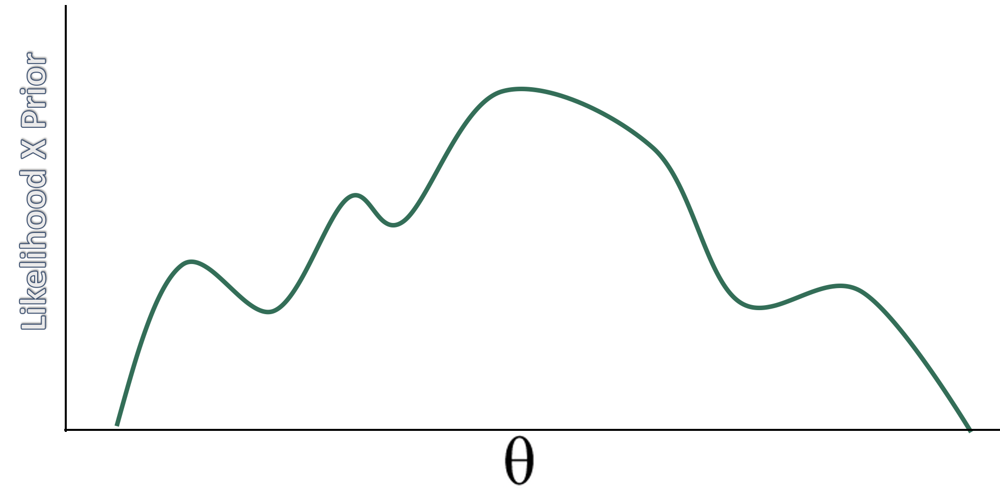
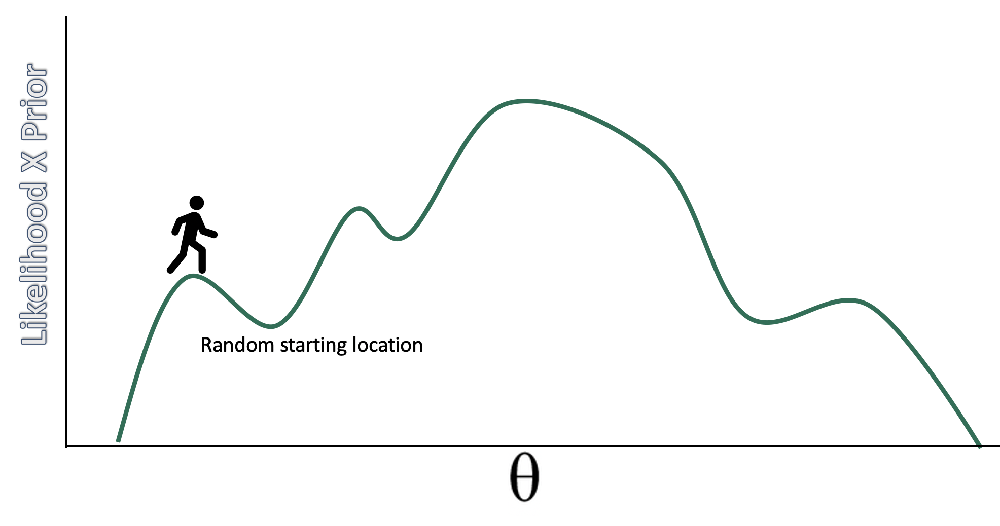
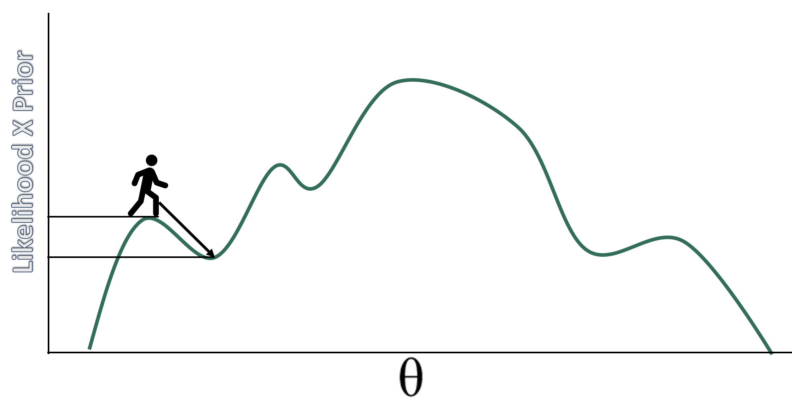
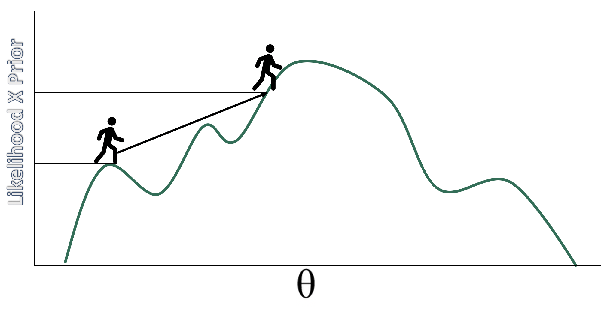
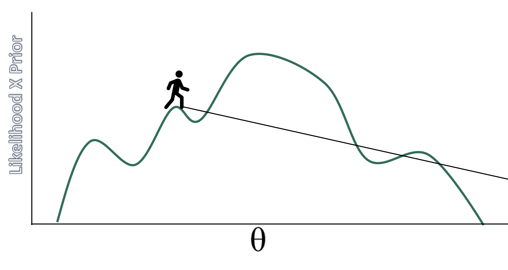
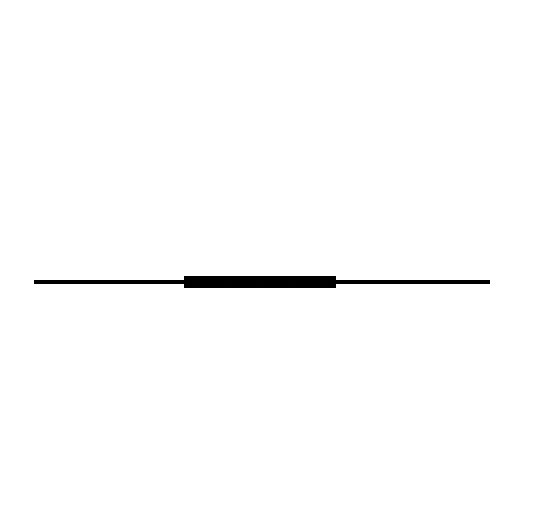
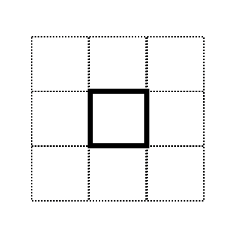
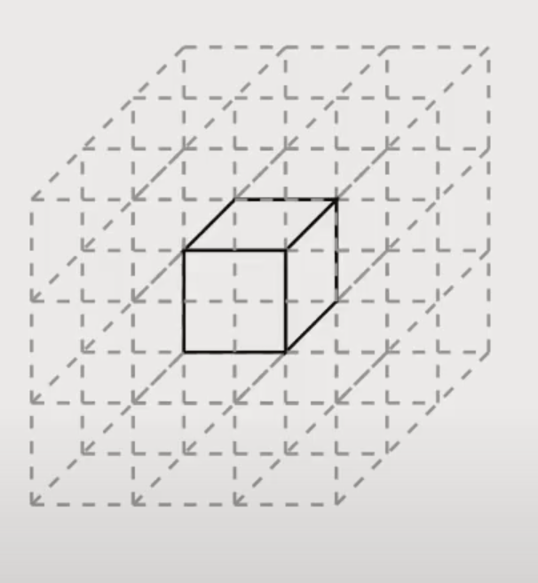
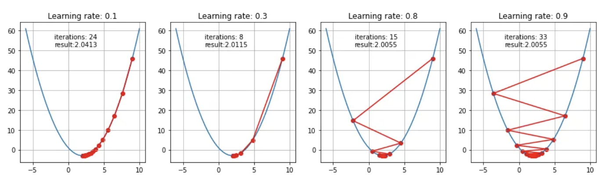

## Why a whole lecture on MCMC? {.smaller}

-   Every `brm()` you've run so far has quietly run MCMC. The "chains" it reports, the `Rhat` and `Bulk_ESS` columns, and the occasional warning in red all come from it.

-   You don't need to be able to build a sampler. You do need to be able to:

    1.  say what the draws *are*
    2.  tell when to trust them
    3.  know what to do when brms complains

-   Today: open the hood just far enough to do those three things. (Reviewers increasingly ask for convergence diagnostics, too.)

## From a grid to a pile of draws {.smaller}

-   Lecture 1: the posterior is a **pile of guesses**, more of them where the posterior is higher. Every summary we use is counting in that pile.

-   On a grid we built the pile by scoring every possible value. Fine for one or two parameters; hopeless for ten (100 values each = 100^10 scores).

-   MCMC gets the same kind of pile **without the grid**: it wanders through parameter values, spending more time where prior × likelihood is higher.

-   Think of marbles in a bag: we can't see inside, but if we draw enough marbles we learn what the bag holds.

## Ways to get a posterior {.smaller}

| Approach | Idea | When it works |
|---|---|---|
| Grid | score every possible value | 1–2 parameters (lecture 1) |
| Conjugate math | pick a prior that makes the answer a known formula | a few simple models |
| Approximation | assume the posterior is roughly normal | large samples, simple models |
| **MCMC** | draw samples from it | almost anything: what brms does |

The rest of the lecture: why the direct route is hard, how MCMC gets around it, and how to check that it worked.

## Why this way? {.smaller}

-   Short answer: computation is difficult.

-   Computation of the posterior requires three terms: a prior, a likelihood and the evidence. The evidence (aka probability of the data; marginal likelihood) normalizes the posterior so it integrates (adds up) to 1.

-   We assume a prior distribution and we can compute a likelihood based on what we know about the distribution we assumed for the DGP (most of the time). The tricky part is the evidence. This makes computation analytically intractable.

$$ p(x) = \int_\theta p(x|\theta)p(\theta)d(\theta) $$

Two ways around this integral: make it easy (conjugate priors), or avoid it entirely (MCMC).

## Escape 1: conjugate priors {.smaller}

-   With many parameters it is basically impossible to compute analytically. "Bayesian analysis is hard because integrals are hard". Maximization (derivatives) is easier than integrals, which is why frequentist is so popular.

-   Conjugate priors are a less computational heavy approach to solving the integral problem. If posterior is from the same family as prior then it is easier to compute the evidence. E.g., a normal likelihood (with known σ) and a normal prior on the mean give a normal posterior; a binomial likelihood and a beta prior give a beta posterior (what we did on the grid in week 1); for a variance, the conjugate prior is an inverse-gamma. As a result the posterior, p( $\theta$ \| data), becomes analytically tractable.

-   The catch: only a handful of simple prior–likelihood pairs are conjugate. Logistic regression, multilevel models, and most of what we'll fit this semester have none, so we need another way.

## Escape 2: we don't need the evidence {.smaller}

$$p(\theta | data) = \frac{p(data | \theta) \times p(\theta )}{p(data)}$$

The denominator, $p(data)$, is called the **evidence**: the probability of the data, averaged over every possible $\theta$. It's the same number for every value of $\theta$, so the posterior is proportional to the likelihood × the prior:

$$ p(\theta | data) \propto p(data | \theta) \times p(\theta ) $$

Why compare two values? A sampler moves from one value of $\theta$ to the next, and to decide whether to move it asks: "is this new value more plausible than the one I'm at?" In that comparison, the evidence cancels:

$$\frac{p(\theta_1 | data)}{p(\theta_2 | data)} = \frac{p(data | \theta_1)\, p(\theta_1)}{p(data | \theta_2)\, p(\theta_2)}$$

That's all MCMC needs: likelihood × prior, never the evidence.

## The posterior is a landscape {.smaller .nostretch}

Every spot on the map is one set of parameter values. Its **height** is prior × likelihood: how well those values explain the data, weighted by what we believed beforehand. We're looking down from above, like a topographic map: both axes are parameters, and **brightness is height**. (With one parameter we can see the hill from the side instead; that's coming up.)

:::: columns
::: {.column width="55%"}
```{r}
#| code-fold: true
#| fig-height: 3.3
#| fig-width: 5
#| out-width: "100%"
library(tidyverse)
# a made-up two-parameter posterior with a curved ridge
log_target <- function(x, y) dnorm(x, 0, 1.2, log = TRUE) + dnorm(y, 0.6 * x^2 - 1, 0.6, log = TRUE)
landscape <- expand_grid(x = seq(-3.5, 3.5, length.out = 200), y = seq(-2.5, 6, length.out = 200)) %>%
  mutate(height = exp(log_target(x, y)))
ggplot(landscape, aes(x, y, fill = height)) +
  geom_raster() +
  scale_fill_viridis_c(option = "magma", name = "likelihood\n× prior",
                       breaks = function(lims) lims, labels = c("low", "high")) +
  labs(x = expression(theta[1]), y = expression(theta[2])) +
  theme_classic(base_size = 14)
```
:::
::: {.column width="45%"}
-   **Maximum likelihood** finds the summit
-   **Bayes** wants the whole map: where the high ground is, and how much of it there is
-   With 2 parameters we can draw it. With 50 (a typical multilevel model) nobody can: we're exploring in the dark
:::
::::

## A hiker in the fog {.smaller .nostretch}

The hiker sees only the ground underfoot. One rule: **step somewhere nearby; if it's higher, go; if it's lower, go only sometimes.**

```{r}
#| code-fold: true
#| fig-height: 3
#| fig-width: 9
#| out-width: "100%"
library(patchwork)
set.seed(11)
n_steps <- 6000
path <- matrix(NA, n_steps, 2); here <- c(3, -2)                  # start somewhere low
for (i in 1:n_steps) {
  step <- here + rnorm(2, 0, 0.4)
  if (log(runif(1)) < log_target(step[1], step[2]) - log_target(here[1], here[2])) here <- step
  path[i, ] <- here
}
path <- as_tibble(path, .name_repair = ~ c("x", "y")) %>% mutate(step = row_number())
base <- ggplot(landscape, aes(x, y)) +
  geom_contour(aes(z = height), colour = "grey70", bins = 8) +
  coord_cartesian(xlim = c(-3.5, 3.5), ylim = c(-2.5, 6)) +
  labs(x = expression(theta[1]), y = expression(theta[2])) + theme_classic(base_size = 13)
(base + geom_path(data = filter(path, step <= 150), colour = "#D55E00") +
   geom_point(data = filter(path, step == 1), colour = "#D55E00", size = 3) +
   labs(subtitle = "the first 150 steps, from a bad start")) |
(base + geom_point(data = filter(path, step > 1000), alpha = .08, size = .6, colour = "#0072B2") +
   labs(subtitle = "5,000 footprints later"))
```

The hiker never sees the map, yet the footprints pile up where the land is high, in proportion to its height. **The footprints are the posterior draws.** That's MCMC.

## Born at Los Alamos, used everywhere {.smaller}

-   **1953:** Nicholas Metropolis, Arianna and Marshall Rosenbluth, and Augusta and Edward Teller needed to average over more arrangements of atoms than could ever be listed. On MANIAC, one of the first computers, they used the hiker's rule: wander, preferring likely states. (Arianna Rosenbluth wrote the code.)
-   **1970:** Hastings generalized it. **1990:** Gelfand and Smith showed statisticians it made Bayesian models practical, and Bayesian statistics took off
-   Named one of the **top 10 algorithms of the 20th century**
-   Still everywhere, because it works when the landscape is too big to map: physicists estimating the parameters of the universe from the cosmic microwave background, biologists reconstructing evolutionary trees, epidemiologists estimating the effects of COVID-19 lockdowns, election forecasters, and every `brm()` you run

## Markov Chain Monte Carlo {.smaller}

-   Markov Chain: random process that moves between states, where the next state depends only on the current state. This is the "memoryless" property: given where you are now, where you were before adds nothing. (Draws are still correlated with earlier draws through the chain, which is why we'll check autocorrelation.)

-   Monte Carlo: Famous casino in Monaco. Used here to refer to repeated random sampling, like tossing dice

-   In the limit, the samples generated by the MCMC method will be samples from the target (posterior in our case) distribution. Note that the shape of the posterior does not have to be defined by a known probability distribution -- it can take any shape.

## MCMC

-   Refers to a series of different algorithms. Metropolis, Gibbs, Hamiltonian are the most popular and historically relevant.

-   Stan (and thus brms) uses Hamiltonian\

-   JAGS (in Kruschke's DBDA) stands for Just Another Gibbs Sampler

-   BUGS (Bayesian inference Using Gibbs Sampling) was the standard tool in the 1990s and 2000s

## Metropolis {.smaller}

Steps of algorithm:

1.  Sample a value of $\theta$

2.  Propose a new value centered on old + noise N(0, $\sigma$ )

3.  Calculate likelihood\*prior of proposal

4.  Divide the proposal's value by the current value: the acceptance ratio

5.  Draw a random number from runif(1)

6.  If the random number is less than the ratio, move to the proposal; otherwise stay. (Uphill moves, ratio > 1, are always accepted; downhill moves only sometimes.)

## Metropolis, step by step (1)

Now the side view: one parameter along the bottom, and height (likelihood × prior) on the y-axis. Same idea, same hiker.

{.r-stretch}

## Metropolis, step by step (2)

**Start** somewhere, anywhere. (Stan picks random starting values for you.)

{.r-stretch}

## Metropolis, step by step (3) {.smaller}

-   **Propose:** new θ = current θ + a random nudge, e.g. Normal(0, step size). Here the nudge happens to land downhill.
-   **Ratio:** height there ÷ height here (the two horizontal lines) = 0.24 / 0.34 ≈ 0.7
-   **Decide:** draw `runif(1)`. Below 0.7, move; otherwise stay put and record this spot again. So this downhill move happens 70% of the time.

{.r-stretch}

## Metropolis, step by step (4) {.smaller}

-   Another proposal, this time uphill: ratio = 0.58 / 0.34 ≈ 1.7
-   Every `runif(1)` is below 1.7, so **uphill moves always happen**
-   Repeat thousands of times. The hiker spends time in each place in proportion to its height, and the recorded spots are the posterior draws.

{.r-stretch}

## Metropolis, step by step (5) {.smaller}

-   **Step size** = how big the random nudge is, and it matters
-   **Too small:** almost every proposal is accepted, but the hiker inches along and rarely makes it across a valley to another hill
-   **Too big:** proposals often land far down in low ground (like this one) and get rejected, so the hiker stands still a lot

{.r-stretch}

## Metropolis in 15 lines {.smaller}

The hiker's rule on the smallest possible landscape. McElreath's King Markov (SR 9.1): 10 islands in a ring, island *k* has population proportional to *k*, and the king wants to visit each island in proportion to its population. Each week he flips a coin to propose a neighbor and moves with probability (proposal population / current population). The islands are the possible values of θ; population is the height (likelihood × prior).

```{r}
#| code-fold: true
set.seed(9)
num <- 1000
positions <- rep(0, num) 
current   <- 10

for (i in 1:num) {
  
  # record current position 
  positions[i] <- current
  # flip a coin to propose a neighboring island
  proposal <- current + sample(c(-1, 1), size = 1)
  # the islands form a ring: 1 and 10 are neighbors
  if (proposal < 1) proposal <- 10
  if (proposal > 10) proposal <- 1
  # move with probability proposal / current (always move "uphill")
  prob_move <- proposal/current
  current <- ifelse(runif(1) < prob_move, proposal, current)
  
}  

library(tidyverse)

tibble(week   = 1:1000,
       iteration = positions) %>%
  ggplot(aes(x = week, y = iteration)) +
  geom_point(shape = 1) +
  scale_x_continuous(breaks = seq(from = 0, to = 1000, by = 100)) +
  scale_y_continuous(limits = c(-2, 13), breaks = seq(from = -2, to = 15, by = 2)) +
  coord_cartesian(xlim = c(0, 1000)) +
  labs(title = "The king's path: one island per week") +
  xlab("week (iteration)") + ylab("island")


```

## Did the king hit his target? {.smaller .nostretch}

Orange: the target. Island 10 has 10× the people of island 1, so it should get 10× the weeks (18% vs 2%). Grey: the share of weeks the king actually spent there.

```{r}
#| code-fold: true
#| fig-height: 2.45
#| fig-width: 8
#| out-width: "75%"
tibble(island = positions) %>%
  count(island) %>%
  mutate(share = n / sum(n), target = island / sum(1:10)) %>%
  ggplot(aes(x = island)) +
  geom_col(aes(y = share), fill = "grey70") +
  geom_point(aes(y = target), colour = "#D55E00", size = 3) +
  scale_x_continuous(breaks = 1:10) +
  labs(y = "share of weeks", title = "after 1,000 weeks") +
  theme_classic(base_size = 13)
```

-   1,000 weeks is about `r round(1000 / 52)` years of island hopping, and the king never computed those percentages; he only compared neighbors
-   Close but not exact. As the number of weeks grows, the grey bars get closer and closer to the orange target

## Metropolis on a real posterior {.smaller}

Galton's children's heights again, estimating the mean μ (σ fixed at 2.5 to keep it one-dimensional) with lecture 1's prior, μ ~ Normal(66, 5). Same recipe as the king, with a continuous "island":

```{r}
heights <- psychTools::galton$child
log_post <- function(mu) sum(dnorm(heights, mu, 2.5, log = TRUE)) + dnorm(mu, 66, 5, log = TRUE)

set.seed(27)
chain <- numeric(5000)
current <- 60                                   # a deliberately bad start
for (i in 1:5000) {
  proposal <- current + rnorm(1, 0, 0.2)        # a small random step
  if (log(runif(1)) < log_post(proposal) - log_post(current)) current <- proposal   # ratio, on the log scale
  chain[i] <- current
}
```

Comparing on the log scale (a difference instead of a ratio) avoids the tiny-number problem from lecture 1.

## Did it find the posterior? {.nostretch}

```{r}
#| code-fold: true
#| fig-height: 2.8
#| fig-width: 9
#| out-width: "100%"
library(patchwork)
# exact posterior for a normal mean with known sigma (conjugate)
post_prec <- length(heights) / 2.5^2 + 1 / 5^2
post_mean <- (sum(heights) / 2.5^2 + 66 / 5^2) / post_prec
p.trace <- tibble(iteration = 1:5000, mu = chain) %>%
  ggplot(aes(iteration, mu)) + geom_line(linewidth = .3) +
  annotate("rect", xmin = 0, xmax = 1000, ymin = -Inf, ymax = Inf, alpha = .15, fill = "#D55E00") +
  labs(y = expression(mu), subtitle = "shaded: warmup, discarded") + theme_classic(base_size = 13)
p.dens <- tibble(mu = chain[-(1:1000)]) %>%
  ggplot(aes(mu)) + geom_histogram(aes(y = after_stat(density)), bins = 40, fill = "grey75", colour = "white") +
  stat_function(fun = dnorm, args = list(post_mean, 1 / sqrt(post_prec)), colour = "#0072B2", linewidth = 1) +
  labs(x = expression(mu), y = NULL, subtitle = "grey: 4,000 draws · blue: the exact posterior") + theme_classic(base_size = 13)
p.trace | p.dens
```

The chain walks from its bad start to the posterior (that walk is what warmup throws away), then wanders around it. Its draws match the exact answer.

## Multivariate posterior distributions

-   Posteriors are not simple hill climbing exercises, instead they represent high dimensional spaces. These high dimensional spaces make it such that there is a lot of space to explore.

-   To visualize posteriors we usually "marginalize" them: look at one parameter at a time, averaged over all the others.

## Joint and marginal distributions

Raw data here (friends and health), but the idea is the same for a posterior: the scatter is the *joint* distribution; the curves on the edges are the *marginals*.

```{r}
#| code-fold: true
data <- read.csv("week3.csv") %>%   # also at https://josh-jackson.github.io/bayes27/week3.csv
  select(-ID, -SES)

library(ggExtra)

p <- ggplot(data, aes(x=friends, y=health)) +
      geom_point() +
      theme(legend.position="none")

p2 <- ggMarginal(p, type="density")
p2
```

## A correlated posterior

```{r}
#| code-fold: true
samples = 200
r = 0.93

cor.dat = MASS::mvrnorm(n=samples, mu=c(0, 0), Sigma=matrix(c(1, r, r, 1), nrow=2), empirical=TRUE)
X = cor.dat[, 1]  # standard normal (mu=0, sd=1)
Y = cor.dat[, 2]  # standard normal (mu=0, sd=1)

cor <- tibble(X,Y)

cor %>% 
  ggplot(aes(x = X, y = Y, fill = after_stat(density))) +
  stat_density_2d(geom = "raster", contour = F) +
  scale_fill_viridis_c(option = "D") +
  labs(x = expression(theta[1]),
       y = expression(theta[2])) +
  coord_equal() 


```

## Gibbs {.smaller}

-   To explore a high dimensional space we need to be savvy about our proposals. Especially, when we are drawing samples for each parameter given a specific value of another parameter.

-   Gibbs updates one parameter at a time, drawing it directly from its distribution *given the current values of all the others* (its "full conditional"). Every draw is accepted, so there's no wasted guess-and-check.

-   Usually faster than Metropolis (and good enough for many regressions), but it needs those conditional distributions to be easy to sample from, which in practice means conjugate priors.

## When Gibbs and Metropolis struggle

-   Both struggle when parameters are strongly correlated, like the posterior below: moving one parameter at a time (Gibbs) or with small random steps (Metropolis) creeps slowly along the narrow ridge. Metropolis also needs its step size tuned: too small and it takes forever to explore, too large and most proposals are rejected.

```{r, echo = FALSE}
samples = 200
r = 0.93

cor.dat = MASS::mvrnorm(n=samples, mu=c(0, 0), Sigma=matrix(c(1, r, r, 1), nrow=2), empirical=TRUE)
X = cor.dat[, 1]  # standard normal (mu=0, sd=1)
Y = cor.dat[, 2]  # standard normal (mu=0, sd=1)

cor <- tibble(X,Y)

cor %>% 
  ggplot(aes(x = X, y = Y, fill = after_stat(density))) +
  stat_density_2d(geom = "raster", contour = F) +
  scale_fill_viridis_c(option = "D") +
  labs(x = expression(theta[1]),
       y = expression(theta[2])) +
  coord_equal() 


```

## Concentration of measure

-   With many parameters, guess and check (Metropolis) becomes very inefficient: most proposals get rejected, or the chain keeps re-exploring the same ground.

-   The reason is surprising. **Probability = height × room.** The mode is the highest point, but there's almost no room near it. Far out there's lots of room but almost no height. With many parameters, most of the probability ends up in between, away from the mode.

## Where the room is (1)

One parameter: the middle third of the range is **1/3** of the space.

{.r-stretch}

## Where the room is (2)

Two parameters: the middle square is **1/9** of the space.

{.r-stretch}

## Where the room is (3)

Three parameters: the middle cube is **1/27**. With 10 parameters it's 1/59,049 (0.002%). Almost all the room is out toward the edges.

{.r-stretch}

## Near the peak, all at once? {.smaller .nostretch}

Say each parameter is normal (and independent, to keep it simple). One parameter is within 1 SD of its peak in 68% of draws. To be near the mode of the *whole* model, **every** parameter has to be within 1 SD at once.

```{r}
#| code-fold: true
#| fig-height: 2.2
#| fig-width: 8
#| out-width: "70%"
within_1sd <- pnorm(1) - pnorm(-1)                     # 0.68
tibble(parameters = 1:25, share = within_1sd^parameters) %>%
  ggplot(aes(parameters, share)) +
  geom_line(colour = "#0072B2", linewidth = 1) +
  geom_point(colour = "#0072B2") +
  scale_y_continuous(labels = scales::percent) +
  labs(x = "number of parameters", y = "draws with every\nparameter within 1 SD") +
  theme_classic(base_size = 13)
```

-   10 parameters: `r round(100 * (pnorm(1) - pnorm(-1))^10)`% of draws (a typical draw has about 3 parameters out past 1 SD). 100 parameters: about 1 in 40 quadrillion
-   So you'll never see a draw near the mode, though it's the single most likely point. The draws live in a band away from it, and that's where the sampler has to work

## Why that breaks the hiker {.smaller}

From a spot in that band, almost every random direction leads off it: outward to low ground, or inward where there's no room. So most Metropolis proposals get rejected. Here is Metropolis on a normal posterior, same step size (0.5 SD) every time:

```{r}
#| code-fold: true
metropolis_accept <- function(n_par, step = 0.5, n_iter = 5000) {
  here <- rep(0, n_par); accepted <- 0
  for (i in 1:n_iter) {
    proposal <- here + rnorm(n_par, 0, step)
    if (log(runif(1)) < sum(dnorm(proposal, log = TRUE)) - sum(dnorm(here, log = TRUE))) {
      here <- proposal; accepted <- accepted + 1
    }
  }
  accepted / n_iter
}
set.seed(1)
tibble(parameters = c(1, 10, 100)) %>%
  mutate(`proposals accepted` = scales::percent(map_dbl(parameters, metropolis_accept), accuracy = 0.1)) %>%
  knitr::kable()
```

-   The usual fix: shrink the steps as the number of parameters grows. Then proposals are accepted, but the hiker inches along and successive draws are nearly identical
-   What we want instead: a sampler that knows which way the band curves, so it can take long steps and stay on it

## Hamiltonian MCMC {.smaller}

-   Instead of guessing a direction, use the slope of the posterior (the gradient) to glide along the band. Long steps, and they still get accepted. It's a physics simulation!

-   Pretend you have a hockey puck and flick it on an air hockey table that represent the minus log of the posterior (for a gaussian this would be a valley or a bowl). After a flick, we will record the position after a certain time. No rejections (almost)! Depending on the topography the puck will go slower or faster and change direction.

-   Proposals based on the `gradient`, which is just the slope via derivative.

## What the gradient is for {.smaller}

-   The **gradient** is the slope of the (log) posterior surface where you are now: which way is uphill, and how steep
-   **Optimizers** (maximum likelihood: `lm()`, `glm()`, `lme4`) follow it uphill to the single peak and stop. One answer, no distribution
-   **HMC** uses the same gradient differently: the puck feels the slope and glides across the surface, so it explores the *whole* posterior, spending time in proportion to its height instead of stopping at the top
-   Same ingredient, two goals: find the top (optimization) vs. map the whole mountain (sampling)

## Following the gradient, pictured



## Visualize H-MCMC

[chi-feng.github.io/mcmc-demo](https://chi-feng.github.io/mcmc-demo/app.html): try Random Walk Metropolis vs. Hamiltonian Monte Carlo on the "banana" or "donut" target.

## Gradients and autodiff

-   If proposals depend on the curvature or gradient in the posterior how do we calculate that? Derivatives. Lots of them.

-   Automatic differentiation (autodiff) computes those gradients exactly and efficiently, which is what makes HMC practical.

-   We are not calculating the posterior directly, but instead just local estimation of the curvature (not full integral).

-   The samples give us a full picture of the posterior.

## Can we ensure accurate posteriors?

Two key points:

1.  It is iterative, does not create the posterior distribution, instead it results in samples.

2.  It is stochastic. This means you won't get the same result each time (unless you set a seed).

So we need to make sure that the algorithm "works" in that there are enough samples to get a good picture of the posterior, and that the samples will replicate across different attempts.

## How many iterations do you need? {.smaller}

-   More iterations = more precise Monte Carlo estimates of the *same* posterior (not a narrower posterior). Usable draws = (iterations − warmup) × chains

-   Effective sample size: roughly the number of draws divided by (1 + 2 × the sum of the autocorrelations), i.e., how many *independent* draws your correlated draws are worth. It can even exceed the number of draws when successive draws are negatively correlated (this is good!). Referred to as Bulk_ESS in `brms`

-   Tail_ESS is similar but it is used more for CIs. The convergence of Markov chains are not uniform across the parameter. Central tendency estimates should use Bulk_ESS, whereas for intervals (the tails) look at Tail_ESS.

-   **How much is enough?** Rule of thumb: Bulk_ESS and Tail_ESS above about **400** (≈100 per chain with 4 chains) for every parameter you report (Vehtari et al., 2021).

## A model to diagnose

```{r}
#| code-fold: true
library(tidyverse)
library(brms)

week3 <- read.csv("week3.csv") %>%   # also at https://josh-jackson.github.io/bayes27/week3.csv
  dplyr::select(-ID, -SES) %>% 
  mutate(mood.group.d = factor(mood.group) %>% 
           fct_recode("control" = "0", "tx" = "1", "tx" = "2"))


h.3 <- 
  brm(family = gaussian,
      health ~ 0 + mood.group.d,
      prior = c(prior(normal(0, 10), class = b),
                prior(cauchy(0, 10), class = sigma)),
      data = week3,
      iter = 1000, warmup = 500, chains = 2, cores = 2,
      backend = "cmdstanr",
      file = "h.3")
summary(h.3)

```

## Autocorrelation within each chain

```{r}
#| code-fold: true
library(bayesplot)
mcmc_acf(h.3, pars = c("b_mood.group.dcontrol", "b_mood.group.dtx", "sigma"))
```

Each bar is the correlation between a draw and the draw *lag* steps later, within a chain. Here it drops to about 0 after a lag or two: the draws are nearly independent, so ESS is close to the number of draws.

## How many chains do you need? {.smaller}

-   Enough to check convergence: several chains from different starting points should end up describing the same distribution.

-   More chains cost more warmup (each chain throws its own away), and they only run in parallel if you have the cores.

-   The Stan team suggests that 4 chains are adequate for checking convergence. `brms` defaults are iter = 2000 and warmup = 1000 which yields 4000 usable posterior samples ((iter - warmup) \* chains).

When setting up models: `one short chain to debug, four chains for verification and inference`

## Checking convergence

Convergence is to a target distribution (the required posterior), not to a single value as in ML methods.

First step is to look for fuzzy caterpillars (mixing, stationarity, and convergence) in the trace plots. Note that our warm up samples are not visualized.

## What warmup does {.smaller .nostretch}

The same model, four chains started far apart, keeping the warmup draws this time:

```{r}
#| code-fold: true
#| results: hide
#| message: false
#| fig-height: 3
#| fig-width: 9
#| out-width: "100%"
h.3w <- update(h.3, save_warmup = TRUE, chains = 4, cores = 4, init = 10, seed = 27, file = "h.3w")
mcmc_trace(as_draws_array(h.3w, inc_warmup = TRUE), pars = "b_mood.group.dcontrol",
           n_warmup = 500, window = c(0, 150)) +
  labs(subtitle = "the first 150 of 500 warmup iterations")
```

The chains start in different places and find the same region within a few dozen steps. Warmup also tunes the step size; its draws are thrown away. R-hat asks whether the chains, after warmup, agree.

## Trace plots

```{r}
#| code-fold: true
plot(h.3)
```

## Rank plots

A more sensitive check than trace plots: pool all draws, rank them, then plot each chain's ranks as a histogram. If the chains are exploring the same distribution, every chain's histogram is roughly **flat** (each chain gets its fair share of low, middle, and high values).

```{r}
#| code-fold: true
#| fig-height: 3.5
mcmc_rank_overlay(h.3, pars = c("b_mood.group.dcontrol", "b_mood.group.dtx", "sigma"))
```

A chain whose histogram bulges at one end is stuck in part of the posterior, even if its trace plot looks like a fuzzy caterpillar.

## R-hat

-   Compares the variance between chains to the variance within chains (brms reports the improved rank-normalized, split version).

-   1 indicates that the chains agree.

-   Current recommendation: R-hat < 1.01 for every parameter (Vehtari et al., 2021). Older rules of thumb used 1.1 or 1.05; brms warns above 1.05.

## Fixing wild chains

In roughly this order:

1.  **Check the model:** vague priors, redundant or poorly identified parameters, a likelihood that doesn't fit the data

2.  **Run longer:** more warmup and iterations (helps R-hat and ESS when the model is fine but mixing is slow)

3.  **Adjust the sampler:** `adapt_delta`, `max_treedepth` (a last resort, after the model is right)

## Which warning, which fix? (1) {.smaller}

| Warning | What it means | Usual cause | First things to try |
|---|---|---|---|
| R-hat > 1.01 | chains disagree | too short a run; a multimodal or poorly identified posterior | more warmup/iterations; check the model (priors, redundant parameters) |
| Low Bulk/Tail ESS | too few effectively independent draws | high autocorrelation, often from strongly correlated parameters | more iterations; reparameterize or remove redundancy |

## Which warning, which fix? (2) {.smaller}

| Warning | What it means | Usual cause | First things to try |
|---|---|---|---|
| Divergent transitions | the sampler hit regions it can't follow; **results may be biased** | sharp curvature: tiny data with vague priors, funnels in multilevel models | better priors; `adapt_delta = .95` or `.99`; non-centered parameterization |
| Max treedepth | the sampler took the longest allowed trajectories; an **efficiency** warning | long, narrow posteriors (e.g., near-duplicate predictors), flat priors | fix the model first; then `max_treedepth = 12` or more |

Rule of thumb: **divergences and non-identified models need a model fix; sampler settings are a last resort.**

## Divergent transitions

Because this is a physics simulation, we can examine the "energy" of the hockey puck to see if our simulation goes wrong. This is a good property of H-MCMC; similar properties do not exist for other algorithms.

A deliberately bad model: two data points (−1 and 1) with absurdly vague priors (an SD of 1,000 on the mean, and a σ prior with a mean of 10,000).

```{r}
#| code-fold: true
div.t <-
  brm(data = list(y = c(-1, 1)), 
      family = gaussian,
      y ~ 1,
      prior = c(prior(normal(0, 1000), class = Intercept),
                prior(exponential(0.0001), class = sigma)),
      iter = 2000, warmup = 1000, chains = 2,
      backend = "cmdstanr",
      file = "div.t")
```

## A model with divergences

```{r}
#| code-fold: true
summary(div.t)
```

## Divergences in a pairs plot

```{r}
#| code-fold: true
pairs(div.t, 
      np = nuts_params(div.t),
      off_diag_args = list(size = 1/4))
```

## Divergences in trace plots

```{r}
#| code-fold: true
plot(div.t)
```

## Fixing the divergences: better priors {.smaller}

Same two data points, priors on a sensible scale:

```{r}
div.ok <- brm(data = list(y = c(-1, 1)), family = gaussian, y ~ 1,
              prior = c(prior(normal(0, 10), class = Intercept),
                        prior(exponential(1), class = sigma)),
              iter = 2000, warmup = 1000, chains = 2, seed = 27,
              backend = "cmdstanr", file = "div.ok")
count_div <- function(m) sum(subset(nuts_params(m), Parameter == "divergent__")$Value)
c(vague_priors = count_div(div.t), sensible_priors = count_div(div.ok))
```

No `adapt_delta` needed. With two data points, the priors do a lot of the work, so they have to be sensible.

## A model that can't be identified

Two predictors that carry the same information: each person's leg length, measured on the left and the right leg (after SR 6.1).

```{r}
#| code-fold: true
set.seed(5)
n <- 100
legs <- tibble(height    = rnorm(n, 10, 2),
               leg_prop  = runif(n, .4, .5),
               leg_left  = leg_prop * height + rnorm(n, 0, .02),
               leg_right = leg_prop * height + rnorm(n, 0, .02))
cor(legs$leg_left, legs$leg_right)

legs.1 <- brm(height ~ 1 + leg_left + leg_right, data = legs,
              iter = 400, warmup = 100, chains = 4, cores = 4, seed = 5,
              backend = "cmdstanr", file = "legs.1")    # brms default (flat) priors on the slopes
```

## Non-identified: the symptoms {.smaller}

```{r}
#| code-fold: true
summary(legs.1)
```

R-hat above 1.01, ESS around 150, and each leg slope's interval runs from about −4 to +5 even though leg length obviously predicts height. Look at the shape to see why.

## Non-identified: the shape

```{r}
#| code-fold: true
#| fig-height: 3.5
mcmc_scatter(legs.1, pars = c("b_leg_left", "b_leg_right"), alpha = .3)
```

The data only pin down the **sum** of the two slopes, so the posterior is a long, thin ridge. Running longer maps the ridge more thoroughly but can't make it narrower: **fix the model** (drop or combine the duplicate, or give the slopes real priors).

## Autocorrelation and ESS, side by side {.smaller .nostretch}

```{r}
#| code-fold: true
#| fig-height: 2.8
#| fig-width: 9
#| out-width: "100%"
ess_of <- function(m, par) round(posterior::ess_bulk(posterior::extract_variable_matrix(as_draws_array(m), par)))
(mcmc_acf(h.3, pars = "b_mood.group.dcontrol") +
   labs(title = paste0("h.3: ESS ≈ ", ess_of(h.3, "b_mood.group.dcontrol"), " of ", ndraws(h.3), " draws"))) |
(mcmc_acf(legs.1, pars = "b_leg_left") +
   labs(title = paste0("legs.1: ESS ≈ ", ess_of(legs.1, "b_leg_left"), " of ", ndraws(legs.1), " draws")))
```

On a ridge, each draw is close to the last one: high autocorrelation, so 1,200 draws are worth far fewer independent ones.

## Running longer doesn't fix it {.smaller}

Ten times the iterations:

```{r}
legs.2 <- update(legs.1, iter = 4000, warmup = 1000, seed = 5, file = "legs.2")
summary(legs.2)$fixed[, c("Estimate", "l-95% CI", "u-95% CI", "Rhat", "Bulk_ESS")] %>% round(2) %>% transform(Bulk_ESS = round(Bulk_ESS))
```

The diagnostics improve, but the slopes are just as uncertain: we've mapped the ridge in more detail, not made it narrower.

## Fixing the model {.smaller}

The data only know the **sum** of the slopes, and that sum was well estimated all along:

```{r}
library(tidybayes)
legs.2 %>% spread_draws(b_leg_left, b_leg_right) %>% 
  mutate(sum_of_slopes = b_leg_left + b_leg_right) %>% median_qi(sum_of_slopes)
```

Drop the redundant predictor and the model is identified:

```{r}
legs.3 <- brm(height ~ 1 + leg_left, data = legs, chains = 4, cores = 4, seed = 5,
              backend = "cmdstanr", file = "legs.3")
summary(legs.3)$fixed[, c("Estimate", "l-95% CI", "u-95% CI", "Rhat", "Bulk_ESS")] %>% round(2) %>% transform(Bulk_ESS = round(Bulk_ESS))
```

## Leap Frog steps and NUTS

-   Need to figure out the correct 1) step size (time interval) and 2) number of leap frog steps (where the gradients are calculated).

-   Step size is done through warm up samples.

-   Number of steps is done with NUTS, the No U-Turn Sampler. It extends the puck's path (forward and backward in time) until the path starts to double back on itself, a "U-turn", so each region gets as many steps as it needs and no more.

## Fixing divergences: adapt_delta

If dealing with divergent transitions, increasing the acceptance probability during warm up will result in smaller steps (smaller time interval) and a longer sampling time (but more robust sampling).

```{r, eval = FALSE}
#| code-fold: true
h.3 <- 
  brm(family = gaussian,
      health ~ 0 + mood.group.d,
      prior = c(prior(normal(0, 10), class = b),
                prior(cauchy(0, 10), class = sigma)),
      data = week3,
      iter = 1000, warmup = 500, chains = 2, cores = 2, 
      control = list(adapt_delta = .95), # default is .8 
      file = "h.3_adapt")   # a new file name, or brms just loads the old fit
summary(h.3)
```

## tree depth

Divergent transitions are a validity concern, hitting the maximum treedepth is an efficiency concern. When the maximum allowed tree depth is reached it means the H-MCMC sampler is terminating to avoid excessively long execution time. Treedepth is associated with steps via: 2\^treedepth, with 2\^10 = 1024 leapfrog steps the default.

```{r, eval = FALSE}
#| code-fold: true
h.3 <- 
  brm(family = gaussian,
      health ~ 0 + mood.group.d,
      prior = c(prior(normal(0, 10), class = b),
                prior(cauchy(0, 10), class = sigma)),
      data = week3,
      iter = 1000, warmup = 500, chains = 2, cores = 2, 
      control = list(max_treedepth = 15), # default is 10
      file = "h.3_treedepth")
summary(h.3)
```

## Preview: divergences in multilevel models {.smaller}

The most common place you'll see divergences is a multilevel model with few groups or a small between-group SD. If group effects are $u_j \sim \text{Normal}(0, \tau)$, then when $\tau$ is near 0 all the $u_j$ are squeezed near 0, and the posterior takes a **funnel** shape that HMC can't follow with one step size.

The standard fix is the **non-centered parameterization**: sample standardized effects and scale them,

$$z_j \sim \text{Normal}(0, 1), \qquad u_j = \tau \, z_j$$

Same model, different geometry: the $z_j$ don't get squeezed when $\tau$ is small. brms already does this for you (you'll see it in `stancode()` in the multilevel weeks), but knowing why helps when you write your own Stan code.

## Every time you fit a model {.smaller}

1.  **Read the warnings** brms prints. Don't ignore them
2.  **R-hat < 1.01** for every parameter
3.  **Bulk and Tail ESS > 400** for every parameter you report
4.  **Trace and rank plots:** fuzzy caterpillars, flat rank histograms
5.  **Zero divergences.** Any divergence means look at the model, not just `adapt_delta`
6.  **`pp_check()`:** the model can sample well and still be the wrong model

If something fails: check the model first (priors, redundant parameters), run longer second, tune the sampler last.
