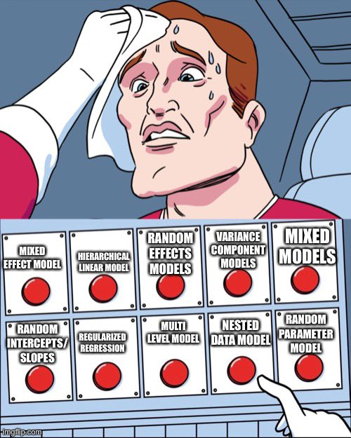
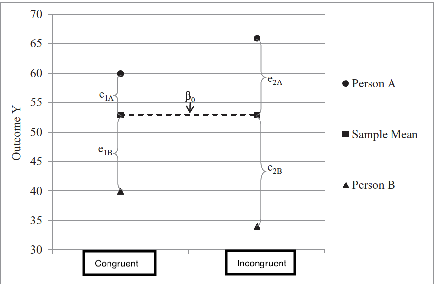
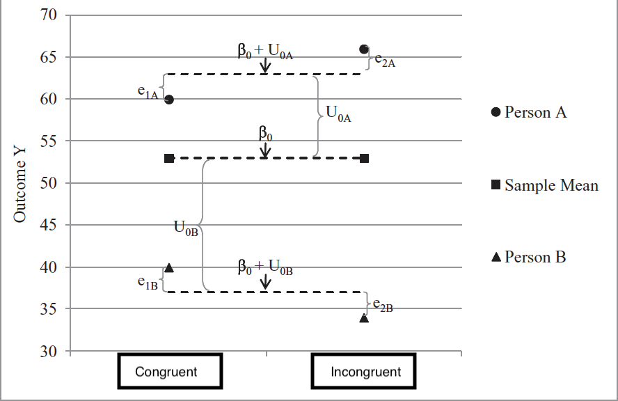

## So many names, one model



## MLM review

$${Y}_{i} = b_{0} + b_{1}X_{i} +  ... +\epsilon_{i}$$

$${Y}_{ij} = b_{0} + b_{1}X_{ij} + ... +\epsilon_{ij}$$ where *i* refers to the cluster or group (e.g., a person) and *j* to the observations within it

## Our running example: the Stroop task {.smaller}

```{r}
st <- read.csv("stroop.csv")  # also at https://josh-jackson.github.io/bayes27/stroop.csv
head(st)
```

-   Lin, Saunders, Friese, Evans & Inzlicht (2020, *Psychological Science*), Study 1: an ego-depletion study. Each person did a hard ("deplete") and an easy ("control") task, each followed by a Stroop task.
-   Our subset: 100 random participants, the first 30 Stroop trials after each task, correct trials only (`r nrow(st)` trials). `rt` is reaction time in ms; `congruency` is whether the word and ink color matched.
-   Trials (*j*) are nested in people (*i*).

```{r}
#| code-fold: true
#| eval: false
# how stroop.csv was made (the full data are in the afex package)
data(stroop, package = "afex")
set.seed(2027)
keep <- sample(unique(as.character(stroop$pno[stroop$study == "1"])), 100)
stroop %>%
  filter(pno %in% keep, trialnum <= 30, acc == 1, !is.na(rt)) %>%
  mutate(id = as.integer(factor(pno, levels = keep)), rt = round(rt * 1000)) %>%
  select(id, condition, trial = trialnum, congruency, rt)
```

```{r, echo = FALSE}
library(tidyverse)
library(tidybayes)
library(ggdist)
library(brms)
library(modelr)
library(marginaleffects)
```

## Twenty people, twenty Stroop effects {.smaller}

```{r}
#| code-fold: true
#| fig-width: 9
#| fig-height: 3.6
set.seed(114)
st %>%
  filter(id %in% sample(unique(id), 20)) %>%
  group_by(id, congruency) %>%
  summarise(rt = mean(rt), .groups = "drop") %>%
  ggplot(aes(x = congruency, y = rt, group = id, colour = factor(id))) +
  geom_line() + geom_point() +
  labs(x = NULL, y = "Mean RT (ms)") +
  theme_classic(base_size = 14) + theme(legend.position = "none")
```

Everyone is slower on incongruent trials, but people differ in how fast they are overall *and* in how big their Stroop effect is. Today: the first of those (intercepts). Next time: the second (slopes).

## Empty model

Level 1 $${Y}_{ij} = \beta_{0i}  + \varepsilon_{ij}$$

Level 2 $${\beta}_{0i} = \gamma_{00} + U_{0i}$$

$${U}_{0i} \sim N(0, \tau_{00}^{2})$$
$${\varepsilon}_{ij} \sim N(0, \sigma^{2})$$

## The empty model, pictured {.smaller}

```{r}
#| code-fold: true
#| fig-height: 3
set.seed(7)
eight <- st %>% filter(id %in% sample(unique(id), 8))
ggplot(eight, aes(x = factor(id), y = rt)) +
  geom_jitter(width = .15, alpha = .3, size = 1) +
  stat_summary(fun = mean, geom = "crossbar", width = .6, colour = "#4C78A8") +   # each person's mean
  geom_hline(yintercept = mean(st$rt), linetype = "dashed") +                     # grand mean
  labs(x = "Person", y = "RT (ms)") + theme_classic(base_size = 14)
```

$${Y}_{ij} = \gamma_{00} + U_{0i}  + \varepsilon_{ij}$$

Dashed: $\gamma_{00}$. Blue bars: each person's mean, $\gamma_{00} + U_{0i}$. Dots around a bar: $\varepsilon_{ij}$. Akin to ANOVA if we treat $U_{0i}$ as between-subjects variance and $\varepsilon_{ij}$ as within-subjects variance.

## Random and fixed effects

::::: columns
::: {.column width="40%"}
Level 1: $${Y}_{ij} = \beta_{0i}  + \varepsilon_{ij}$$

Level 2: $${\beta}_{0i} = \gamma_{00} + U_{0i}$$ Combined: $${Y}_{ij} = \gamma_{00} + U_{0i}  + \varepsilon_{ij}$$
:::

::: {.column width="60%"}
$U_{0i}$ is considered a random effect, as it varies across our grouping

$\gamma_{00}$ is considered a fixed effect, as it is what is fixed (average) across our grouping
:::
:::::

## The empty model in brms {.smaller}

```{r}
st.1 <-
  brm(family = gaussian,
      rt ~ 1 + (1 | id),
      prior = c(prior(normal(650, 150), class = Intercept),   # Stroop RTs average 600-700 ms
                prior(normal(0, 100), class = sd),            # people's averages differ by up to ~200 ms
                prior(exponential(0.01), class = sigma)),     # trial-to-trial noise, mean 100 ms
      iter = 3000, warmup = 1000, chains = 4, cores = 4,
      sample_prior = "yes",
      data = st,
      backend = "cmdstanr",
      file = "st.1")
```

Three priors, in milliseconds: the `Intercept` prior is for the average person, the `sd` prior is for how much people differ from that average ($\sigma_0$), and `sigma` is the trial-to-trial noise within a person. Where these come from is the last of the six intuitions below.

## `st.1` summary

```{r}
summary(st.1)
```

## How much is between people? The ICC {.smaller}

The intraclass correlation: the share of the total variance that is between people,

$$\text{ICC} = \frac{\sigma_0^2}{\sigma_0^2 + \sigma^2}$$

Compute it **draw by draw**, so it gets its own posterior:

```{r}
as_draws_df(st.1) %>%
  mutate(icc = sd_id__Intercept^2 / (sd_id__Intercept^2 + sigma^2)) %>%
  median_qi(icc)
```

## Reading the ICC

```{r}
#| echo: false
icc_1 <- as_draws_df(st.1) %>% mutate(icc = sd_id__Intercept^2 / (sd_id__Intercept^2 + sigma^2)) %>% pull(icc)
```

About `r round(100 * median(icc_1))`% of the variation in RT is stable differences between people; about `r 100 - round(100 * median(icc_1))`% is trial-to-trial variation within a person. Equivalently, two trials from the same person correlate about `r sprintf("%.2f", median(icc_1))`.

Single trials are noisy: that's why reaction-time studies use many trials per person.

## MLM as default and make it maximum

If you have data like this you should analyze like this! If you don't, then you are losing information (GEE being a potential exception).

The question often is about which random effects to fit. There are multiple opinions, but mine is to start maximum, and then work downward (ie simplify) if necessary/consistent with theory. It doesn't really hurt to include them, especially within Bayesian estimation!

## MLM intuitions {.smaller}

Anytime you have repeated DVs you should use MLM as opposed to doing aggregation outside the model. While that should be your default, it is helpful to conceptualize why it is helpful.

1.  Aggregation is bad
2.  Regressions within regressions (ie coefficients as outcomes)
3.  Questions at different levels
4.  Variance decomposition\
5.  Learning from other data through pooling/shrinkage
6.  Parameters that depend on parameters

## 1. Aggregation obscures hypotheses

What if people had more than 1 DV, like our Stroop trials? What do you do with multiple items, multiple trials, multiple \_\_\_\_ ?

Two options: (1) collapse and average across them, or (2) model every observation, nested in its person (MLM). The next slides show what (1) can hide.

## Example

```{r}
#| code-fold: true
library(tidyverse)
library(broom)

simp<- tribble(
  ~ID, ~group,  ~test.score, ~study,
1,1,5,1,
2,1,7,3,
3,2,4,2,
4,2,6,4,
5,3,3,3,
6,3,5,5,
7,4,2,4,
8,4,4,6,
9,5,1,5,
10,5,3,7)
```

```{r, echo=FALSE}
#| fig-height: 4
simp %>%
ggplot(aes(x=study, y=test.score)) +
    geom_point(aes(colour = factor(group)))
```

## Aggregating

Could aggregate across group

```{r, echo = FALSE}
simp.1<- tribble(
  ~ID, ~group,  ~test.score, ~study,
  1,1,6,2,
  2,2,5,3,
  3,3,4,4,
  4,4,3,5,
  5,5,2,6)
```

```{r, echo=FALSE}
#| fig-height: 4
simp.1 %>%
ggplot(aes(x=study, y=test.score)) +
    geom_point() +
    geom_smooth(method=lm, se=FALSE) +
  geom_point(data = simp, aes(colour = factor(group)))
```

## Separate lines for each group

```{r, echo = FALSE}
simp %>%
ggplot(aes(x=study, y=test.score, group = group)) +
    geom_point(aes(colour = factor(group))) +
    geom_smooth(aes(colour = factor(group)),method=lm,se=FALSE)
```

## 1. Aggregation obscures hypotheses

-   Between person H1: Do students who study more get better grades?

-   Within person H2: When a student studies, do they get better grades?

-   H1 and H2 are independent from one another! Aggregation collapses the two. When you have nested data with many DVs it is important to not aggregate.

-   #compositeskill

## 2. Regressions within regressions

Helps to take multilevel and split it into the different levels.

Level 1 is the smallest unit of analysis (students, waves, trials, family members)

Level 2 variables are what level 1 variables are "nested" in (people, schools, counties, families, dyads)

We use the level 1 coefficients as outcomes in a level 2 regression, while level 1 is also estimating its own regression (coefficients as outcomes).

## Stroop example

We calculate stroop scores by looking at repeated trials of congruent vs not congruent. This is dummy coded such that the $\beta_{1}$ reflects the average stroop effect. How much slower are people in incongruent trials?

$$Y_{i} = \beta_{0} + \beta_{1}X_{1} + \varepsilon_i$$

## Stroop as an MLM {.smaller}

$$Y_{trials, i} = \beta_{0i} + \beta_{1i}X_{trial,i} + \varepsilon_{trial,i}$$

$$\beta_{0i} = \gamma_{00} + U_{0i}$$ $$\beta_{1i} = \gamma_{10} +\gamma_{11}Age_i+ U_{1i}$$

Our B1 coefficient indexes the stroop effect. However, people differ on this stroop effect. There is some average effect (fixed effect) that people vary around. Each person has some personal $\beta_1$, which we find using Level 1 data. From there we can also ask questions (with regressions) about that random variable.

## People differ

Same idea with our data: each person has their own average RT, and people vary around the grand mean.

```{r}
#| code-fold: true
#| fig-height: 3.2
set.seed(11)
three <- st %>% filter(id %in% sample(unique(id), 3))
ggplot(three, aes(x = trial, y = rt)) +
  geom_point(alpha = .4) +
  geom_hline(aes(yintercept = m), data = three %>% group_by(id) %>% summarise(m = mean(rt)), colour = "#4C78A8", linewidth = 1) +
  geom_hline(yintercept = mean(st$rt), linetype = "dashed") +
  facet_wrap(~ id, labeller = label_both) +
  labs(x = "Trial", y = "RT (ms)", caption = "Blue: the person's mean. Dashed: the grand mean.") +
  theme_classic(base_size = 13)
```

## Distribution of person means

```{r}
#| code-fold: true
#| fig-height: 3.6
st %>%
  group_by(id) %>%
  summarise(estimate = mean(rt)) %>%
  ggplot(aes(x = estimate)) +
  stat_dotsinterval() + xlab("Person's mean RT (ms)") + ylab(NULL) + theme_classic(base_size = 14)
```

## 3. Different levels

To sum up the first two ways to think about regression, we take a relationship that could be simplified by aggregation, and conduct regressions from regressions. (Regression inception)

The third way is to think of questions at different levels. At level 1 we can ask lower-unit questions e.g., if trials are nested within person, what predicts lengthier trials?

If level 1 is made up of repeated observations, then we can ask level 1/observation level questions like does failure at the trial level impact future trial performance.

## Level 2 questions

At level 2 we can ask broader-unit questions. E.g., is age associated with stroop differences

Often level 2 is between person variables.

Both levels are simple regressions. Level 2 uses coefficients from level 1 as DVs. Level 1 variables are time varying, level 2 variables are time invariant

## 4. Variance decomposition {.smaller}

For standard regression, we think of error as existing in one big bucket called $\varepsilon$ . Everything that we do not know goes into that bucket, from measurement error to unmeasured important factors.

For MLMs we will be breaking up ( $\varepsilon$ ) into multiple buckets. These useful "buckets" (Us) are what we refer to as random/varying effects.

$$Y_{trials, i} = \beta_{0i} + \beta_{1i}X_{trial,i} + \varepsilon_{trial}$$ $$\beta_{0i} = \gamma_{00} + U_{0i}$$ $$\beta_{1i} = \gamma_{10} +\gamma_{11}Z_i+ U_{1i}$$

## One bucket of error

{height=440}

Assume a simple intercept only model where we aggregate across types of trials.

## Person-specific buckets

{height=440}

A MLM intercept only model takes what was previously chalked up to error and reassigns it into person specific "buckets"

## A model for the variance

Model for the means (like normal) and now we have a model for the variance (random effects!)

We will treat random effects as variables themselves e.g. individual differences in reaction time or stroop effect. They index how much people DIFFER on some effect. e.g. does everyone show the same stroop effect?

We can relate the random effects to other random effects e.g., do people who show an effect have a slower reaction time?

## 5. Shrinkage/partial pooling

-   We treat our group variable as coming from a population. All groups are alike (because they are from the same population), but different in their own way. Because of this it is helpful to use information from other groups to help make predictions.

-   We do this in standard regression where we make predictions based on values from the whole dataset (not just binned Xs). We want to pool as this leads to better predictions as we are not overfitting our data!

## Where do the U's come from?

If we take our simplified stroop effect model (an empty model)

$$Y_{trials, i} = \beta_{0i} +  \varepsilon_{trial}$$

$$\beta_{0i} = \gamma_{00} + U_{0i}$$

Where does $U_{0i}$ come from? If we calculated each by hand, through taking the average reaction time for a person i and subtracting that from the grand mean reaction time, would that equal $U_{0i}$ ?

## Complete, partial and no pooling {.smaller}

-   Complete assumes everyone is the same, with $U_{0i}$ being zero for everyone.

-   No pooling is if we calculate every person's effect with a separate regression, subtracting out the grand mean.

-   Partial pooling is in the middle, a weighted average between the two. For those with fewer trials there is less information for a particular individual, thus the complete pooling estimate will be given more weight. If someone has a lot of data, their weighted average is closer to no pooling.

-   Partial pooling prevents both over and under fitting of your data, leading to increased out of sample predictions.

## Complete pooling

Ignores any dependency. Doesn't learn from others, assumes everyone is the same: one mean for all. Underfits the model.

```{r}
#| echo: false
set.seed(3)
pool_ids <- sample(unique(st$id), 30)
pool_dat <- st %>% filter(id %in% pool_ids) %>% mutate(id = fct_reorder(factor(id), rt))
pool_base <- ggplot(pool_dat, aes(x = id, y = rt)) +
  geom_jitter(width = .15, alpha = .15, size = .8) +
  labs(x = "Person (30 of 100, sorted by mean RT)", y = "RT (ms)") +
  theme_classic(base_size = 14) + theme(axis.text.x = element_blank(), axis.ticks.x = element_blank())
```

```{r}
#| code-fold: true
#| fig-height: 3.2
pool_base + geom_hline(yintercept = mean(st$rt), colour = "black", linewidth = 1.2)
```

## No pooling

Everyone is unique and we cannot learn from others: each person's own mean. Leads to overfitting.

```{r}
#| code-fold: true
#| fig-height: 3.2
pool_base + stat_summary(fun = mean, geom = "crossbar", width = .6, colour = "#D55E00")
```

## Partial pooling aka shrinkage aka regularization {.smaller}

```{r}
#| code-fold: true
#| fig-height: 3
pool_base +
  geom_hline(yintercept = mean(st$rt), colour = "black", linewidth = 1.2) +
  stat_summary(fun = mean, geom = "crossbar", width = .6, colour = "#D55E00")
```

Orange: each person's own mean (no pooling). Black: one mean for everyone (complete pooling). Partial pooling lands in between, pulling each person toward the black line, more so for people with little data. We'll see real estimates once we fit the model.

## Partial pooling as learning

Partial pooling aka shrinkage provides the optimal amount of learning from others. Assumes people come from the same distribution but are distinct from one another.

If you have a little data, then the safe bet is to look at the average. If you have a lot of data, you can ignore others.

In a way, this is similar to Bayesian reasoning where learning is based on how much information you have about a person with other people serving as a prior.

## 6. Parameters that depend on other parameters {.smaller}

$$\text{y}_{ij}  \sim \operatorname{Normal}(\mu_{ij}, \sigma)$$ $$\mu_{ij}  = \beta_{0[i]}$$

$$\beta_{0[i]} \sim \operatorname{Normal}({\bar \mu},  \sigma_0)$$ $${\bar \mu}  \sim {\operatorname{Normal}(650, 150)}$$ $$\sigma_0 \sim {\operatorname{Half-Normal}(0, 100)}$$ $$\sigma \sim {\operatorname{Exponential}(0.01)}$$

This is the model we fit as `st.1`.

## Hyperprior

We now have a prior for the population of effects. We typically put a prior directly on parameters. Here, because we are using a multilevel model, we are interested in the population of intercepts, not just a single intercept.

Intercept in simple regression --\> a (prior/posterior) distribution of possible scores

Intercept in mlm --\> a distribution of group/cluster intercepts, described by its own mean ($\bar\mu$) and SD ($\sigma_0$). Those describe the *population* of people, not just the 100 we happened to sample.

## Priors with their own priors {.nostretch .smaller}

The person intercepts $\beta_{0[i]}$ get a prior whose parameters ($\bar\mu$, $\sigma_0$) are themselves estimated: a prior with its own priors.

```{r}
#| code-fold: true
#| out-width: "80%"
#| fig-width: 10
#| fig-height: 4.2
lab <- tribble(~x, ~y, ~label,
  1.2, 3, "bar(mu) %~% Normal(650, 150)",
  3.2, 3, "sigma[0] %~% HalfNormal(0, 100)",
  2.2, 2, "beta[0*'['*i*']'] %~% Normal(bar(mu), sigma[0])",
  4.2, 2, "sigma %~% Exponential(0.01)",
  3.2, 1, "RT[ij] %~% Normal(beta[0*'['*i*']'], sigma)")
arrows <- tribble(~x, ~y, ~xend, ~yend,
  1.3, 2.8, 2.0, 2.2,   3.1, 2.8, 2.4, 2.2,
  2.4, 1.8, 3.0, 1.2,   4.0, 1.8, 3.4, 1.2)
ggplot() +
  geom_segment(data = arrows, aes(x = x, y = y, xend = xend, yend = yend),
               arrow = arrow(length = unit(0.25, "cm"), type = "closed"), colour = "grey50") +
  geom_label(data = lab, aes(x = x, y = y, label = label), parse = TRUE, size = 5.5,
             label.padding = unit(0.4, "lines"), fill = "grey95") +
  annotate("text", x = -0.2, y = c(3, 2, 1), label = c("hyperpriors", "one per person", "one per trial"),
           hjust = 0, colour = "grey40", size = 4.5) +
  xlim(-0.2, 5) + ylim(0.6, 3.4) + theme_void()
```

## Two kinds of priors

If we are estimating a mean, we can divide that up into two priors:

1.  A distribution of our best guess at the mean e.g., N(3,.5) means I am very confident in my guess vs N(3,50). This is all about the mean.

2.  A distribution that represents the spread around that mean e.g., N(0,1) suggests small spread vs (0,100) suggest people may differ a lot (Even though the distribution has the same mean).

Fixed effect describes #1 whereas random effects describe #2

## A single-level model

Notice we have one less parameter we are estimating.

```{r}
st.2 <-
  brm(family = gaussian,
      rt ~ 1 ,
      prior = c(prior(normal(650, 150), class = Intercept),
                prior(exponential(0.01), class = sigma)),
      iter = 3000, warmup = 1000, chains = 4, cores = 4,
      data = st,
      backend = "cmdstanr",
      file = "st.2")
```

## `st.2` summary

```{r}
summary(st.2)
```

## Comparing the two

```{r}
st.1 <- add_criterion(st.1, "loo")
st.2 <- add_criterion(st.2, "loo")
loo_compare(st.1, st.2, criterion = "loo")
```

The MLM wins by a mile: knowing *who* produced a trial helps predict its RT.

## Same intercept, different meaning {.smaller}

-   Notice how the intercept estimate is about the same in each of these models, but the MLM's is less certain (posterior SD `r sprintf("%.1f", fixef(st.1)["Intercept", "Est.Error"])` vs. `r sprintf("%.1f", fixef(st.2)["Intercept", "Est.Error"])` ms): it knows the 100 people differ, so it is less sure about the average person. Conceptually they are different too. The intercept is directly modeled in the standard regression. In the MLM it is better thought of as the map of the distribution of random effects.

-   The population is larger than what we have. This is true for almost anything we do. We sample paradigms, we sample people, we usually never have a full population under our study. Don't we want to model that variation?

## An index model: one mean per person {.smaller}

With mlm we treated means as coming from a population of means. And thus there was a best guess of the mean (intercept) and variation around that guess (SD). With anova we ignored the variation. But we could, in bayes, still examine that variation. Let's fit an index model, where each person gets their own mean. (No priors given, so brms uses flat priors on all 100 means.)

```{r}
st$id.f <- factor(st$id)
st.id <-
  brm(family = gaussian,
      rt ~ 0 + id.f ,
      iter = 3000, warmup = 1000, chains = 4, cores = 4,
      data = st,
      backend = "cmdstanr",
      file = "st.id")
```

## Fixed effects vs random effects {.smaller}

The index model is what economists call a **fixed effects** model: one mean per person, nothing shared across people.

-   **Why economists like it:** comparing each person only to themselves controls for *every* stable person-level confounder, measured or not. An MLM gets the same protection by person-mean centering its predictors (within vs. between effects, next lecture).
-   **Why we usually prefer random effects:** they split the variance into between- and within-person parts, they pool (better predictions for people with little data), and they allow person-level predictors, which a fixed effects model can't estimate.
-   In psychology the clusters are almost always a sample from a bigger population (people, sites, labs), which is exactly what random effects assume.

## `st.id` summary

```{r}
summary(st.id)
```

## Person means from the index model

```{r, warning = FALSE}
as_draws_df(st.id) %>%
  pivot_longer(starts_with("b_id.f"), names_to = "id") %>%
  group_by(id) %>%
  summarise(mean = mean(value), sd = sd(value))
```

## Partial pooling/Shrinkage

$\sigma_0$ (our random effect) can help turn on/off/adjust shrinkage.

Setting SD to zero says everyone is the same. Infinite SD suggests no pooling (and major differences in pop values). In the middle gives you partial pooling.

We use our prior of $\sigma_0$ plus our data to get an estimate of each $\beta_{0[i]}$. This is how we accurately partial pool.

## Pulling out the random effects {.smaller}

```{r}
st.1 %>%
  spread_draws(r_id[id, term]) %>%   # one row per draw per person: 8,000 x 100
  median_qi()
```

-   `r_id` are the $U_{0i}$: each person's **deviation** from the fixed intercept, in ms (like lme4's `ranef()`). `get_variables(st.1)` lists everything in the posterior.
-   `[id, term]` names the indices: person, and which effect (here only `Intercept`).

## Each person's intercept {.smaller}

The fixed effect plus each person's deviation (like lme4's `coef()`), computed draw by draw:

```{r}
st.1 %>%
  spread_draws(b_Intercept, r_id[id, term]) %>%
  mutate(person_I = b_Intercept + r_id) %>%
  median_qi(person_I)
```

## Shrinkage, in one figure {.smaller}

```{r}
#| code-fold: true
#| fig-width: 9
#| fig-height: 4.2
# for a paper: add ggsave("shrinkage.png", width = 6.5, height = 4.5) after the plot
raw <- st %>% group_by(id) %>% summarise(raw = mean(rt), n = n())
pooled <- st.1 %>%
  spread_draws(b_Intercept, r_id[id, term]) %>%
  mutate(pooled = b_Intercept + r_id) %>%
  group_by(id) %>%
  summarise(pooled = mean(pooled))
grand <- fixef(st.1)["Intercept", "Estimate"]
shrink <- left_join(raw, pooled, by = "id") %>% mutate(id = fct_reorder(factor(id), raw))

ggplot(shrink, aes(y = id)) +
  geom_vline(xintercept = grand, linetype = "dashed", colour = "grey50") +
  geom_segment(aes(x = raw, xend = pooled, yend = id), colour = "grey60",
               arrow = arrow(length = unit(0.12, "cm"), type = "closed")) +
  geom_point(aes(x = raw), shape = 21, fill = "white", size = 2) +
  geom_point(aes(x = pooled), colour = "#4C78A8", size = 1.6) +
  labs(x = "Mean RT (ms)", y = "Person (sorted by raw mean)",
       caption = "Open circles: each person's raw mean (no pooling). Blue: partially pooled estimate from the empty model.\nArrows show shrinkage toward the grand mean (dashed): small here, and biggest for the most extreme people.") +
  theme_classic(base_size = 13) +
  theme(axis.text.y = element_blank(), axis.ticks.y = element_blank(), plot.caption = element_text(hjust = 0))
```

## How much shrinkage? {.smaller}

For the empty model, each person's estimate is (approximately) a weighted average of their own mean and the grand mean:

$$\hat\beta_{0[i]} \approx w_i\, \bar y_i + (1 - w_i)\, \bar\mu \qquad w_i = \frac{n_i}{n_i + \sigma^2 / \sigma_0^2}$$

```{r}
#| echo: false
s_e <- posterior_summary(st.1)["sigma", "Estimate"]
s_0 <- posterior_summary(st.1)["sd_id__Intercept", "Estimate"]
w <- function(n) n / (n + s_e^2 / s_0^2)
```

-   Here $\sigma$ = `r round(s_e)` ms and $\sigma_0$ = `r round(s_0)` ms, so $\sigma^2/\sigma_0^2$ = `r sprintf("%.1f", s_e^2 / s_0^2)`.
-   With `r min(raw$n)` to `r max(raw$n)` trials each, people keep `r round(100 * w(min(raw$n)))`–`r round(100 * w(max(raw$n)))`% of their own mean: little shrinkage. With only 5 trials, they'd keep `r round(100 * w(5))`%.
-   More trials, or bigger differences between people ($\sigma_0$), mean less shrinkage. Next time the Stroop *effect* (a difference between two noisy means) shrinks much more.

## Person intercepts with intervals

```{r}
#| fig-height: 4.2
#| code-fold: true
st.1 %>%
  spread_draws(b_Intercept, r_id[id, term]) %>%
  median_qi(person_I = b_Intercept + r_id) %>%
  ggplot(aes(y = reorder(id, person_I), x = person_I, xmin = .lower, xmax = .upper)) +
  geom_pointinterval() + labs(x = "Mean RT (ms)", y = "Person") +
  theme_classic(base_size = 13) + theme(axis.text.y = element_blank(), axis.ticks.y = element_blank())
```

## Forcing complete pooling

Set prior for random effect to almost zero for complete pooling.

```{r}
#| code-fold: true
st.1p <-
  brm(family = gaussian,
      rt ~ 1 + (1 | id),
      prior = c(prior(normal(650, 150), class = Intercept),
                prior(normal(0, .00001), class = sd),
                prior(exponential(0.01), class = sigma)),
      iter = 3000, warmup = 1000, chains = 4, cores = 4,
      file = "st.1p",
      backend = "cmdstanr",
      data = st)
```

## `st.1p` summary

```{r}
summary(st.1p)
```

## Complete pooling, pictured

```{r}
#| code-fold: true
#| fig-height: 3.8
st.1p %>%
  spread_draws(b_Intercept, r_id[id, term]) %>%
  median_qi(person_I = b_Intercept + r_id) %>%
  left_join(st %>% group_by(id) %>% summarise(raw = mean(rt)), by = "id") %>%
  ggplot(aes(x = reorder(factor(id), raw))) +
  geom_point(aes(y = person_I), colour = "orange2") +
  geom_point(aes(y = raw), shape = 1) +
  geom_hline(yintercept = fixef(st.1)["Intercept", "Estimate"]) +
  labs(title = "complete pooling", x = "Person (sorted by raw mean)", y = "RT (ms)") +
  theme_classic(base_size = 13) + theme(axis.text.x = element_blank(), axis.ticks.x = element_blank())
```

## No pooling {.smaller}

No pooling means you are not learning from other data, which is by default not an MLM model. We already fit this fixed effects model above (`st.id`).

## No pooling, pictured

```{r}
#| code-fold: true
#| fig-height: 3.8
as_draws_df(st.id) %>%
  pivot_longer(starts_with("b_id.f"), names_to = "id", names_prefix = "b_id.f",
               names_transform = list(id = as.integer), values_to = "rt_i") %>%
  group_by(id) %>%
  median_qi(rt_i) %>%
  left_join(st %>% group_by(id) %>% summarise(raw = mean(rt)), by = "id") %>%
  ggplot(aes(x = reorder(factor(id), raw))) +
  geom_point(aes(y = rt_i), colour = "orange2") +
  geom_point(aes(y = raw), shape = 1) +
  geom_hline(yintercept = fixef(st.1)["Intercept", "Estimate"]) +
  labs(title = "NO pooling", x = "Person (sorted by raw mean)", y = "RT (ms)") +
  theme_classic(base_size = 13) + theme(axis.text.x = element_blank(), axis.ticks.x = element_blank())
```

## The MLM picks the amount of pooling

MLM will automatically create the best fitting model -- balancing between over and under fitting. It identifies the value of sigma of the random effect that is ideal.

This "knob" can be manually turned to different values and we can look at the fit of the model via LOO or WAIC. But we don't need to!

## Comparing no, complete, and partial pooling {.smaller}

```{r}
st.id <- add_criterion(st.id, "loo")
st.1p <- add_criterion(st.1p, "loo")
st.1  <- add_criterion(st.1, "loo")
loo_compare(st.id, st.1p, st.1)
```

-   Complete pooling is far worse: people really do differ.
-   Partial pooling and no pooling are close: with ~53 trials each, people's means are already well estimated, so there is little to pool. With few trials per person (or noisy effects, next time) partial pooling pulls clearly ahead.

## Level 1 predictors

Level 1 is where you have data that repeats within your grouping or clustering data. Is your cluster classrooms? Then students are level 1. Is your cluster people? Then observations are level 1.

$${Y}_{ij} = \beta_{0i}  + \beta_{1i}X_{ij} + \varepsilon_{ij}$$ Notice the subscripts on X: these predictors vary across groups (*i*) and within a group (*j*). So if your grouping (*i*) is people, then *j* refers to different observations.

## Level 2 {.smaller}

Level 2 takes the parameters at level 1 and decomposes them into a fixed component ( $\gamma$ ) that reflects the average and, if desired, the individual deviations around that fixed effect (U).

$$
\begin{aligned}
\text{Level 1:}\quad Y_{ij} &= \beta_{0i} + \beta_{1i}X_{ij} + \varepsilon_{ij} \\
\text{Level 2:}\quad \beta_{0i} &= \gamma_{00} + U_{0i} \\
\beta_{1i} &= \gamma_{10}
\end{aligned}
$$

## Level 1 predictors in brms {.smaller}

Our level-1 predictor: whether the trial is incongruent (1) or congruent (0).

$$\text{rt}_{ij}  \sim \operatorname{Normal}(\mu_{ij}, \sigma)$$ $$\mu_{ij}  = \beta_{0[i]} + \beta_{1}\,\text{Incongruent}_{ij}$$

$$\beta_{0[i]} \sim \operatorname{Normal}({\bar \mu}, \sigma_0)$$ $${\bar \mu}  \sim {\operatorname{Normal}(650, 150)}$$ $$\sigma_0 \sim {\operatorname{Half-Normal}(0, 100)}$$ $$\beta_{1} \sim {\operatorname{Normal}(0, 100)}$$ $$\sigma \sim {\operatorname{Exponential}(0.01)}$$

## A fixed slope

Notice that the slope has no hyperprior (no [i], no $\sigma_1$). What does that mean? It is not random: everyone gets the same Stroop effect. People could still differ in their slopes if we added predictors of the slope (cross-level interactions), but there is no U to represent leftover random variation. To get that we need a parameter for it, and we don't have one yet (next time).

## Fitting `st.3`

```{r}
st.3 <-
  brm(family = gaussian,
      rt ~ 1 + congruency + (1 | id),
      prior = c(prior(normal(650, 150), class = Intercept),
                prior(normal(0, 100), class = b),            # the Stroop effect, in ms
                prior(normal(0, 100), class = sd),
                prior(exponential(0.01), class = sigma)),
      iter = 3000, warmup = 1000, chains = 4, cores = 4,
      file = "st.3",
      backend = "cmdstanr",
      data = st)
```

## `st.3` summary

```{r}
summary(st.3)
```

The Stroop effect: incongruent trials are about `r round(fixef(st.3)["congruencyincongruent", "Estimate"])` ms slower, for everyone (a fixed slope).

## Three kinds of prediction {.smaller}

| What you want | brms / marginaleffects | Uncertainty from |
|---------------|------------------------|------------------|
| The average person | `re_formula = NA` | the fixed effects only |
| A person in the data | `re_formula = NULL` (the default) | fixed effects + that person's estimated U |
| A new, unseen person | `allow_new_levels = TRUE, sample_new_levels = "gaussian"` | fixed effects + a U drawn from Normal(0, $\sigma_0$) |

## A known person vs. a new person {.smaller}

An incongruent trial for person 6 (in the data) and for someone we've never seen:

```{r}
predictions(st.3, newdata = tibble(id = c(6, 9999), congruency = "incongruent"),
            allow_new_levels = TRUE, sample_new_levels = "gaussian")
predictions(st.3, newdata = tibble(congruency = "incongruent"), re_formula = NA)  # the average person
```

## Why is the new person so uncertain?

-   For person 6, the model has their trials; for person 9999 it only knows people vary with SD $\sigma_0$ (about `r round(posterior_summary(st.3)["sd_id__Intercept", "Estimate"])` ms), so the interval is far wider.
-   The average person's interval is the narrowest: it's about the mean, not about any individual.
-   None of these is a prediction for a single *trial*: that would add the trial-to-trial noise $\sigma$ (`predict()`/`posterior_predict()`).

